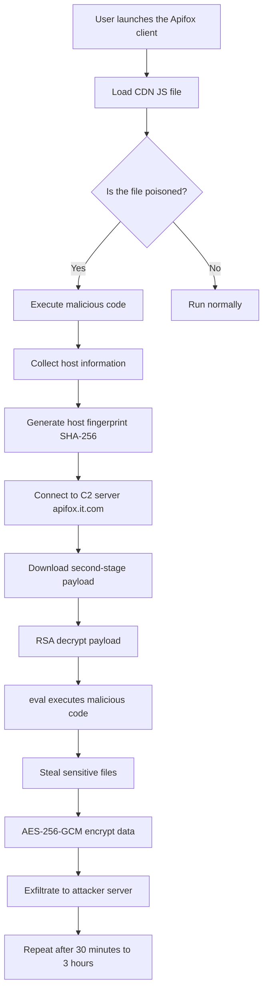

## 1. Incident Overview

In March 2026, Apifox, a popular domestic API collaboration platform, suffered a serious **supply chain poisoning attack**. The attacker tampered with JavaScript files hosted on the official CDN, implanting malicious code into the desktop client with the intent of stealing developers' core credentials and establishing remote control.

The attack began on **March 4, 2026**, remained active for **18 days**, and only stopped when the malicious domain ceased resolving on March 22. Because Apifox is widely used by R&D teams, the impact of this incident was extremely broad, affecting users on Windows, macOS, and Linux platforms.

### 1.1 Incident Timeline

| Date | Event |
|------|------|
| March 4, 2026 | Attacker tampers with JS files on Apifox's official CDN, poisoning attack begins |
| March 4–22, 2026 | Malicious code continues to be distributed, attacker iterates on the payload |
| March 22, 2026 | Malicious domain `apifox.it.com` goes offline, stops resolving |
| March 23, 2026 | Apifox releases v2.8.19 fix |
| March 25, 2026 | Security researchers disclose the incident, Apifox officially publishes a security advisory |

### 1.2 Why Does This Incident Matter?

Unlike traditional virus propagation, this attack is a classic **supply chain attack**. The attacker did not directly target users, but instead chose to compromise Apifox's official software distribution channel, "legitimately" distributing malicious code to victims' computers without their knowledge.

Developers' computers store the "keys" to their organizations' core assets:
- SSH private keys → direct login to production servers
- Git Tokens → access and modification of code repositories
- Cloud service Access Keys → control of cloud infrastructure
- Database passwords → access to sensitive data

A single leaked key can lead to the compromise of an entire corporate intranet.

---

## 2. Technical Deep Dive

### 2.1 Attack Environment: Security Flaws in the Electron Framework

The Apifox desktop client is built on the **Electron framework** and has the following security issues:

| Issue | Description | Consequence |
|------|------|------|
| Sandbox not enabled | Renderer process can access Node.js APIs | Frontend JS can execute system commands |
| Node.js APIs exposed | Can directly call modules such as `fs`, `child_process`, `os` | File read/write, command execution, information gathering |

**Core vulnerability point**: Because the sandbox was not strictly enabled, malicious JS code loaded over the network gained full privileges in the local Node.js environment, allowing it to directly read and write the local filesystem and execute system commands.

### 2.2 Poisoning Mechanism

#### Tampered File

```
URL: https://cdn.apifox.com/www/assets/js/apifox-app-event-tracking.min.js
Normal size: about 34KB
Malicious size: about 77KB
```

The attacker appended approximately **42KB** of highly obfuscated malicious code to the end of the SDK code originally used for event tracking.

#### CDN Information

```
cdn.apifox.com → CNAME → qiniudns.com (Qiniu Cloud CDN)
```

Regarding where the poisoning occurred, there are currently two possibilities:
1. **CDN node tampered with**: Files on some CDN nodes were replaced
2. **Link hijacking**: Tampered with by a man-in-the-middle during HTTPS communication (but certificate validation would need to be bypassed)

### 2.3 Malicious Domain

The attacker registered a highly deceptive domain:

```
apifox.it.com
```

This domain mimics the format of the official domain, aiming to bypass the vigilance of users and some security software.

---

## 3. Complete Attack Chain Flow

### 3.1 Attack Flow Diagram



### 3.2 Attack Phase Details

#### Phase One: Poisoned File Delivery

When the Apifox desktop client starts, it dynamically loads an event tracking script. The attacker appended highly obfuscated malicious code to the end of this file. When the user launches the poisoned client, this malicious code is activated along with it.

#### Phase Two: Establishing Connection and Loading Payload

After the malicious code is activated:

1. **Collect host information**:
   - Hostname
   - Username
   - MAC address
   - CPU model
   - OS version

2. **Generate unique identifier**:
   ```
   SHA-256(mac + cpu + hostname + user + os)
```

3. **Connect to C2 server**:
   Send a request to `apifox.it.com` to retrieve the second-stage malicious payload.

4. **Decrypt and execute**:
   Use the embedded RSA-2048 private key to decrypt the payload, then execute it via the `eval()` function.

#### Phase Three: Core Data Theft

The second-stage script systematically scans for and steals the following sensitive files:

| Type | Path | Risk |
|------|------|------|
| SSH private keys | `~/.ssh/id_rsa` etc. | Direct server login |
| Git credentials | `~/.git-credentials` | Access to code repositories |
| Command line history | `~/.bash_history`, `~/.zsh_history` | May contain plaintext passwords |
| K8s config | `~/.kube/*` | Control of Kubernetes clusters |
| npm credentials | `~/.npmrc` | Access to private package repositories |
| Cloud Access Keys | Various cloud provider configs | Control of cloud infrastructure |

All stolen data is packaged, encrypted using **AES-256-GCM**, and then exfiltrated to the attacker's server.

### 3.3 Communication Characteristics

- **Low-frequency beacon**: Random intervals between 30 minutes and 3 hours
- **Encrypted communication**: Uses RSA-2048 to encrypt payloads
- **Covert transmission**: Custom request headers, disguised as normal traffic

---

## 4. Scope of Impact

### 4.1 Affected Versions

- **Affected versions**: Apifox SaaS desktop client **versions below 2.8.19**
- **Affected platforms**: Windows, macOS, Linux — all platforms
- **Affected period**: March 4 to March 22, 2026

### 4.2 Unaffected Versions

- Web version (browser access)
- Private deployment version
- v2.8.19 and above

### 4.3 Why Are Developers High-Risk Targets?

The attacker's goal is not photos or documents on personal computers, but the "keys" in developers' hands that lead to their organizations' core assets:

```
Developer computer → SSH key → Production server
           → Git Token → Code repository
           → Cloud key → Cloud infrastructure
           → Database password → Sensitive data
```

Developers' computers thus become excellent springboards for attackers to **move laterally** and **penetrate corporate intranets**.

---

## 5. Self-Check Guide

### 5.1 Windows Users

Open PowerShell (as Administrator) and run:

```powershell
Select-String -Path "$env:APPDATA\apifox\Local Storage\leveldb\*" -Pattern "rl_mc","rl_headers" -List | Select-Object Path
```

### 5.2 macOS Users

Open Terminal and run:

```bash
grep -arlE "rl_mc|rl_headers" ~/Library/Application\ Support/apifox/Local\ Storage/leveldb
```

### 5.3 Linux Users

Open Terminal and run:

```bash
grep -arlE "rl_mc|rl_headers" ~/.config/apifox/Local\ Storage/leveldb
```

### 5.4 Interpreting Results

- **Specific files output** → Compromised, immediate remediation measures required
- **No output** → Possibly not infected, but protective measures are still recommended

> **Note**: Because the files being checked are cache files, false negatives are possible. If you used the Apifox desktop client during the attack window (March 4–22), there is a very high probability that you were attacked.

---

## 6. Protection and Remediation Measures

### 6.1 Immediately Upgrade the Client

This is the most direct and effective way to stop the attack.

```
Fixed version: v2.8.19 and above
Fix method: Abolish online dynamic loading of JS, switch to local built-in packaging
```

### 6.2 Comprehensively Rotate Sensitive Credentials

This is the **most critical** step in remediation. You must assume that all credentials ever stored on affected devices have been leaked.

#### Credentials That Must Be Reset

| Credential Type | Action |
|---------|------|
| SSH keys | Generate new key pairs, deploy to all servers and code hosting platforms |
| Git Tokens | Revoke and regenerate all Personal Access Tokens |
| Cloud service keys | Rotate Access Keys for AWS, Alibaba Cloud, Tencent Cloud, etc. |
| Database passwords | Change access passwords for all local or remote databases |
| API Keys | Check and replace all third-party service API Keys |
| K8s Tokens | Regenerate Kubernetes cluster access credentials |

#### SSH Key Reset Example

```bash
# Back up the old key
mv ~/.ssh/id_rsa ~/.ssh/id_rsa.old
mv ~/.ssh/id_rsa.pub ~/.ssh/id_rsa.pub.old

# Generate a new key
ssh-keygen -t ed25519 -C "your_email@example.com"

# Deploy the new public key to the server
ssh-copy-id user@server
```

### 6.3 Network-Level Blocking

Block the following suspicious domains at the network level:

```
apifox.it.com
cdn.openroute.dev
upgrade.feishu.it.com
system.toshinkyo.or.jp
ns.feishu.it.com
```

### 6.4 Check Server Logs

Review server login logs to check for abnormal SSH logins:

```bash
# Check recent SSH login records
last -a | head -20

# Check authentication logs
grep "Accepted" /var/log/auth.log | tail -20
```

---
## 7. Security Implications

### 7.1 Characteristics of Supply Chain Attacks

1. **Highly covert**: Malicious code is obfuscated and encrypted, making it hard to detect
2. **Automatic execution**: Triggered upon client startup, requiring no user interaction
3. **Probabilistic triggering**: Not every request returns the malicious version
4. **Precisely targeted**: Clearly aimed at developers' high-value assets
5. **Runs with high privileges**: Exploits framework vulnerabilities to gain system-level privileges

### 7.2 Developer Security Best Practices

#### Client Security

- ✅ Keep software updated to the latest version
- ✅ Enable the software's security sandbox feature
- ✅ Regularly verify software integrity (check hashes)
- ✅ Download software from official channels

#### Credential Management

- ✅ Use SSH keys instead of password authentication
- ✅ Use different keys for different services
- ✅ Rotate sensitive credentials regularly
- ✅ Use key management tools (such as 1Password, Bitwarden)

#### Network Security

- ✅ Configure firewall rules
- ✅ Monitor abnormal network traffic
- ✅ Block suspicious domains
- ✅ Use DNS filtering services

#### Code Security

- ✅ Enable two-factor authentication (2FA)
- ✅ Use Personal Access Tokens instead of passwords
- ✅ Regularly review code repository access permissions
- ✅ Enable commit signature verification

### 7.3 Recommendations for Electron App Development

If you are an Electron app developer, please note:

```javascript
// ✅ Enable the sandbox
const win = new BrowserWindow({
  webPreferences: {
    sandbox: true,
    contextIsolation: true,
    nodeIntegration: false,
    preload: path.join(__dirname, 'preload.js')
  }
});

// ❌ Avoid doing this
const win = new BrowserWindow({
  webPreferences: {
    nodeIntegration: true,
    contextIsolation: false
  }
});
```

- Enable `sandbox` and `contextIsolation`
- Disable `nodeIntegration`
- Use `preload` scripts to safely expose necessary APIs
- Avoid dynamically loading executable code from the network
- Implement Content Security Policy (CSP)

---

## 8. Summary

The Apifox supply chain poisoning incident was a precision attack targeting developers, exploiting security flaws in the Electron framework and vulnerabilities in the CDN distribution mechanism. This incident reminds us:

1. **Supply chain security is critical**: Any third-party component you depend on can become an attack entry point
2. **Developers are high-risk targets**: They hold access permissions to core enterprise assets
3. **Timely updates are key**: Keeping software up to date effectively defends against known vulnerabilities
4. **Credential management cannot be ignored**: Rotate keys regularly to minimize the impact of leaks

If you have used the Apifox desktop client during the risk period (March 4 to March 22, 2026), please **immediately** carry out the investigation and remediation measures mentioned in this article.

---

## References

- [Apifox Official Security Advisory](https://docs.apifox.com/8392582m0)
- [ThreatBook Intelligence Bureau Analysis Report](https://developer.aliyun.com/article/1726660)
- [Huazhong University of Science and Technology Cybersecurity Notice](https://ncc.hust.edu.cn/info/1443/6691.htm)
- [CSDN In-Depth Analysis Report](https://blog.csdn.net/m0_71099018/article/details/159691630)