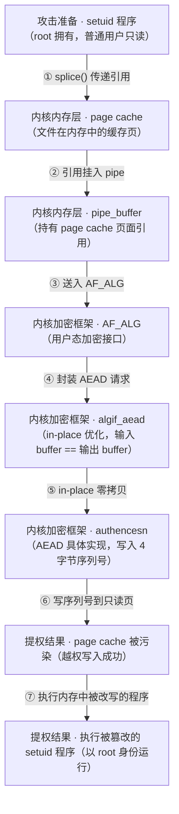
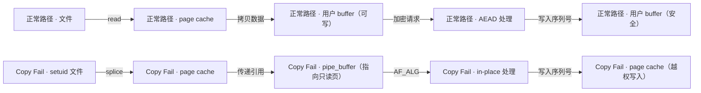

## 1. Vulnerability Effect: Unauthorized Write to Page Cache

The impact of the CVE-2026-31431 privilege escalation vulnerability can be understood as allowing an ordinary user, without write permission, to temporarily modify the contents of certain files in system memory that should never be modified, and then leveraging this opportunity to gain root privileges through arbitrary code execution.

Under normal circumstances, files have permission protection, and ordinary users cannot write to high-privilege sensitive directories, modify system commands, or high-privilege programs.

The problem is that in order to make the system run faster, Linux does not re-read files from the hard disk every time a user needs to read them. When a file is frequently accessed, it places the file into a memory cache, known as the page cache. When programs run, much of what they read is actually this page cache in memory, which can be understood as the file's in-memory mapping or cached representation.

The key to the Copy Fail vulnerability is that the attacker did not modify the file on the hard disk, but instead modified the file contents in the memory cache — this cached representation — ultimately succeeding in the attack.

> **A Plain Analogy**: Imagine the system as a library. The real files in the system (the originals) are kept in the storage room, and ordinary readers can only view them, not modify them. To make reading convenient, the administrator makes a photocopy of commonly used books and places it in the reading room. The normal rule should be that readers can only view the photocopy and cannot modify it either.
>
> This vulnerability can be seen as the system, in some process, mistaking the view-only photocopy for a scratch pad that can be written on. So although the reader has no permission to modify the original book in the storage room, nor permission to modify this read-only photocopy, they actually succeed in modifying this photocopy, accomplishing an unauthorized write.

## 2. The First Core Mechanism: setuid

In the Linux system, there are some special programs that ordinary users can run, but when running, they temporarily carry root privileges. On the surface, it appears that ordinary users can work with higher privileges, somewhat like privilege escalation, but this is trusted by the system.

If we elaborate on this, it involves a core mechanism in the Linux permission model: setuid.

In Linux, there is a class of programs that ordinary users can run, but when running, they temporarily possess the privileges of the program file's owner, usually root.

The most typical example is passwd. When a user changes their password, it essentially requires writing to `/etc/shadow`, and this file can only be written by root. The solution is that the passwd program itself is owned by root and has the setuid bit set. When a user runs it, the program possesses root privileges during execution.

The system considers these programs trustworthy because ordinary users cannot modify them. However, it is precisely this trust model that attackers exploited.

The attack approach of Copy Fail is to first modify the in-memory cached representation of such a program, then have the system execute it. The system believes it is executing the original trusted program, but what actually runs is a temporarily tampered in-memory version, and as a result, an ordinary user may gain root.

## 3. The Second Core Mechanism: splice

Why does the system treat read-only memory data as writable content?

More precisely, the core principle is to avoid data copying and directly pass references to memory pages.

When Linux reads a file, it typically does not access the disk directly every time, because the disk is slow but memory is fast, so the kernel caches file contents in memory by page — this is the page cache. After a file has been read once, its contents may already exist in the page cache. The next time the file is read, the kernel can retrieve data directly from the page cache.

Furthermore, because kernel space and user space are isolated, and the page cache resides in the memory region managed by the kernel, when a user program normally reads a file by calling `read(fd, buf, len)`, what the kernel needs to do is find the corresponding file page from the page cache, then copy these bytes into the user-provided buf.

The data path is: disk file → page cache, then page cache → copy → user space buffer. If the file is already in the page cache, the first step can be skipped, but the second step is still needed, because this is the security boundary between the kernel and user programs.

The purpose of this step is mainly for security — user programs cannot directly modify kernel cache pages — but the cost is that data must be copied every time, which affects performance.

So Linux provides a class of zero-copy mechanisms, one of which is the `splice()` mechanism, aimed at avoiding copying as much as possible when moving data within the kernel.

In the ordinary `read()` flow, data is copied from the page cache to a user space buffer. If the program merely wants to forward file contents to another kernel object, such as a pipe, socket, or encryption interface, then this copying to user space first and then handing it back to the kernel from user space is very wasteful.

The design goal of `splice()` is to bypass this process. It can feed file contents directly into a pipe, allowing subsequent kernel modules to continue consuming this data.

Specifically, `splice()` attaches the file page from the page cache to the pipe's buffer structure, which is called `pipe_buffer`. `pipe_buffer` has a field pointing to a certain `struct page`. `struct page` is the core structure used by the Linux kernel to describe physical memory pages. For file reading scenarios, this `struct page` corresponds to the page in the page cache that holds the file contents.

In other words, the normal read should be "page cache → copy → user space buffer," but `splice()` does not copy the page cache; it only attaches the page cache to `pipe_buffer`. `pipe_buffer` itself does not store a new copy of the file data — it only stores a reference to the page cache page.

**The data is not copied, only referenced.** If this pipe is subsequently handed to other kernel modules, such as network or encryption interfaces, what these modules operate on is actually the original page cache page.

This design itself is reasonable. As long as subsequent modules treat this data as read-only input, there will be no problem.

But the problem is that subsequent modules do not necessarily only read.

## 4. The Third Core Mechanism: Kernel Cryptographic Interface AF_ALG

Linux has a cryptographic framework in the kernel for use by kernel modules. To allow user-space programs to also invoke these capabilities, Linux provides AF_ALG. It is a socket address family through which user programs can submit data to the kernel for hashing, encryption, decryption, or authentication in a socket-like manner.

The Copy Fail vulnerability involves the AEAD type within it.

AEAD is the abbreviation for "Authenticated Encryption with Associated Data." It simultaneously solves two problems: data encryption and data integrity authentication.

In AEAD, data is typically divided into two parts. One part is the data that needs to be encrypted — the actual plaintext or ciphertext content. The other part is called associated data, or AD for short. It does not necessarily need to be encrypted, but it needs to participate in authentication. For example, in network protocols, certain header fields can exist in plaintext, but the receiver still needs to confirm that these fields have not been tampered with.

Users can submit data to AF_ALG and have the kernel perform encryption, decryption, or authentication operations. Copy Fail exploits this path by feeding page cache data from `splice()` into the kernel processing chain.

## 5. The Fourth Core Mechanism: algif_aead

When data enters AF_ALG, it is first handled by algif_aead, which encapsulates the data submitted by the user through AF_ALG into an AEAD request, then hands it to a specific implementation, such as authencesn.

In the normal design, the encryption flow is: input buffer (read-only) → kernel processing → output buffer (writable).

However, in a 2017 kernel change, algif_aead introduced a performance optimization mechanism called **in-place operation**, which allows input and output to share the same block of memory, thereby reducing one copy.

This optimization brought an obvious hidden danger: under in-place, the kernel assumes that the caller provides a **writable buffer**.

For ordinary user space buffers, this assumption holds. But in the Copy Fail scenario, this memory comes from `splice()`, which actually points to the page cache.

## 6. The Fifth Core Mechanism: authencesn (the Real Vulnerability Point)

authencesn can be understood by breaking it apart. authenc represents the combined mode of "authentication + encryption," and esn stands for Extended Sequence Number. It is commonly used in protocol scenarios like IPsec ESP, where the protocol needs to simultaneously handle encrypted data, authentication data, and sequence number related fields.

During this processing, authencesn needs to construct the authentication input. To allow the underlying hash or authentication algorithm to compute correctly, it writes a sequence number field at a certain position. This field is 4 bytes, i.e., 32 bits. The position is roughly: `offset = 关联数据长度 + 加密数据长度`.

In the original design, this write should land in the output buffer or a temporary workspace. Since the output buffer is writable, writing 4 bytes is not a problem.

The key is that algif_aead enables in-place processing, and under the in-place optimization, **input buffer == output buffer**.

If this buffer is ordinary user memory, the write is still controllable. If this buffer comes from the `splice()` mechanism, it actually points to `pipe_buffer`, and `pipe_buffer` is a reference to a page cache page. So authencesn's 4-byte write lands on the file cache page — the page cache.

**This is where the vulnerability truly occurs.** It stems from the kernel assuming the buffer is writable, but what is actually passed in is a read-only page cache, causing the write operation to pollute the file cache and resulting in an unauthorized write.

There is also a subtle detail: this 4-byte write occurs **before** authencesn validates the authentication tag. In other words, even if the data submitted by the attacker fails authentication and the kernel ultimately returns EBADMSG reporting decryption failure, the page cache pollution has already been completed. The attacker does not need to construct a valid AEAD ciphertext — the failed decryption request itself is sufficient to trigger the write.

> **One-Sentence Summary**: The kernel thinks it is writing to a writable AEAD output buffer, but what it actually writes to is the page cache of a read-only file.
## 7. Complete Attack Chain

So, the entire attack process is roughly as follows:

1. The attacker first selects a file that they can read but do not have write permission for. This file could be a setuid program. Under the normal permission model, the attacker can only read it, not modify it.
2. The attacker uses the `splice()` mechanism to splice part of this file's content into a pipe. At this point, the `pipe_buffer` in the pipe points to the `struct page` corresponding to that file in the page cache. Here, the data is not copied; the pipe holds a page reference.
3. The attacker feeds the data in this pipe to AF_ALG. From the kernel's perspective, this is just a piece of AEAD input data waiting to be processed.
4. algif_aead processes it according to in-place logic.
5. The key problem here is that the kernel does not distinguish between page cache pages from `splice()` and ordinary writable user buffers during processing, leading to the subsequent tragedy—unauthorized writes.
6. The AEAD request enters authencesn. To construct the authentication data, authencesn writes a 4-byte sequence number field at a computed location. This location theoretically belongs to the writable output region, but due to the aforementioned tragedy, this write actually lands on the page cache page referenced by `pipe_buffer`.
7. The result is that the in-memory cached page of a read-only file has been modified by 4 bytes.

**Do not underestimate four bytes**—in a binary program, a small number of bytes can change instructions, jumps, conditional branches, or data structures. If the attacker can control the file offset and write location, they may be able to alter the in-memory behavior of a setuid program to whatever they want. Furthermore, the attacker can repeatedly issue requests, each time writing to a different offset, thereby making multiple precise modifications to the setuid program's memory image.

Finally, the attacker executes this setuid program. The system still considers it a trusted program owned by root, because the on-disk file has not been modified and the permissions have not changed. But at execution time, the content hit is already the unauthorized-modified version in the page cache, giving the attacker an opportunity to gain root privileges.

## 8. Living off the Land

Throughout the entire process, the attacker did not write to disk, did not change file permissions, and did not leave traces of file tampering in the traditional sense. This is what is called **Living off the Land (LotL)**—a memory-level attack method that does not modify on-disk files and will not trigger security monitoring tools that rely on file system events.

## 9. Summary of the Five Chained Mechanisms

| Mechanism | Role |
|------|------|
| setuid | Causes an ordinary user program to run with root privileges during execution |
| `splice()` | Causes the transfer process to be a reference to a page cache page rather than a copy of it |
| AF_ALG | Hands user-provided data to the kernel crypto framework for processing |
| algif_aead | The in-place optimization assumes input and output can share a single writable memory region |
| authencesn | The implementation writes a 4-byte field during processing |

Putting it all together, the result is: for an ordinary user, authencesn modifies the program's memory image in the page cache and executes this program with root privileges.

## 10. Mitigations

The most essential mitigation is to **update the kernel**, remove algif_aead's in-place logic, restore the separation of input and output, and prevent writes from landing on the input buffer.

If upgrading is not possible, then restrict the AF_ALG interface first and disable the relevant modules.

Of course, the most permanent and fundamental solution is naturally still to apply the kernel patch.