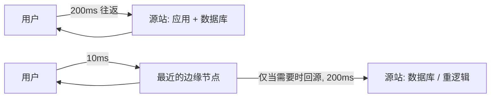

## 1. 先算一笔物理账

关于边缘计算，大部分文章从「快」讲起，但更准确的起点是「远」。

网络请求的下限不是带宽，是光速。北京到美国弗吉尼亚的直线距离约 11,000 公里，光纤的实际走线还要更长，而光在光纤中的传播速度约为 20 万公里/秒。粗略估算：单程约 60~75 毫秒，一次 TCP + TLS 握手加请求响应，**物理下限就已经在 150 毫秒上下**——这部分延迟与服务器有多快、代码写得多好都无关。

```text
用户（北京）  ──75ms──▶  源站（弗吉尼亚） ──75ms──▶  用户
                  合计 ≈ 150ms，还没算上应用处理时间
```

把同一段逻辑放到离用户几百公里内的节点上，这段账就变成了个位数毫秒。这就是边缘计算唯一真正想解决的事：**让往返的物理距离变短**，而不是让 CPU 变快。

我自己的博客就是个现成的例子。静态页面有 CDN，全球访问都很快；但站内的 AI 聊天助手需要一个动态接口去转发 DeepSeek 的 API。这一层如果放在源站机器上，用户每发一条消息都要横跨太平洋；而它现在跑在 `workers/chat-proxy/` 里，是一个 Cloudflare Worker，部署在离用户最近的边缘节点上。

## 2. 中心化与边缘化的请求路径

用一张图看清楚差别：



关键在最后那根回源箭头。边缘计算并不会让「读数据库」「跑重逻辑」变快——**真要回源，延迟只会比直连源站更差**，因为多了一跳。它真正省掉的，是那些本来就必须回源的请求：鉴权、重定向、A/B 分流、CORS 预检、缓存命中判断、静态资源的组装。这些逻辑的共同点是**无状态、计算量小、每个请求都要执行**——正好是边缘的地盘。

## 3. 运行时：V8 isolate 到底省掉了什么

传统 Serverless（AWS Lambda 那一类）为每个函数实例准备一个容器，冷启动要拉起一整个语言运行时，通常是几百毫秒。Cloudflare Workers 换了个思路：用 V8 isolate——同一个进程里可以同时承载成百上千个隔离的执行上下文。

按 Cloudflare 官方文档的说法：**isolate 的启动速度约比容器或虚拟机上的 Node 进程快 100 倍，启动时占用的内存低一个数量级**。因为运行时只被加载一次，之后每个新 isolate 只是「切」出来一小块内存。

但同一份文档里还有一句很容易被忽略的提醒，它也决定了后面几乎所有工程决策：

> isolate 不一定是长期存在的，可能因资源限制而被回收，因此**不要把可变状态存在全局作用域里**。

换句话说，边缘运行时是一个「随时可能被换掉的临时工」。它的速度来自共享进程，代价就是不能长期持有状态。这条约束会直接改写很多习惯写法——比如限流。

## 4. 必须记住的限制

边缘不是没有代价的廉价算力。以下数字来自 Cloudflare Workers 官方 Limits 文档（免费版 / 付费版）：

| 限制项 | 免费版 | 付费版 | 超限后果 |
| --- | --- | --- | --- |
| 每个 isolate 内存 | 128 MB | 128 MB（不可提升） | Error 1102 |
| CPU 时间 / 请求 | 10 ms | 默认 30 s，可配置至 5 min | 请求终止 |
| 启动时间（全局作用域） | 1 s | 1 s | 错误码 10021 |
| 子请求数 / 调用 | 50 | 默认 10,000 | 抛出异常 |
| 包体积（gzip 后） | 3 MB | 10 MB | 部署失败 |

有两点特别值得注意：

- **128MB 是硬限制，付费也提不上去。** 它和 AWS Lambda 那种「加钱买内存」的模型完全不同。官方给的缓解建议很直接：用流式处理（`TransformStream`）代替把响应整个读进内存，大文件放 R2/KV。
- **CPU 时间是计算时间，不含等待 I/O 和网络。** 所以「调一个慢 API」不会撑爆 10ms 限额，但「在边缘解析一个 5MB 的 JSON」会。

这两条合起来，恰好解释了为什么本站的 Worker 在转发 DeepSeek 的流式响应时是这样写的：

```ts
// 直接把上游的 ReadableStream 交给客户端，不读进内存、不缓冲
return new Response(response.body, {
  headers: {
    ...corsHeaders(origin),
    'Content-Type': 'text/event-stream',
    'Cache-Control': 'no-cache',
  },
});
```

## 5. 实战：把本站的聊天代理拆开看

这个 Worker 只有 190 行，但每一行都在回应上面那份限制清单。挑三处讲。

### 5.1 CORS 白名单必须是精确匹配

```ts
// Exact-match CORS allowlist. Do NOT use prefix matching here: an origin such
// as "https://www.hehonglei.cn.evil.com" must never pass the check.
const ALLOWED_ORIGINS = new Set([
  'https://www.hehonglei.cn',
  'https://hehonglei.cn',
  'http://localhost:4321',
]);
```

很多人会用 `origin.startsWith('https://www.hehonglei.cn')` 来写校验。这行注释解释了为什么不能：`https://www.hehonglei.cn.evil.com` 这样的域名同样以它开头，而浏览器对 `Origin` 头的控制权完全在攻击者手里。用 `Set` 做全等匹配，是唯一安全的写法。

### 5.2 用 Cache API 做限流：因为没有内存可用

这是我踩过的最「边缘」的一课。直觉写法是在模块作用域放一个 `Map<string, number>` 当计数器——但按上一节的约束，isolate 会被回收、也会横向复制出很多份，内存计数既不准也留不住。边缘上没有单机可依赖的内存。

这个 Worker 改用 Cache API 存每个 IP 的滑动窗口状态：

```ts
async function isRateLimited(ip: string): Promise<boolean> {
  const now = Date.now();
  // Fake URL: the Cache API requires a full URL as the key.
  const key = `https://chat-proxy-ratelimit/${encodeURIComponent(ip)}`;
  try {
    const cache = caches.default;
    const cached = await cache.match(key);
    let state: RateLimitState = { windowStart: now, count: 0 };
    if (cached) {
      try {
        state = JSON.parse(await cached.text()) as RateLimitState;
      } catch {
        state = { windowStart: now, count: 0 };
      }
    }
    if (now - state.windowStart >= RATE_LIMIT_WINDOW_MS) {
      state = { windowStart: now, count: 0 };
    }
    state.count += 1;
    // Responses are only stored when they carry a Cache-Control header.
    await cache.put(
      key,
      new Response(JSON.stringify(state), {
        headers: { 'Cache-Control': `max-age=${Math.ceil(RATE_LIMIT_WINDOW_MS / 1000)}` },
      }),
    );
    return state.count > RATE_LIMIT_MAX_REQUESTS;
  } catch {
    // Fail open: never let a rate-limit storage error block legitimate traffic.
    return false;
  }
}
```

三个细节都来自边缘环境本身：Cache API 的 key 必须是完整 URL（所以造了个假域名）；响应必须带 `Cache-Control` 才会被真正存下来；任何存储异常一律 **fail open**——限流是保护措施，不该在存储抖动时把正常用户一起挡在门外。

### 5.3 在边缘把不可信输入削一遍

Worker 在转发给模型之前，会把客户端传来的消息彻底过一遍：

```ts
// Sanitize: keep only user/assistant turns (never let the client inject a
// system prompt) and bound the total payload size.
const messages = body.messages
  .filter(
    (m): m is { role: 'user' | 'assistant'; content: string } =>
      !!m && ALLOWED_ROLES.has(m.role ?? '') && typeof m.content === 'string',
  )
  .map((m) => ({ role: m.role, content: m.content.trim().slice(0, MAX_TOTAL_CHARS) }));
```

因为客户端能直接改请求体，`system` 角色的消息必须被过滤掉，否则任何人都能覆盖系统提示词。这一层放在边缘而不是源站，成本几乎为零，却让每次请求少走一趟长途。

## 6. 三个高频的坑

### 6.1 Node.js API 不是「都有」

边缘运行时基于 Web 标准 API，`fs`、`child_process` 这类 Node 专属模块天然不存在。Cloudflare 用 `nodejs_compat` 兼容标志来补：从兼容日期 **2026-08-04 起，该标志以及 `nodejs_compat_v2` 已默认开启**，不再需要手动配置。缺失的 API 由 [unenv](https://github.com/unjs/unenv) 提供 polyfill——注意它只能保证「能 import 进来」，调用未实现的方法会直接抛 `[unenv] <method> is not implemented yet!`。

### 6.2 TCP 数据库驱动基本用不了

`pg`、`mysql2`、`mongodb`、`ioredis` 这些驱动都建立在 TCP 连接与 Node 的 socket 之上，在边缘运行时里不可用。Vercel 的 Edge Runtime 文档也把这一点列在「不受支持」里，并明确建议：**新的 Vercel Function 默认用 Node.js 运行时**，只有确实需要低延迟的中间件、地理路由、边缘配置读取等场景才选 Edge。真要在边缘访问数据库，得换成 HTTP 协议的驱动（Neon、PlanetScale 这类），或者直接使用平台自带的 KV / D1 / Durable Objects。

### 6.3 需要状态，就得上 Durable Objects

第 5 节的限流用 Cache API 只能算「尽力而为」。如果业务需要真正的强一致状态——比如库存扣减、协作编辑、每房间的实时计数器——就必须用 Durable Objects 这类有明确归属的存储模型，而不能指望普通 Worker 的进程内内存。

## 7. 什么时候不该放到边缘

边缘不是默认选项。以下几类场景，放上去只会更慢或更贵：

- **重 CPU 逻辑**：图片转码、大文件解析、模型推理，免费版 10ms 的 CPU 额度几毫秒就被打爆。
- **强一致写操作**：需要事务、需要唯一性约束的写入，最终都要回到真正的数据库。
- **纯静态内容**：CDN 已经在做了，再包一层 Worker 只是增加故障面。
- **调试优先的阶段**：边缘环境的日志、断点、依赖排查都弱于普通服务器，功能没稳定之前不值得为延迟提前付出这份成本。

一条简单的判断规则：

> 这段逻辑是不是**每个请求都要跑、无状态、输入输出都不大**？是，就适合搬到边缘；不是，留在源站。

## 8. 结语

边缘计算常被包装成「更快的服务器」，但它的真实形状更接近「把那些本来就要在每个请求上重复一遍的小逻辑，从长途电话挪到街边便利店」。物理距离省下的那 100 多毫秒是真实的；128MB 内存、10ms CPU、没有可依赖的本地状态，这些限制也是真实的。想清楚这个交换比，比记住某个平台的 API 重要得多。

## 参考来源

- [Cloudflare Workers — Limits](https://developers.cloudflare.com/workers/platform/limits/)（内存 128MB、CPU 时间、启动 1s、子请求与包体积限制）
- [Cloudflare Workers — How Workers works](https://developers.cloudflare.com/workers/reference/how-workers-works/)（isolate 与容器的差别、启动速度与内存对比、isolate 可能被回收）
- [Cloudflare Workers — Node.js compatibility](https://developers.cloudflare.com/workers/runtime-apis/nodejs/)（`nodejs_compat` 标志、2026-08-04 起默认开启、unenv polyfill 行为）
- [Vercel — Edge Runtime](https://vercel.com/docs/functions/runtimes/edge)（Edge Runtime 支持的 Web API 子集与不支持项）
- [Vercel — How can I make my library compatible with the Vercel Edge Runtime?](https://vercel.com/kb/guide/library-sdk-compatible-with-vercel-edge-runtime-and-functions)（不支持 `fs`、`require`、`eval` 等，以及默认推荐 Node.js 运行时）
