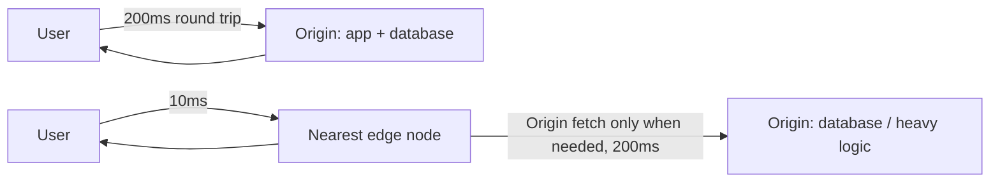

## 1. Do the Physics First

Most articles about edge computing start with "fast," but the more accurate starting point is "far."

The lower bound on a network request isn't bandwidth—it's the speed of light. The straight-line distance from Beijing to Virginia is about 11,000 kilometers, and the actual fiber route is even longer. Light travels through fiber at roughly 200,000 km/s. A rough estimate: about 60–75 ms one way, and once you add a TCP + TLS handshake plus request-response, **the physical floor is already around 150 ms**—and that latency has nothing to do with how fast the server is or how well the code is written.

```text
用户（北京）  ──75ms──▶  源站（弗吉尼亚） ──75ms──▶  用户
                  合计 ≈ 150ms，还没算上应用处理时间
```

Move that same logic to a node a few hundred kilometers from the user, and the math drops to single-digit milliseconds. That's the one thing edge computing is really trying to solve: **shortening the physical round-trip distance**, not making the CPU faster.

My own blog is a ready-made example. Static pages have a CDN, so they're fast to access worldwide; but the site's AI chat assistant needs a dynamic endpoint to forward requests to DeepSeek's API. If that layer sat on the origin server, every message a user sends would have to cross the Pacific. Instead, it now runs in `workers/chat-proxy/`, as a Cloudflare Worker deployed at the edge node closest to the user.

## 2. Centralized vs. Edge Request Paths

One diagram makes the difference clear:



The key is that last arrow back to the origin. Edge computing doesn't make "reading a database" or "running heavy logic" faster—**if you really do have to go back to the origin, latency will only be worse than connecting directly to the origin**, because you've added an extra hop. What it actually eliminates is the requests that would have had to go back to the origin anyway: authentication, redirects, A/B routing, CORS preflight, cache-hit checks, assembling static assets. What these all have in common is that they're **stateless, cheap to compute, and executed on every request**—exactly the edge's territory.

## 3. Runtime: What V8 Isolates Actually Save

Traditional Serverless (the AWS Lambda kind) prepares a container for each function instance, and a cold start has to spin up an entire language runtime, usually hundreds of milliseconds. Cloudflare Workers takes a different approach: V8 isolates—a single process can host hundreds or thousands of isolated execution contexts at once.

According to Cloudflare's official docs: **isolates start about 100 times faster than Node processes on containers or virtual machines, and use an order of magnitude less memory at startup**. Because the runtime is loaded only once, each new isolate just "carves out" a small chunk of memory afterward.

But the same docs contain a reminder that's easy to overlook, and it determines almost every engineering decision that follows:

> An isolate isn't necessarily long-lived; it may be reclaimed due to resource limits, so **don't store mutable state in the global scope**.

In other words, the edge runtime is a "temp worker" that could be swapped out at any moment. Its speed comes from the shared process, and the price is that it can't hold state for long. This constraint directly rewrites many habitual patterns—rate limiting, for example.

## 4. Limits You Must Remember

The edge isn't cheap compute without a cost. The following numbers come from Cloudflare Workers' official Limits documentation (free / paid):

| Limit | Free | Paid | Consequence of exceeding |
| --- | --- | --- | --- |
| Memory per isolate | 128 MB | 128 MB (cannot be increased) | Error 1102 |
| CPU time / request | 10 ms | 30 s default, configurable up to 5 min | Request terminated |
| Startup time (global scope) | 1 s | 1 s | Error code 10021 |
| Subrequests / invocation | 50 | 10,000 default | Exception thrown |
| Bundle size (after gzip) | 3 MB | 10 MB | Deployment fails |

Two points are especially worth noting:

- **128MB is a hard limit, and paying can't raise it.** It's completely different from the AWS Lambda model of "pay more, buy more memory." The official mitigation advice is straightforward: use streaming (`TransformStream`) instead of reading the entire response into memory, and put large files in R2/KV.
- **CPU time is compute time, excluding waiting on I/O and network.** So "calling a slow API" won't blow the 10ms limit, but "parsing a 5MB JSON at the edge" will.

Together, these two points explain exactly why this site's Worker is written the way it is when forwarding DeepSeek's streaming response:

```ts
//Hand the upstream ReadableStream directly to the client, without reading it into memory or buffering
return new Response(response.body, {
  headers: {
    ...corsHeaders(origin),
    'Content-Type': 'text/event-stream',
    'Cache-Control': 'no-cache',
  },
});
```

## 5. In Practice: Taking This Site's Chat Proxy Apart

This Worker is only 190 lines, but every line responds to that list of limits above. Let's look at three spots.

### 5.1 The CORS Allowlist Must Be an Exact Match

```ts
// Exact-match CORS allowlist. Do NOT use prefix matching here: an origin such
// as "https://www.example.com.evil.com" must never pass the check.
const ALLOWED_ORIGINS = new Set([
  'https://www.example.com',
  'https://example.com',
  'http://localhost:4321',
]);
```

Many people would use `origin.startsWith('https://www.example.com')` to write the check. This comment explains why you can't: a domain like `https://www.example.com.evil.com` also starts with it, and the browser's control over the `Origin` header is entirely in the attacker's hands. Using `Set` for an exact-equality match is the only safe way to write it.

### 5.2 Rate Limiting with the Cache API: Because There's No Memory to Use

This was the most "edge" lesson I've learned the hard way. The intuitive approach is to put a `Map<string, number>` in module scope as a counter—but per the constraints in the previous section, isolates get reclaimed and also get horizontally replicated into many copies, so an in-memory count is neither accurate nor persistent. At the edge, there's no single machine's memory you can rely on.

This Worker instead uses the Cache API to store a sliding-window state per IP:

```ts
async function isRateLimited(ip: string): Promise<boolean> {
  const now = Date.now();
  // Fake URL: the Cache API requires a full URL as the key.
  const key = `https://chat-proxy-ratelimit/${encodeURIComponent(ip)}`;
  try {
    const cache = caches.default;
    const cached = await cache.match(key);
    let state: RateLimitState = { windowStart: now, count: 0 };
    if (cached) {
      try {
        state = JSON.parse(await cached.text()) as RateLimitState;
      } catch {
        state = { windowStart: now, count: 0 };
      }
    }
    if (now - state.windowStart >= RATE_LIMIT_WINDOW_MS) {
      state = { windowStart: now, count: 0 };
    }
    state.count += 1;
    // Responses are only stored when they carry a Cache-Control header.
    await cache.put(
      key,
      new Response(JSON.stringify(state), {
        headers: { 'Cache-Control': `max-age=${Math.ceil(RATE_LIMIT_WINDOW_MS / 1000)}` },
      }),
    );
    return state.count > RATE_LIMIT_MAX_REQUESTS;
  } catch {
    // Fail open: never let a rate-limit storage error block legitimate traffic.
    return false;
  }
}
```

All three details come from the edge environment itself: the Cache API key must be a full URL (hence the fake domain); the response must carry `Cache-Control` to actually be stored; and any storage exception **fails open**—rate limiting is a protective measure, and it shouldn't lock out legitimate users when storage hiccups.

### 5.3 Sanitizing Untrusted Input at the Edge

Before forwarding to the model, the Worker thoroughly scrubs the messages coming from the client:

```ts
// Sanitize: keep only user/assistant turns (never let the client inject a
// system prompt) and bound the total payload size.
const messages = body.messages
  .filter(
    (m): m is { role: 'user' | 'assistant'; content: string } =>
      !!m && ALLOWED_ROLES.has(m.role ?? '') && typeof m.content === 'string',
  )
  .map((m) => ({ role: m.role, content: m.content.trim().slice(0, MAX_TOTAL_CHARS) }));
```

Because the client can directly modify the request body, messages with the `system` role must be filtered out, otherwise anyone could override the system prompt. Putting this layer at the edge instead of the origin costs almost nothing, yet it saves every request a long trip.
## 6. Three Common Pitfalls

### 6.1 Not All Node.js APIs Are Available

Edge runtimes are built on Web standard APIs, so Node-specific modules like `fs` and `child_process` simply don't exist. Cloudflare fills the gap with the `nodejs_compat` compatibility flag: **as of compatibility date 2026-08-04, this flag and `nodejs_compat_v2` are enabled by default**, so no manual configuration is needed. Missing APIs are polyfilled by [unenv](https://github.com/unjs/unenv)—note that it only guarantees "it can be imported"; calling unimplemented methods will throw `[unenv] <method> is not implemented yet!` directly.

### 6.2 TCP Database Drivers Are Basically Unusable

Drivers like `pg`, `mysql2`, `mongodb`, and `ioredis` are all built on TCP connections and Node's sockets, making them unavailable in edge runtimes. Vercel's Edge Runtime documentation also lists this under "unsupported" and explicitly recommends: **new Vercel Functions should default to the Node.js runtime**, choosing Edge only for scenarios that genuinely need low-latency middleware, geo-routing, or edge config reads. If you really need to access a database at the edge, switch to an HTTP-based driver (like Neon or PlanetScale), or use the platform's built-in KV / D1 / Durable Objects.

### 6.3 If You Need State, You Need Durable Objects

The rate limiting in Section 5 using the Cache API is only "best effort." If your business requires truly strongly consistent state—such as inventory deduction, collaborative editing, or per-room real-time counters—you must use a storage model with clear ownership like Durable Objects, rather than relying on a regular Worker's in-process memory.

## 7. When Not to Put It at the Edge

The edge is not the default option. For the following scenarios, putting things there will only make them slower or more expensive:

- **Heavy CPU logic**: Image transcoding, large file parsing, model inference—the free tier's 10ms CPU budget gets blown in a few milliseconds.
- **Strongly consistent writes**: Writes that need transactions or uniqueness constraints ultimately have to go back to a real database.
- **Purely static content**: The CDN is already handling it; wrapping another Worker around it just adds another failure surface.
- **Debugging-first phases**: Logging, breakpoints, and dependency troubleshooting in edge environments are all weaker than on regular servers. Before features are stable, it's not worth paying this cost upfront for latency.

A simple rule of thumb:

> Does this logic **run on every request, is it stateless, and are both inputs and outputs small**? If yes, it's a good fit for the edge; if not, keep it on the origin.

## 8. Conclusion

Edge computing is often packaged as "a faster server," but its true shape is closer to "moving the small logic that was already going to repeat on every request from a long-distance call to a corner convenience store." The 100-plus milliseconds saved by physical distance is real; the 128MB memory, 10ms CPU, and no dependable local state—these constraints are real too. Understanding this trade-off clearly matters far more than memorizing any particular platform's API.

## References

- [Cloudflare Workers — Limits](https://developers.cloudflare.com/workers/platform/limits/) (128MB memory, CPU time, 1s startup, subrequest and bundle size limits)
- [Cloudflare Workers — How Workers works](https://developers.cloudflare.com/workers/reference/how-workers-works/) (differences between isolates and containers, startup speed and memory comparison, isolates may be evicted)
- [Cloudflare Workers — Node.js compatibility](https://developers.cloudflare.com/workers/runtime-apis/nodejs/) (`nodejs_compat` flag, enabled by default as of 2026-08-04, unenv polyfill behavior)
- [Vercel — Edge Runtime](https://vercel.com/docs/functions/runtimes/edge) (the subset of Web APIs supported by Edge Runtime and unsupported items)
- [Vercel — How can I make my library compatible with the Vercel Edge Runtime?](https://vercel.com/kb/guide/library-sdk-compatible-with-vercel-edge-runtime-and-functions) (does not support `fs`, `require`, `eval`, etc., and recommends the Node.js runtime by default)