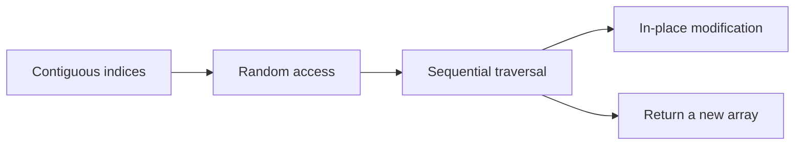

## Overview

Arrays are the most commonly used data structure: they place a group of elements in sequential logical positions and access them through indices. Whether it's frontend list rendering, table data processing, or interval scanning in algorithm problems, arrays are almost always the first layer of abstraction.

The key to understanding arrays is not just knowing how to call `push`, `map`, `filter`, but understanding:

- Why index access is fast;
- Why insertion and deletion can be slow;
- How to maintain state during traversal;
- When to modify in place and when to return a new array.

> Prerequisites
> - **Index access**: Arrays locate elements by position
> - **Dynamic arrays**: Understanding resizing, shifting, and amortized complexity
> - **Traversal model**: Read-write pointers are the foundation of in-place array processing

---

## Problem Definition

Arrays are suitable for representing data collections that are "order-stable and locatable by position."

| Requirement | Is an array suitable? | Reason |
| --- | --- | --- |
| Read the k-th element by index | Suitable | Random access locates directly |
| Frequent appends at the end | Suitable | Dynamic arrays are typically amortized O(1) |
| Frequent insertions/deletions at the front | Not suitable | Subsequent elements need to be shifted entirely |
| Maintain sorted order and binary search | Suitable | Indices can directly access the midpoint |
| Represent chained relationships | Not necessarily | Linked lists or Maps may be more natural |

In JavaScript / TypeScript, arrays are dynamic arrays: the length can change, and elements can be of any type. But in algorithm analysis, we still understand them through the model of "contiguous indices + sequential storage."

---

## Core Principle: Step-by-Step Illustration

Suppose the array is:

```text
index:  0   1   2   3
value: 10  20  30  40
```

### Accessing Elements

When reading `arr[2]`, we only need to locate the 2nd position through the index:

```text
index:  0   1   2   3
value: 10  20 [30] 40
```

So random access is O(1).

### Insertion in the Middle

If we want to insert `15` at index 1, the original `20、30、40` all need to shift backward:

```text
插入前: 10 20 30 40
移动后: 10 _  20 30 40
插入后: 10 15 20 30 40
```

The cost of shifting elements depends on the length of the tail, so middle insertion is O(n) in the worst case.

### Two-Pointer In-Place Modification

Arrays are also commonly used in the "read-write pointer" model: one pointer scans the original array, and another pointer maintains the write position.

```text
read  -> 扫描每个元素
write -> 指向下一个有效元素位置
```

This type of technique can optimize many "filter, deduplicate, compress" problems from extra O(n) space to O(1) extra space.

---

## Basic Operations and Complexity

| Operation | Example | Time Complexity | Description |
| --- | --- | --- | --- |
| Random access | `arr[i]` | O(1) | Locate by index |
| Modify element | `arr[i] = x` | O(1) | Does not change array structure |
| Append at end | `arr.push(x)` | Amortized O(1) | Resizing incurs extra cost |
| Delete at end | `arr.pop()` | O(1) | Does not shift preceding elements |
| Insert at front | `arr.unshift(x)` | O(n) | Requires shifting all elements |
| Delete in middle | `arr.splice(i, 1)` | O(n) | Requires shifting subsequent elements |
| Traversal | `for ...` | O(n) | Each element visited once |
| Sorting | `arr.sort()` | Typically O(n log n) | Depends on runtime implementation |

The most easily overlooked operations in engineering are `shift` and `unshift`. They look simple, but on large arrays they can be much slower than `push` / `pop`.

---

## TypeScript Implementation

Below, we use an example of "deduplicating a sorted array" to connect array access, traversal, and in-place writing.

### 1. In-Place Deduplication

```typescript
function removeDuplicates(nums: number[]): number {
  if (nums.length === 0) return 0;

  let write = 1;

  for (let read = 1; read < nums.length; read++) {
    if (nums[read] !== nums[read - 1]) {
      nums[write] = nums[read];
      write++;
    }
  }

  return write;
}

const nums = [1, 1, 2, 2, 3, 4, 4];
const len = removeDuplicates(nums);
console.log(nums.slice(0, len)); // [1, 2, 3, 4]
```

The key invariant here is:

- The interval `[0, write)` always holds the confirmed unique elements;
- `read` is responsible for scanning candidate elements to the right;
- When a new value is found, write it to position `write`.

### 2. Merging Two Sorted Arrays

```typescript
function mergeSorted(left: number[], right: number[]): number[] {
  const result: number[] = [];
  let i = 0;
  let j = 0;

  while (i < left.length && j < right.length) {
    if (left[i] <= right[j]) {
      result.push(left[i]);
      i++;
    } else {
      result.push(right[j]);
      j++;
    }
  }

  while (i < left.length) result.push(left[i++]);
  while (j < right.length) result.push(right[j++]);

  return result;
}
```

This implementation demonstrates another common array model: two indices move on two sequences respectively, and the result array is appended in order.

---

## Engineering Optimization: In-Place vs. New Array

Array operations typically come in two styles:

| Style | Example | Advantage | Cost |
| --- | --- | --- | --- |
| In-place modification | `sort`, `splice`, two-pointer writing | Saves space | Easily affects references held by callers |
| Return a new array | `map`, `filter`, `slice` | Safer, more suitable for immutable state | Requires extra space |

In frontend state management, returning a new array is usually preferred, because frameworks like React rely on reference changes to determine whether to update:

```typescript
const nextTodos = todos.filter(todo => !todo.completed);
```

In algorithm or performance-sensitive scenarios, in-place modification is more common because it reduces extra memory:

```typescript
nums.sort((a, b) => a - b);
```

The criterion for choosing is not "which is more advanced," but whether the current scenario values readability, immutability, or space efficiency more.

---

## Applications and Limitations

### Typical Applications

- List rendering, pagination, sorting, and filtering;
- Array algorithms such as two pointers, sliding windows, and prefix sums;
- Underlying storage for structures like matrices, heaps, and union-find;
- Batch request results, log records, and table data processing.

### Limitations

- Middle insertion and deletion are costly;
- Sparse arrays make behavior unintuitive;
- `sort` sorts by string by default; numeric sorting requires passing a comparator function;
- Frequent copying of large arrays brings significant memory pressure.

---

## Summary



- The core advantage of arrays is index access and sequential traversal.
- The cost of insertion and deletion mainly comes from element shifting.
- Two pointers are the foundational model for in-place array processing.
- In engineering, distinguish between in-place modification and returning a new array.
- Mastering arrays enables a more natural understanding of binary search, sliding windows, prefix sums, and other algorithms.