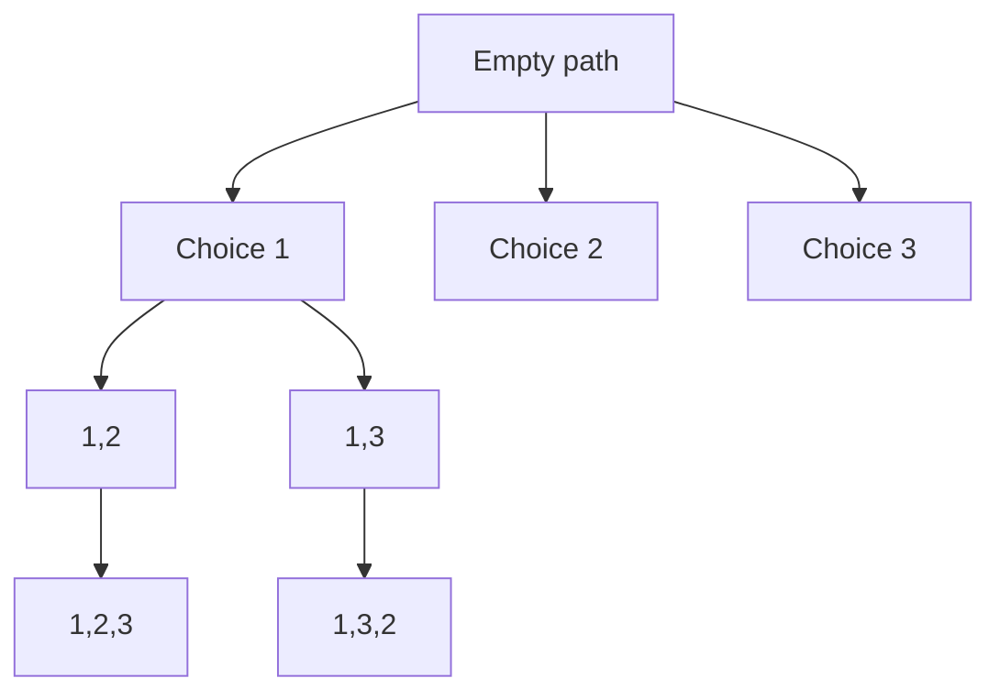
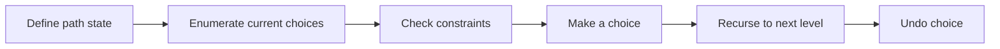

## Overview

**Backtracking** is an enumeration method that performs a depth-first search on a decision tree. It tries a choice and continues searching downward; if the current path does not satisfy the conditions, it undoes the choice and returns to the previous level to try other branches.

> Prerequisites
> - **DFS**: Backtracking is essentially a depth-first traversal of a decision tree
> - **Recursion**: Using the call stack to save the choice state at each level
> - **Pruning**: Skipping branches that cannot possibly produce an answer

---

## Problem Definition

Given a set of choice spaces, enumerate all solutions that satisfy the constraints, and avoid invalid branches during the search process.

| Element | Description |
|------|------|
| Input | Candidate elements, target length, target sum, or board constraints |
| Output | All paths, combinations, permutations, or layouts that satisfy the conditions |
| Key State | Current path, available range, used markers, constraint checking |
| Typical Problems | Full permutations, combinations, subsets, combination sum, N-Queens |

---

## Core Principle: Step-by-Step Illustration

Taking the full permutations of `[1, 2, 3]` as an example, each level selects a number that has not yet been used:



The core actions of backtracking can be broken down into three steps:

1. **Make a choice**: Add a candidate element to the current path.
2. **Continue searching**: Recurse into the next level of decision-making.
3. **Undo the choice**: Restore the state so that the same level can try the next candidate.

If all paths are viewed as a tree, backtracking is "walking all the way down one path, then retreating to switch paths."

---

## Detailed Algorithm Steps

```
算法：Backtrack(path, choices)
输入：当前路径 path，可选集合 choices
输出：所有满足条件的解

1. 如果 path 已满足结束条件：
2.     复制 path 到结果集
3.     返回
4. 遍历 choices 中的每个 choice：
5.     如果 choice 不满足约束，跳过
6.     将 choice 加入 path
7.     更新选择状态
8.     Backtrack(path, nextChoices)
9.     撤销 choice 和状态更新
```

**Complexity Analysis**:

| Problem Type | Search Scale | Description |
|------|------|------|
| Permutations | O(n × n!) | n! permutations, each result copied in O(n) |
| Combinations | O(k × C(n,k)) | Only enumerates paths of length k |
| Subsets | O(n × 2^n) | Each element is either chosen or not |
| N-Queens | Approximately O(n!) | After pruning, far less than brute-force n^n |
| Space Complexity | O(n) + output | Recursion depth and current path are O(n) |

---

## TypeScript Implementation

### 1. Full Permutations

```typescript
function permute(nums: number[]): number[][] {
  const result: number[][] = [];
  const path: number[] = [];
  const used = new Array(nums.length).fill(false);

  function backtrack(): void {
    if (path.length === nums.length) {
      result.push([...path]);
      return;
    }

    for (let i = 0; i < nums.length; i++) {
      if (used[i]) continue;
      used[i] = true;
      path.push(nums[i]);
      backtrack();
      path.pop();
      used[i] = false;
    }
  }

  backtrack();
  return result;
}
```

### 2. Combinations

```typescript
function combine(n: number, k: number): number[][] {
  const result: number[][] = [];
  const path: number[] = [];

  function backtrack(start: number): void {
    if (path.length === k) {
      result.push([...path]);
      return;
    }

    for (let i = start; i <= n - (k - path.length) + 1; i++) {
      path.push(i);
      backtrack(i + 1);
      path.pop();
    }
  }

  backtrack(1);
  return result;
}
```

### 3. Subsets

```typescript
function subsets(nums: number[]): number[][] {
  const result: number[][] = [];
  const path: number[] = [];

  function backtrack(start: number): void {
    result.push([...path]);

    for (let i = start; i < nums.length; i++) {
      path.push(nums[i]);
      backtrack(i + 1);
      path.pop();
    }
  }

  backtrack(0);
  return result;
}
```

### 4. N-Queens

```typescript
function solveNQueens(n: number): string[][] {
  const result: string[][] = [];
  const board = Array.from({ length: n }, () => new Array(n).fill('.'));
  const cols = new Set<number>();
  const diag1 = new Set<number>();
  const diag2 = new Set<number>();

  function backtrack(row: number): void {
    if (row === n) {
      result.push(board.map(line => line.join('')));
      return;
    }

    for (let col = 0; col < n; col++) {
      if (cols.has(col) || diag1.has(row - col) || diag2.has(row + col)) continue;
      cols.add(col);
      diag1.add(row - col);
      diag2.add(row + col);
      board[row][col] = 'Q';

      backtrack(row + 1);

      board[row][col] = '.';
      cols.delete(col);
      diag1.delete(row - col);
      diag2.delete(row + col);
    }
  }

  backtrack(0);
  return result;
}
```

---

## Engineering Optimization: Pruning and State Isolation

The most error-prone aspect of backtracking code is state reuse. In engineering, optimization can be approached from three angles:

| Optimization Point | Approach | Value |
|------|------|------|
| Pruning conditions upfront | First check whether remaining elements are sufficient and whether the current sum exceeds the limit | Reduces invalid recursion |
| Paired state modifications | `push` and `pop`, `add` and `delete` appear in pairs | Avoids contaminating other branches |
| Copy results | Use `[...path]` when collecting answers | Prevents subsequent backtracking from modifying already-saved results |

In N-Queens, using the three sets `cols / diag1 / diag2` instead of scanning cell by cell reduces each validity check from O(n) to O(1).

---

## Applications and Limitations

### Typical Applications

- Enumeration problems such as permutations, combinations, and subsets
- Board search: N-Queens, Sudoku
- Path search: maze paths, word search
- Constraint satisfaction problems: parenthesis generation, phone number letter combinations

### Limitations

| Limitation | Description |
|------|------|
| Large search space | Most backtracking problems are inherently exponential |
| Prone to state contamination | Forgetting to undo a choice leads to incorrect results |
| Limited recursion depth | Excessive depth may trigger call stack limits |

---

## Summary



**Key Takeaways**:

1. Backtracking = DFS + state selection + undoing choices.
2. Permutations use `used` to control repeated use; combinations and subsets use `start` to control order.
3. Pruning does not change the answer; it skips branches that cannot possibly produce an answer.
4. When collecting results, you must copy the current path and cannot directly save a reference.