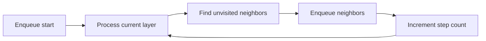

## Overview

**Breadth-First Search (BFS)** is a traversal algorithm that expands layer by layer. Starting from the source, it first visits nodes at distance 1, then nodes at distance 2, making it naturally suited for finding the minimum number of steps in an unweighted graph.

> Prerequisites
> - **Queue**: First in, first out, ensuring layer-by-layer processing
> - **Graph / grid modeling**: Treating states as nodes and single-step transitions as edges
> - **visited set**: Avoiding duplicate enqueues and infinite loops

---

## Problem Definition

Given a starting point and state transition rules, search for the target state in order of increasing distance.

| Element | Description |
|------|------|
| Input | Start point, target, neighbor generation function or graph structure |
| Output | Minimum steps to reach the target, level-order result, or number of connected components |
| Core structure | Queue + visited set |
| Applicability | Every edge has equal weight, or only the minimum number of transitions matters |

---

## Core Principle: Step-by-Step Illustration

BFS expands outward layer by layer like ripples in water:

 ```mermaid
graph TD
    S[Start step=0] --> A[First layer step=1]
    S --> B[First layer step=1]
    A --> C[Second layer step=2]
    A --> D[Second layer step=2]
    B --> E[Second layer step=2]
```

### Level-Order Expansion

1. Enqueue the starting point and mark it as visited.
2. Each round processes only the nodes currently in the queue, which belong to the same layer.
3. Add unvisited neighbors to the queue as the next layer.
4. After processing one layer, increment the step count `step + 1`.

As soon as the target is encountered for the first time, the current step count can be returned, because BFS guarantees this is the shortest path.

---

## Detailed Algorithm Steps

```
算法：BFS(start, target)
输入：起点 start，目标 target
输出：最少步数；不可达时返回 -1

1. queue ← [start]
2. visited ← {start}
3. step ← 0
4. while queue 不为空：
5.     size ← queue.length
6.     重复 size 次：
7.         cur ← queue 出队
8.         如果 cur 是 target，返回 step
9.         遍历 cur 的邻居 next：
10.            如果 next 未访问：标记并入队
11.    step ← step + 1
12. return -1
```

**Complexity Analysis**:

| Scenario | Time Complexity | Space Complexity | Description |
|------|------|------|------|
| Graph traversal | O(V + E) | O(V) | Each vertex and edge is processed at most once |
| Grid BFS | O(mn) | O(mn) | Each cell is enqueued at most once |
| State search | O(number of states × branching factor) | O(number of states) | Such as combination lock, word ladder |
| Bidirectional BFS | Approximately O(b^(d/2)) | O(b^(d/2)) | Suitable when both start and end are known |

---

## TypeScript Implementation

### 1. Generic BFS Template

```typescript
function bfs<T>(start: T, isTarget: (node: T) => boolean, getNeighbors: (node: T) => T[]): number {
  const queue: T[] = [start];
  const visited = new Set<T>([start]);
  let head = 0;
  let step = 0;

  while (head < queue.length) {
    const size = queue.length - head;

    for (let i = 0; i < size; i++) {
      const cur = queue[head++];
      if (isTarget(cur)) return step;

      for (const next of getNeighbors(cur)) {
        if (visited.has(next)) continue;
        visited.add(next);
        queue.push(next);
      }
    }

    step++;
  }

  return -1;
}
```

### 2. Number of Islands

```typescript
function numIslands(grid: string[][]): number {
  const m = grid.length;
  const n = grid[0].length;
  const dirs = [[1, 0], [-1, 0], [0, 1], [0, -1]];
  let count = 0;

  function floodFill(row: number, col: number): void {
    const queue: [number, number][] = [[row, col]];
    let head = 0;
    grid[row][col] = '0';

    while (head < queue.length) {
      const [x, y] = queue[head++];
      for (const [dx, dy] of dirs) {
        const nx = x + dx;
        const ny = y + dy;
        if (nx < 0 || nx >= m || ny < 0 || ny >= n || grid[nx][ny] !== '1') continue;
        grid[nx][ny] = '0';
        queue.push([nx, ny]);
      }
    }
  }

  for (let i = 0; i < m; i++) {
    for (let j = 0; j < n; j++) {
      if (grid[i][j] === '1') {
        count++;
        floodFill(i, j);
      }
    }
  }

  return count;
}
```

### 3. Open the Lock

```typescript
function openLock(deadends: string[], target: string): number {
  const dead = new Set(deadends);
  if (dead.has('0000')) return -1;

  const queue = ['0000'];
  const visited = new Set<string>(['0000']);
  let head = 0;
  let step = 0;

  function nextStates(state: string): string[] {
    const result: string[] = [];
    for (let i = 0; i < 4; i++) {
      const digit = Number(state[i]);
      for (const next of [(digit + 1) % 10, (digit + 9) % 10]) {
        result.push(state.slice(0, i) + next + state.slice(i + 1));
      }
    }
    return result;
  }

  while (head < queue.length) {
    const size = queue.length - head;

    for (let i = 0; i < size; i++) {
      const cur = queue[head++];
      if (cur === target) return step;

      for (const next of nextStates(cur)) {
        if (dead.has(next) || visited.has(next)) continue;
        visited.add(next);
        queue.push(next);
      }
    }

    step++;
  }

  return -1;
}
```

### 4. Bidirectional BFS

```typescript
function openLockBidirectional(deadends: string[], target: string): number {
  const dead = new Set(deadends);
  if (dead.has('0000')) return -1;

  let begin = new Set<string>(['0000']);
  let end = new Set<string>([target]);
  const visited = new Set<string>(['0000']);
  let step = 0;

  function nextStates(state: string): string[] {
    const result: string[] = [];
    for (let i = 0; i < 4; i++) {
      const digit = Number(state[i]);
      result.push(state.slice(0, i) + ((digit + 1) % 10) + state.slice(i + 1));
      result.push(state.slice(0, i) + ((digit + 9) % 10) + state.slice(i + 1));
    }
    return result;
  }

  while (begin.size > 0 && end.size > 0) {
    if (begin.size > end.size) [begin, end] = [end, begin];

    const nextLayer = new Set<string>();
    for (const cur of begin) {
      if (dead.has(cur)) continue;
      if (end.has(cur)) return step;

      for (const next of nextStates(cur)) {
        if (visited.has(next)) continue;
        visited.add(next);
        nextLayer.add(next);
      }
    }

    begin = nextLayer;
    step++;
  }

  return -1;
}
```

---
## Engineering Optimization: Queues and Access Timing

JavaScript array `shift()` shifts subsequent elements; for large queue scenarios, use a `head` pointer to simulate dequeuing.

| Optimization Point | Recommended Practice | Reason |
|------|------|------|
| Dequeue | `const cur = queue[head++]` | Avoid the O(n) shifting of `shift()` |
| Marking visits | Mark when enqueuing | Prevent the same node from being enqueued repeatedly |
| Level counting | Record the current level `size` | Accurately maintain the shortest step count |
| Bidirectional search | Expand from the smaller frontier | Reduce the exponential state space |

---

## Applications and Limitations

### Typical Applications

- Shortest path in unweighted graphs
- Level-order traversal of binary trees
- Grid propagation: islands, mazes, rotting oranges
- State search: combination lock, word ladder

### Limitations

| Limitation | Description |
|------|------|
| High memory usage | The queue may hold an entire level of nodes |
| Not suitable for weighted shortest paths | When edge weights differ, algorithms such as Dijkstra should be used |
| State explosion | When the branching factor is large, pruning or bidirectional search is needed |

---

## Summary



**Key Points**:

1. BFS = queue + visited + level-by-level expansion.
2. In an unweighted graph, the first time the target is reached is the shortest path.
3. For large queues, use a head pointer; do not frequently `shift()`.
4. When both the start and end points are known, prioritize bidirectional BFS.