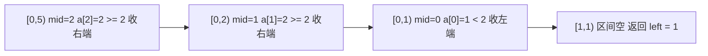

## Why Start with a Template

[Binary Search: From Beginner to Boundary-Handling Mastery](/technology/binary-search/) covered the **principles**: monotonicity, loop invariants, and why binary search is correct. This article tackles a different problem — **when you actually sit down in front of the screen, what should the first line be?**

The code skeleton for binary search is really just one structure. Among the three variants — searching for an element, searching for the left boundary, and searching for the right boundary — the differences are so small that they come down to just **one comparison operator** and **one return line**. But it's precisely this tiny difference that causes the most trouble: whether the interval is closed or open, whether the initial value of `right` is `n` or `n - 1`, whether to return `left` or `left - 1` — get any one of these backwards, and your code either loops forever or silently returns an index that looks reasonable but is off by one.

This article first converges all three search variants into a single skeleton, then explains one by one why each of the three "fill-in-the-blank" spots is filled the way it is, and finally provides a troubleshooting checklist. The goal is concrete: **from now on, whenever you encounter any binary search problem, first recite the skeleton from memory, then just modify the three blanks.**

> **About the Code**
>
> All three templates are provided in C / C++ / JavaScript implementations. The logic is completely equivalent; switch tabs to view.
> All three templates uniformly adopt the **left-closed, right-open interval `[left, right)`** — only "search for an element" retains the more intuitive left-closed, right-closed form because it needs to return early. The reason for not forcing uniformity is explained at the end of the article.

---

## Template Overview: One Skeleton, Three Blanks

Let's look at the skeleton first. The problem it solves is: **find the position of the "first element that satisfies a condition" on `[left, right)`**.

```text
/* 二分查找通用骨架：左闭右开区间 [left, right) */
left = 0, right = n                  /* ① 右端取 n，不是 n - 1 */
while (left < right):                /* 区间里还有元素，就继续二分 */
    mid = left + (right - left) / 2  /* ② 防溢出的中点写法 */
    if (check(a[mid])):              /* ③ 判断条件 —— 每道题不一样 */
        right = mid                  /*    mid 可能是答案，保留它 */
    else:
        left = mid + 1               /*    mid 一定不是答案，排除它 */
return left                          /* ④ 返回 left，取值落在 [0, n] */
```

Inside the entire loop, only three spots require thought:

| Blank | Meaning | Range of Variation |
|--------|------|---------|
| ③ **Condition** `check(a[mid])` | "What is the value at mid?" | Only `>=` and `>` are used throughout |
| Shrink direction | True goes `right = mid`, false goes `left = mid + 1` | **Identical across all three searches — no need to change** |
| ④ **Return value** | `left` itself, or `left ± 1` with verification | Differs across all three searches |

Note that the second row is fixed: **as long as the condition is written correctly, the actions for the true and false branches are always the same**. This is the most reassuring aspect of this skeleton — you never need to re-derive "should I `±1` or not," because there's only one rule:

> **`check(mid)` is true → `right = mid` (mid could be the answer, keep it in the interval); false → `left = mid + 1` (mid definitely isn't the answer, exclude it along with itself).**

Since `mid` always satisfies `left ≤ mid < right`, the two branches respectively make the right end strictly smaller and the left end strictly larger. The interval strictly shrinks every iteration, so **it naturally never loops forever**.

---

## Unified Perspective: The Three Searches Are Actually the Same Problem

If you break apart "search for an element / left boundary / right boundary," what they all want is actually the same kind of thing — **the first index that satisfies some condition** — just with different conditions:

| What You Want | Equivalent to "Find the first position satisfying…" | `check(a[mid])` |
|--------|------------------------------|-----------------|
| Left boundary | Position of `>= target` | `a[mid] >= target` |
| Right boundary | Position of `> target`, then minus one | `a[mid] > target` |
| Insertion position | Position of `>= target` (same as left boundary) | `a[mid] >= target` |
| A specific element | First find position of `>= target`, then check if it's exactly equal | `a[mid] >= target` + one verification |

In other words, **the `>=` version (hereafter `lowerBound`) and the `>` version (hereafter `upperBound`) — these two functions cover all cases** — they differ by only one comparison operator. The real difference lies in the return value: the left boundary returns directly, the right boundary needs to subtract one, and searching for an element requires an extra check of "is it actually equal."

Remember these two conversions first. The three templates that follow are all just a wrapper layered on top of them:

```text
搜索左边界(第一个 == target) = lowerBound(target)          + 校验 a[i] == target
搜索右边界(最后一个 == target) = upperBound(target) - 1      + 校验 a[i] == target
搜索插入位置                 = lowerBound(target)          （不校验，直接返回）
```

---
## Template A: Searching for an Element

The most familiar scenario: find an exact value in an array, return its index if found, otherwise return `-1`.


This one is most intuitive with a **closed interval on both ends `[left, right]`**: return `return mid` immediately on a hit, and if the loop ends, it means nothing was found.

:::code-tabs{default="cpp"}
```c title="C"
int search(const int *a, int n, int target) {
    int left = 0, right = n - 1;              /* 闭区间 [left, right] */
    while (left <= right) {                   /* 注意是 <=，不是 <           */
        int mid = left + (right - left) / 2;
        if (a[mid] == target) return mid;     /* 命中，直接返回             */
        if (a[mid] < target) left = mid + 1;  /* 答案在右半                 */
        else                 right = mid - 1; /* 答案在左半                 */
    }
    return -1;                                /* 区间空了，没找到           */
}
```

```cpp title="C++"
#include <vector>

int search(const std::vector<int>& a, int target) {
    int left = 0, right = static_cast<int>(a.size()) - 1;
    while (left <= right) {
        int mid = left + (right - left) / 2;
        if (a[mid] == target) return mid;
        if (a[mid] < target) left = mid + 1;
        else                 right = mid - 1;
    }
    return -1;
}
```

```js title="JavaScript"
function search(a, target) {
  let left = 0;
  let right = a.length - 1;                    // 闭区间 [left, right]
  while (left <= right) {                      // 注意是 <=，不是 <
    const mid = left + Math.floor((right - left) / 2);
    if (a[mid] === target) return mid;         // 命中，直接返回
    if (a[mid] < target) left = mid + 1;       // 答案在右半
    else right = mid - 1;                      // 答案在左半
  }
  return -1;
}
```
:::

### Key Points

- **The initial value of `right` is `n - 1`, and the loop condition is `<=`.** The "empty" state of a closed interval is `left > right`, so the condition for continuing to binary search is `left <= right`.
- **Only when `mid` definitely cannot be the answer do we dare to `±1`.** Here `a[mid]` has already been compared and confirmed unequal, so both branches skip `mid` itself.
- **When duplicate elements are present, it may return any one of them.** If you want to pinpoint a specific one in `[2,2,2]`, you'll need the left/right boundary templates that follow.

### Rewriting It with the Unified Skeleton

Template A can also be written as `lowerBound` plus a single check—this is exactly the key to connecting it back to the unified perspective:

:::code-tabs{default="cpp"}
```c title="C"
int search(const int *a, int n, int target) {
    int i = lowerBound(a, n, target);         /* 第一个 >= target 的位置 */
    return (i < n && a[i] == target) ? i : -1; /* 恰好相等才算找到         */
}
```

```cpp title="C++"
int search(const std::vector<int>& a, int target) {
    int i = lowerBound(a, target);
    return (i < static_cast<int>(a.size()) && a[i] == target) ? i : -1;
}
```

```js title="JavaScript"
function search(a, target) {
  const i = lowerBound(a, target);            // 第一个 >= target 的位置
  return i < a.length && a[i] === target ? i : -1;
}
```
:::

This version is a bit longer than the closed-interval one, but the advantage is that **there's only one skeleton left in the entire piece**: you no longer need to maintain two kinds of loop conditions in your head.

---
## Template B: Search for the Left Boundary (`lowerBound`)

Scenario: the array contains duplicate elements, and you want the index of the **first** `== target`; or you simply want the insertion position—the position of the first `>= target`.

Taking `nums = [1, 2, 2, 2, 3]` and `target = 2` as an example, what we want is index `1`:

```text
nums:   1  2  2  2  3
index:  0  1  2  3  4
           ^
      lowerBound(2) = 1
```

:::code-tabs{default="cpp"}
```c title="C"
/* 第一个 >= target 的位置，返回值范围 [0, n] */
int lowerBound(const int *a, int n, int target) {
    int left = 0, right = n;                   /* 开区间 [left, right)     */
    while (left < right) {
        int mid = left + (right - left) / 2;
        if (a[mid] >= target) right = mid;     /* mid 可能是答案，保留它   */
        else                  left = mid + 1;  /* mid 太小，连自己一起排除 */
    }
    return left;                               /* 第一个 >= target 的下标  */
}
```

```cpp title="C++"
#include <vector>

int lowerBound(const std::vector<int>& a, int target) {
    int left = 0, right = static_cast<int>(a.size());  /* 开区间 [left, right) */
    while (left < right) {
        int mid = left + (right - left) / 2;
        if (a[mid] >= target) right = mid;
        else                  left = mid + 1;
    }
    return left;
}
```

```js title="JavaScript"
function lowerBound(a, target) {
  let left = 0;
  let right = a.length;                        // 开区间 [left, right)
  while (left < right) {
    const mid = left + Math.floor((right - left) / 2);
    if (a[mid] >= target) right = mid;         // mid 可能是答案，保留它
    else left = mid + 1;                       // mid 太小，连自己一起排除
  }
  return left;                                 // 第一个 >= target 的下标
}
```
:::

Tracing through it step by step, you can see how the interval shrinks down to the answer:



### Key Points

- **The initial value of `right` is `n` (not `n - 1`).** In a half-open interval, `right` means "definitely not the first position of the answer," and the meaning of the initial `n` is "the answer may fall after the end of the array"—only then can the insertion position possibly return `n`.
- **`right = mid` rather than `mid - 1`.** Because when `a[mid] >= target`, `mid` itself may be the answer (for example, it is the first position equal to `target`), and excluding it would miss the solution.
- **Will `right = mid` cause an infinite loop?** No. `mid < right` always holds, so `right = mid` makes the right end strictly smaller; the other branch `left = mid + 1` makes the left end strictly larger. This is exactly why the skeleton is safe.
- **The return value of `lowerBound` may equal `n`.** This happens when all elements in the array are less than `target`, so you must check `i < n` before using the value.

### One Verification Step, and It Becomes "Search for the Left Boundary"

What is returned above is the position of the "first `>= target`," and when `target` does not exist, it points to an element greater than `target`. To get the strict "first `== target`," just add an equality check:

:::code-tabs{default="cpp"}
```c title="C"
int searchLeft(const int *a, int n, int target) {
    int i = lowerBound(a, n, target);          /* 第一个 >= target         */
    return (i < n && a[i] == target) ? i : -1; /* 存在才算数，否则 -1      */
}
```

```cpp title="C++"
int searchLeft(const std::vector<int>& a, int target) {
    int i = lowerBound(a, target);
    return (i < static_cast<int>(a.size()) && a[i] == target) ? i : -1;
}
```

```js title="JavaScript"
function searchLeft(a, target) {
  const i = lowerBound(a, target);             // 第一个 >= target
  return i < a.length && a[i] === target ? i : -1;
}
```
:::

Both checks `i < n` and `a[i] == target` are indispensable: the former prevents out-of-bounds access, and the latter distinguishes "insertion position" from "actually exists."

---
## Template C: Searching for the Right Boundary (`upperBound`)

Scenario: you want the index of the **last** `== target`. Same array, same `target = 2`, but this time you want index `3`.

The most reliable approach isn't "binary search from right to left," but rather **copy Template B and change `>=` to `>`**, obtaining the position of the "first `> target`," then subtracting one:

```text
nums:   1  2  2  2  3
index:  0  1  2  3  4
                    ^
      upperBound(2) = 4          （第一个 > 2）
      upperBound(2) - 1 = 3      （最后一个 <= 2，也就是 2 的右边界）
```

:::code-tabs{default="cpp"}
```c title="C"
/* 第一个 > target 的位置，返回值范围 [0, n] */
int upperBound(const int *a, int n, int target) {
    int left = 0, right = n;
    while (left < right) {
        int mid = left + (right - left) / 2;
        if (a[mid] > target) right = mid;      /* 唯一改动：>= 变成 >       */
        else                 left = mid + 1;
    }
    return left;                               /* 第一个 > target 的下标    */
}

int searchRight(const int *a, int n, int target) {
    int i = upperBound(a, n, target) - 1;      /* 最后一个 <= target        */
    return (i >= 0 && a[i] == target) ? i : -1;/* 恰好相等才是右边界        */
}
```

```cpp title="C++"
#include <vector>

int upperBound(const std::vector<int>& a, int target) {
    int left = 0, right = static_cast<int>(a.size());
    while (left < right) {
        int mid = left + (right - left) / 2;
        if (a[mid] > target) right = mid;      // 唯一改动：>= 变成 >
        else                 left = mid + 1;
    }
    return left;
}

int searchRight(const std::vector<int>& a, int target) {
    int i = upperBound(a, target) - 1;         // 最后一个 <= target
    return (i >= 0 && a[i] == target) ? i : -1;
}
```

```js title="JavaScript"
function upperBound(a, target) {
  let left = 0;
  let right = a.length;
  while (left < right) {
    const mid = left + Math.floor((right - left) / 2);
    if (a[mid] > target) right = mid;          // 唯一改动：>= 变成 >
    else left = mid + 1;
  }
  return left;                                 // 第一个 > target 的下标
}

function searchRight(a, target) {
  const i = upperBound(a, target) - 1;         // 最后一个 <= target
  return i >= 0 && a[i] === target ? i : -1;
}
```
:::

### Key Points

- **Differs from `lowerBound` by only one symbol.** `lowerBound` checks `>=`, `upperBound` checks `>`; everything else (`right = mid` / `left = mid + 1` / returning `left`) is identical word for word. When writing code, you can first copy down `lowerBound`, then change that one symbol.
- **Why subtract one.** `upperBound` finds the **first position greater than `target`**; the cell to its left is the "last position less than or equal to `target`"—that is, the right boundary of `target`. When `target` doesn't exist, the element at this position is some other value, so it must be filtered out via the `a[i] == target` check.
- **`upperBound(target) - 1` may equal `-1`.** When all elements in the array are greater than `target`, `upperBound` returns `0`. Before taking `a[i]`, you must first check `i >= 0`.
- **Don't substitute `lowerBound(target + 1) - 1`.** The effect is the same, but when `target` happens to be `INT_MAX`, `target + 1` overflows to a negative number. Using `upperBound` (checking `> target`) avoids this pitfall at its root.

---

## Comparison Table of the Three Templates

Looking at the three searches side by side, the differences are immediately clear:

| | Template A: Search for Element | Template B: Left Boundary | Template C: Right Boundary |
|--|--------------|--------------|--------------|
| Interval | Closed `[left, right]` | Open `[left, right)` | Open `[left, right)` |
| Initial value of `right` | `n - 1` | `n` | `n` |
| Loop condition | `left <= right` | `left < right` | `left < right` |
| Check condition | `a[mid] == target` | `a[mid] >= target` | `a[mid] > target` |
| True branch | `return mid` | `right = mid` | `right = mid` |
| False branch | By comparison `mid ± 1` | `left = mid + 1` | `left = mid + 1` |
| Return value | `mid` or `-1` | `left` then verify | `left - 1` then verify |
| Return value range | `[-1, n-1]` | `[0, n]` | `[-1, n-1]` |

To summarize all three tables in one sentence: **`>=` and `>` are swapped back and forth, `right = mid` never changes, and the return value's `-1` and verification are patched in at the end.**

Take another look at how `target = 2` performs in `[2,2,2,2]`—this is also the fastest way to decide which template to use:

| Scenario | Which to use | Result |
|------|--------|------|
| Just need to know "is it there or not" | A | The index of any `2` |
| Want "the first `2`" / insertion position | B | `0` |
| Want "the last `2`" | C | `3` |
| Want the entire range where `target` appears | B + C | `[0, 3]` |

---

## Appendix: Why Left-Closed Right-Open Is Recommended for Intervals

The easiest place to make mistakes in binary search isn't the algorithm—it's the **definition of the interval**. Once you pin down the interval, the initial value of `right`, the loop condition, and the return value can all be mechanically derived. The two approaches are compared below:

| | Left-closed right-closed `[left, right]` | Left-closed right-open `[left, right)` |
|--|--------------------------|--------------------------|
| Initial value of `right` | `n - 1` | `n` |
| Condition for loop to continue | `left <= right` | `left < right` |
| What "empty interval" looks like | `left > right` | `left == right` |
| Interval length | `right - left + 1` | `right - left` |
| When the loop ends | `left == right + 1` | `left == right` |
| Suited for | Searching for one element (return upon finding) | Searching for boundaries / insertion position |

**Left-closed right-open is recommended for three reasons:**

1. **The interval length is just `right - left`, no `+1` needed.** One less `+1` means one less place to get backwards.
2. **The empty-interval check is built into the loop condition.** `left == right` means the interval is empty, and `while (left < right)`'s stopping condition naturally aligns—no need to separately think about "when is the search considered done."
3. **"The answer may not exist" has somewhere to go.** The initial value of `right` is `n`, meaning "the answer may fall one cell past the end of the array"; returning `n` as the insertion position won't go out of bounds. The closed-interval approach has no such position, and handling "insert at the end" requires a special case.

The reason Template A retains the closed interval is simply that once it hits, it `return`, so it doesn't need the unified semantics of "the first position satisfying the condition"—the closed interval reads more straightforwardly. **If you want to keep only one style in your project, just replace Template A with its `lowerBound` + verification version.**

---
## Troubleshooting Checklist: If You Get Binary Search Wrong, It's Almost Always One of These Four

### 1. `right` Initial Value Set Wrong

For left-closed right-open, you must write `n`. Writing `n - 1` will miss the slot "answer is after the end," causing the insertion position to never return `n`.

```c
int left = 0, right = n;      /* 开区间，✓ */
int left = 0, right = n - 1;  /* 开区间，✗ 末尾那格被漏掉了 */
```

### 2. `mid` Overflow

In C / C++ / Java / Go, when `left + right` exceeds `INT_MAX` (about 2.1 billion), `(left + right) / 2` will **first overflow into a negative number**, then dividing by 2 gives a negative index, and `a[mid]` goes out of bounds directly.

```c
int mid = (left + right) / 2;            /* ✗ left + right 可能溢出   */
int mid = left + (right - left) / 2;     /* ✓ 先减后加，永不溢出      */
```

JavaScript uses double-precision floating point, so it won't overflow at the magnitude of array indices, but **keeping the same formulation** lets you compare code across all three languages at a glance, and avoids stepping into this pitfall when porting to another language later.

### 3. Infinite Loop

`left = mid` must **never appear** in the loop body of `while (left < right)`. The reason is that when `mid` takes the lower median, `mid < right` always holds, but when `right == left + 1`, `mid == left`, at which point `left = mid` equals no movement, the interval doesn't shrink, and you get an infinite loop.

Using `left = mid + 1` in the skeleton is precisely to avoid this. Conversely, if you really need to "keep `mid` as the new left endpoint," then `mid` must be changed to the **upper median** `left + (right - left + 1) / 2`, otherwise it will get stuck just the same.

> Just remember one thing: **`while (left < right)` paired with `left = mid + 1` is always safe.**

### 4. Return Value Out of Bounds

The return value ranges of `lowerBound` and `upperBound` are both `[0, n]`, and **both can equal `n`**; `upperBound(target) - 1` can equal `-1`. Whenever you want to use this index to access `a[i]`, you must first guard against it:

| Return Value | Value That May Go Out of Bounds | Check Before Use |
|--------|---------------|-----------|
| `lowerBound` | `n` (all less than target) | `i < n` |
| `upperBound` | `n` (all less than or equal to target) | `i < n` |
| `upperBound - 1` | `-1` (all greater than target) | `i >= 0` |

---

## Template Extension: Find First and Last Position of Element (LeetCode 34)

Combining Template B and Template C gives you this classic problem—obtaining the entire range of `target` in one pass.

### Problem Description

Given an integer array `nums` sorted in ascending order, and a target value `target`. Find the **starting position and ending position** of `target` in the array. If `target` does not exist in the array, return `[-1, -1]`.

**Example:**

```text
输入：nums = [5,7,7,8,8,10], target = 8
输出：[3,4]

输入：nums = [5,7,7,8,8,10], target = 6
输出：[-1,-1]

输入：nums = [], target = 0
输出：[-1,-1]
```

**Constraints:** `0 <= nums.length <= 10^5`, `-10^9 <= nums[i] <= 10^9`. O(log n) time complexity is required.

### Approach: Binary Search Once for Left Boundary and Once for Right Boundary

- `start = lowerBound(target)`: the position of the first `>= target`.
- `end = upperBound(target) - 1`: the position of the last `<= target`.
- The precondition for both to exist is `start < n` and `nums[start] == target`—when satisfied, `end` necessarily `>= start`, so return them together directly; otherwise return `[-1, -1]`.

:::code-tabs{default="cpp"}
```c title="C"
#include <stdlib.h>

int *searchRange(int *nums, int numsSize, int target, int *returnSize) {
    int *res = (int *)malloc(2 * sizeof(int));
    *returnSize = 2;

    int left  = lowerBound(nums, numsSize, target);       /* 第一个 >= target */
    int right = upperBound(nums, numsSize, target) - 1;   /* 最后一个 <= target */

    if (left < numsSize && nums[left] == target) {        /* 确认 target 存在 */
        res[0] = left;
        res[1] = right;
    } else {
        res[0] = -1;
        res[1] = -1;
    }
    return res;
}
```

```cpp title="C++"
#include <vector>
using namespace std;

class Solution {
public:
    vector<int> searchRange(vector<int>& nums, int target) {
        int left  = lowerBound(nums, target);             // 第一个 >= target
        int right = upperBound(nums, target) - 1;         // 最后一个 <= target

        if (left < (int)nums.size() && nums[left] == target)  // 确认 target 存在
            return {left, right};
        return {-1, -1};
    }
};
```

```js title="JavaScript"
function searchRange(nums, target) {
  const left = lowerBound(nums, target);          // 第一个 >= target
  const right = upperBound(nums, target) - 1;     // 最后一个 <= target

  if (left < nums.length && nums[left] === target) return [left, right];
  return [-1, -1];
}
```
:::

### Complexity

| Dimension | Analysis |
|------|------|
| Time Complexity | **O(log n)** — two independent binary searches, `2 × O(log n)` is still O(log n) |
| Space Complexity | **O(1)** — only two pointers used; the array returned by the C version is the result required by the problem and doesn't count as extra space |

### Common Pitfalls

1. **One binary search can't get both boundaries.** A common mistake is "after finding `target`, linearly expand to both sides"—in the worst case (array is all `target`), this degrades to O(n) and times out. You must honestly do two binary searches.
2. **`upperBound(target) - 1` instead of `upperBound(target)`.** Forgetting to subtract one is the most typical error—the returned `end` will point to the element that is "the first one greater than `target`," off by one position to the right.
3. **Empty array.** When `numsSize == 0`, `lowerBound` returns `0`, `0 < 0` is false, and it goes directly to the `[-1, -1]` branch without special handling; but in the C version, allocating two `int` for `malloc` cannot be skipped, because the caller will read according to `*returnSize == 2`.
4. **Don't reverse the validation conditions.** To check existence, it's `left < numsSize && nums[left] == target`—both conditions are needed: writing only the first half will misjudge the "insertion position" as a hit, and writing only the second half will go out of bounds when `left == numsSize`.

---

## Related Articles

- [Binary Search: From Beginner to Boundary Handling Mastery](/technology/binary-search/) — principles, monotonicity, interval invariants, and more variants
- [Sliding Window Core Code Template: Three Problems to Master All Substring and Subarray Problems](/technology/sliding-window-template/) — same philosophy of "one template converges a class of problems"
- [Find the Duplicate Number: Binary Search and Fast-Slow Pointers](/technology/find-duplicate-number/) — a classic example of binary searching on the value range rather than indices
- [Array Two Pointers: The Optimization Tool from O(n²) to O(n)](/technology/two-pointers-array/) — another framework that reduces brute force to a linear scan