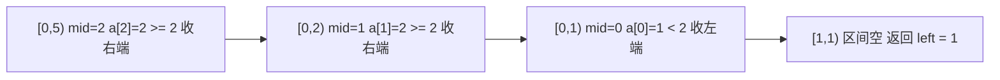

## 为什么先要一套模板

[二分搜索：从入门到边界处理精通](/technology/binary-search/) 那篇讲的是**原理**：单调性、区间不变量、二分为什么正确。这篇要解决的是另一个问题——**真正坐到屏幕前，第一行该写什么**。

二分的代码骨架其实只有一套，搜元素、搜左边界、搜右边界三种写法之间，差别小到只有**一个比较符号**和**一行返回值**。但恰恰是这点差别最要命：区间写成闭的还是开的、`right` 初值取 `n` 还是 `n - 1`、返回 `left` 还是 `left - 1`，任意一处记反，代码要么死循环，要么悄悄返回一个看起来合理、其实错一位的下标。

这篇先把三种搜索收敛到同一个骨架，再逐个解释三处「填空处」为什么这么填，最后给出排查清单。目标很具体：**以后遇到任何二分题，先默写骨架，再改三处填空就行。**

> **关于代码**
>
> 三种模板都给出 C / C++ / JavaScript 三语言实现，逻辑完全等价，可切换标签查看。
> 三个模板统一采用**左闭右开区间 `[left, right)`**——只有「搜索一个元素」因为要提前返回，保留更直观的左闭右闭写法，文末会解释为什么不强求统一。

---

## 模板总览：一个骨架，三处填空

先看骨架。它解决的问题是：**在 `[left, right)` 上找到「第一个满足条件」的位置**。

```text
/* 二分查找通用骨架：左闭右开区间 [left, right) */
left = 0, right = n                  /* ① 右端取 n，不是 n - 1 */
while (left < right):                /* 区间里还有元素，就继续二分 */
    mid = left + (right - left) / 2  /* ② 防溢出的中点写法 */
    if (check(a[mid])):              /* ③ 判断条件 —— 每道题不一样 */
        right = mid                  /*    mid 可能是答案，保留它 */
    else:
        left = mid + 1               /*    mid 一定不是答案，排除它 */
return left                          /* ④ 返回 left，取值落在 [0, n] */
```

整个循环里只有三处需要动脑：

| 填空处 | 含义 | 变化范围 |
|--------|------|---------|
| ③ **判断条件** `check(a[mid])` | 「mid 这一格是什么」 | 全篇只用到 `>=` 和 `>` 两个符号 |
| 收缩方向 | 真走 `right = mid`、假走 `left = mid + 1` | **三种搜索完全一致，不用改** |
| ④ **返回值** | `left` 本身，或 `left ± 1` 再校验 | 三种搜索各不相同 |

注意第二行是固定的：**只要判断条件写对，真假两个分支的动作永远一样**。这是这套骨架最省心的地方——不需要每次重新推导「该不该 `±1`」，因为规则只有一条：

> **`check(mid)` 为真 → `right = mid`（mid 可能是答案，留在区间里）；为假 → `left = mid + 1`（mid 肯定不是答案，连自己一起排除）。**

因为 `mid` 永远满足 `left ≤ mid < right`，所以两个分支分别让右端严格变小、左端严格变大，区间每轮严格收缩，**天然不会死循环**。

---

## 统一视角：三种搜索其实是同一个问题

把「搜索一个元素 / 左边界 / 右边界」拆开看，它们要的其实是同一类东西——**第一个满足某个条件的下标**，只是条件不同：

| 你要的 | 等价于「找第一个满足…的位置」 | `check(a[mid])` |
|--------|------------------------------|-----------------|
| 左边界 | `>= target` 的位置 | `a[mid] >= target` |
| 右边界 | `> target` 的位置，再减一 | `a[mid] > target` |
| 插入位置 | `>= target` 的位置（和左边界同一个） | `a[mid] >= target` |
| 某个元素 | 先找 `>= target` 的位置，再看是不是恰好相等 | `a[mid] >= target` + 一次校验 |

也就是说，**`>=` 版（下称 `lowerBound`）和 `>` 版（下称 `upperBound`）这两个函数，就能覆盖全部情况**——它们之间只差一个比较符号。真正的差别在返回值：左边界直接返回，右边界要减一，搜元素还要多做一次「是否真的相等」的校验。

先记住这两条换算，后面三个模板都是在它们上面套了一层壳：

```text
搜索左边界(第一个 == target) = lowerBound(target)          + 校验 a[i] == target
搜索右边界(最后一个 == target) = upperBound(target) - 1      + 校验 a[i] == target
搜索插入位置                 = lowerBound(target)          （不校验，直接返回）
```

---

## 模板 A：搜索一个元素

最熟悉的场景：数组里找一个精确值，找到返回下标，否则返回 `-1`。


这一种用**左闭右闭 `[left, right]`** 最直观：命中就立刻 `return mid`，循环结束时说明没找到。

:::code-tabs{default="cpp"}
```c title="C"
int search(const int *a, int n, int target) {
    int left = 0, right = n - 1;              /* 闭区间 [left, right] */
    while (left <= right) {                   /* 注意是 <=，不是 <           */
        int mid = left + (right - left) / 2;
        if (a[mid] == target) return mid;     /* 命中，直接返回             */
        if (a[mid] < target) left = mid + 1;  /* 答案在右半                 */
        else                 right = mid - 1; /* 答案在左半                 */
    }
    return -1;                                /* 区间空了，没找到           */
}
```

```cpp title="C++"
#include <vector>

int search(const std::vector<int>& a, int target) {
    int left = 0, right = static_cast<int>(a.size()) - 1;
    while (left <= right) {
        int mid = left + (right - left) / 2;
        if (a[mid] == target) return mid;
        if (a[mid] < target) left = mid + 1;
        else                 right = mid - 1;
    }
    return -1;
}
```

```js title="JavaScript"
function search(a, target) {
  let left = 0;
  let right = a.length - 1;                    // 闭区间 [left, right]
  while (left <= right) {                      // 注意是 <=，不是 <
    const mid = left + Math.floor((right - left) / 2);
    if (a[mid] === target) return mid;         // 命中，直接返回
    if (a[mid] < target) left = mid + 1;       // 答案在右半
    else right = mid - 1;                      // 答案在左半
  }
  return -1;
}
```
:::

### 关键点

- **`right` 初值是 `n - 1`，循环条件是 `<=`。** 闭区间的「空」是 `left > right`，所以能继续二分的条件是 `left <= right`。
- **`mid` 一定不会是答案时才敢 `±1`。** 这里 `a[mid]` 已经比较过、确认不等，所以两个分支都跳过 `mid` 本身。
- **碰到重复元素时，它返回的可能是任意一个。** 想在 `[2,2,2]` 里定位到具体哪一个，就得用后面的左/右边界模板。

### 用统一骨架重写它

模板 A 也能写成 `lowerBound` 加一次校验——这正是把它接回统一视角的关键：

:::code-tabs{default="cpp"}
```c title="C"
int search(const int *a, int n, int target) {
    int i = lowerBound(a, n, target);         /* 第一个 >= target 的位置 */
    return (i < n && a[i] == target) ? i : -1; /* 恰好相等才算找到         */
}
```

```cpp title="C++"
int search(const std::vector<int>& a, int target) {
    int i = lowerBound(a, target);
    return (i < static_cast<int>(a.size()) && a[i] == target) ? i : -1;
}
```

```js title="JavaScript"
function search(a, target) {
  const i = lowerBound(a, target);            // 第一个 >= target 的位置
  return i < a.length && a[i] === target ? i : -1;
}
```
:::

这样写比左闭右闭版长一点，但好处是**全篇只剩一个骨架**：以后不再需要在脑子里维护两种循环条件。

---

## 模板 B：搜索左边界（`lowerBound`）

场景：数组里有重复元素，要的是 **第一个** `== target` 的下标；或者干脆是要插入位置——第一个 `>= target` 的位置。

以 `nums = [1, 2, 2, 2, 3]`、`target = 2` 为例，要的是下标 `1`：

```text
nums:   1  2  2  2  3
index:  0  1  2  3  4
           ^
      lowerBound(2) = 1
```

:::code-tabs{default="cpp"}
```c title="C"
/* 第一个 >= target 的位置，返回值范围 [0, n] */
int lowerBound(const int *a, int n, int target) {
    int left = 0, right = n;                   /* 开区间 [left, right)     */
    while (left < right) {
        int mid = left + (right - left) / 2;
        if (a[mid] >= target) right = mid;     /* mid 可能是答案，保留它   */
        else                  left = mid + 1;  /* mid 太小，连自己一起排除 */
    }
    return left;                               /* 第一个 >= target 的下标  */
}
```

```cpp title="C++"
#include <vector>

int lowerBound(const std::vector<int>& a, int target) {
    int left = 0, right = static_cast<int>(a.size());  /* 开区间 [left, right) */
    while (left < right) {
        int mid = left + (right - left) / 2;
        if (a[mid] >= target) right = mid;
        else                  left = mid + 1;
    }
    return left;
}
```

```js title="JavaScript"
function lowerBound(a, target) {
  let left = 0;
  let right = a.length;                        // 开区间 [left, right)
  while (left < right) {
    const mid = left + Math.floor((right - left) / 2);
    if (a[mid] >= target) right = mid;         // mid 可能是答案，保留它
    else left = mid + 1;                       // mid 太小，连自己一起排除
  }
  return left;                                 // 第一个 >= target 的下标
}
```
:::

分步追踪一遍，可以看到区间是怎么缩到答案上的：



### 关键点

- **`right` 初值是 `n`（不是 `n - 1`）。** 开区间里 `right` 表示「一定不是答案的第一个位置」，初始 `n` 的含义是「答案可能落在数组末尾之后」，插入位置才可能返回 `n`。
- **`right = mid` 而不是 `mid - 1`。** 因为 `a[mid] >= target` 时 `mid` 本身就可能是答案（比如它就是第一个等于 `target` 的位置），排除掉就会漏解。
- **`right = mid` 会不会死循环？** 不会。`mid < right` 恒成立，所以 `right = mid` 让右端严格变小；另一支 `left = mid + 1` 让左端严格变大。这正是骨架安全的原因。
- **`lowerBound` 返回值可能等于 `n`。** 当数组里所有元素都小于 `target` 时就是这种情况，取值前必须判 `i < n`。

### 校验一步，就是「搜索左边界」

上面返回的是「第一个 `>= target`」的位置，它在 `target` 不存在时会指向一个比 `target` 大的元素。要得到严格的「第一个 `== target`」，补一句相等校验即可：

:::code-tabs{default="cpp"}
```c title="C"
int searchLeft(const int *a, int n, int target) {
    int i = lowerBound(a, n, target);          /* 第一个 >= target         */
    return (i < n && a[i] == target) ? i : -1; /* 存在才算数，否则 -1      */
}
```

```cpp title="C++"
int searchLeft(const std::vector<int>& a, int target) {
    int i = lowerBound(a, target);
    return (i < static_cast<int>(a.size()) && a[i] == target) ? i : -1;
}
```

```js title="JavaScript"
function searchLeft(a, target) {
  const i = lowerBound(a, target);             // 第一个 >= target
  return i < a.length && a[i] === target ? i : -1;
}
```
:::

`i < n` 和 `a[i] == target` 两个判断缺一不可：前者防越界，后者把「插入位置」和「真的存在」区分开。

---

## 模板 C：搜索右边界（`upperBound`）

场景：要的是**最后一个** `== target` 的下标。同一个数组、同一个 `target = 2`，这次要的是下标 `3`。

最稳的做法不是「从右往左二分」，而是**照抄模板 B、把 `>=` 换成 `>`**，得到「第一个 `> target`」的位置，再减一：

```text
nums:   1  2  2  2  3
index:  0  1  2  3  4
                    ^
      upperBound(2) = 4          （第一个 > 2）
      upperBound(2) - 1 = 3      （最后一个 <= 2，也就是 2 的右边界）
```

:::code-tabs{default="cpp"}
```c title="C"
/* 第一个 > target 的位置，返回值范围 [0, n] */
int upperBound(const int *a, int n, int target) {
    int left = 0, right = n;
    while (left < right) {
        int mid = left + (right - left) / 2;
        if (a[mid] > target) right = mid;      /* 唯一改动：>= 变成 >       */
        else                 left = mid + 1;
    }
    return left;                               /* 第一个 > target 的下标    */
}

int searchRight(const int *a, int n, int target) {
    int i = upperBound(a, n, target) - 1;      /* 最后一个 <= target        */
    return (i >= 0 && a[i] == target) ? i : -1;/* 恰好相等才是右边界        */
}
```

```cpp title="C++"
#include <vector>

int upperBound(const std::vector<int>& a, int target) {
    int left = 0, right = static_cast<int>(a.size());
    while (left < right) {
        int mid = left + (right - left) / 2;
        if (a[mid] > target) right = mid;      // 唯一改动：>= 变成 >
        else                 left = mid + 1;
    }
    return left;
}

int searchRight(const std::vector<int>& a, int target) {
    int i = upperBound(a, target) - 1;         // 最后一个 <= target
    return (i >= 0 && a[i] == target) ? i : -1;
}
```

```js title="JavaScript"
function upperBound(a, target) {
  let left = 0;
  let right = a.length;
  while (left < right) {
    const mid = left + Math.floor((right - left) / 2);
    if (a[mid] > target) right = mid;          // 唯一改动：>= 变成 >
    else left = mid + 1;
  }
  return left;                                 // 第一个 > target 的下标
}

function searchRight(a, target) {
  const i = upperBound(a, target) - 1;         // 最后一个 <= target
  return i >= 0 && a[i] === target ? i : -1;
}
```
:::

### 关键点

- **和 `lowerBound` 只差一个符号。** `lowerBound` 判 `>=`、`upperBound` 判 `>`，其余（`right = mid` / `left = mid + 1` / 返回 `left`）逐字相同。写代码时可以先把 `lowerBound` 抄下来，再改那一个符号。
- **为什么要减一。** `upperBound` 找到的是**第一个大于 `target` 的位置**，它左边一格才是「最后一个小于等于 `target`」的位置——也就是 `target` 的右边界。当 `target` 不存在时，这个位置指向的元素是别的值，所以要靠 `a[i] == target` 校验掉。
- **`upperBound(target) - 1` 可能等于 `-1`。** 当数组里所有元素都大于 `target` 时，`upperBound` 返回 `0`。取 `a[i]` 前必须先判 `i >= 0`。
- **别用 `lowerBound(target + 1) - 1` 代替。** 效果一样，但当 `target` 恰好是 `INT_MAX` 时 `target + 1` 会溢出成负数。用 `upperBound`（判 `> target`）从根上避免这个坑。

---

## 三个模板对照表

三种搜索并排看，差别一目了然：

| | 模板 A 搜元素 | 模板 B 左边界 | 模板 C 右边界 |
|--|--------------|--------------|--------------|
| 区间 | 闭 `[left, right]` | 开 `[left, right)` | 开 `[left, right)` |
| `right` 初值 | `n - 1` | `n` | `n` |
| 循环条件 | `left <= right` | `left < right` | `left < right` |
| 判断条件 | `a[mid] == target` | `a[mid] >= target` | `a[mid] > target` |
| 真分支 | `return mid` | `right = mid` | `right = mid` |
| 假分支 | 按大小 `mid ± 1` | `left = mid + 1` | `left = mid + 1` |
| 返回值 | `mid` 或 `-1` | `left` 再校验 | `left - 1` 再校验 |
| 返回值范围 | `[-1, n-1]` | `[0, n]` | `[-1, n-1]` |

一句话概括三张表：**`>=` 和 `>` 换来换去，`right = mid` 从不改变，返回值的 `-1` 和校验是最后补的。**

再看一眼 `[2,2,2,2]` 里 `target = 2` 三者的表现——这也是判断该用哪个模板的最快方法：

| 场景 | 用哪个 | 结果 |
|------|--------|------|
| 只要知道「在不在」 | A | 任意一个 `2` 的下标 |
| 要「第一个 `2`」/ 插入位置 | B | `0` |
| 要「最后一个 `2`」 | C | `3` |
| 要 `target` 出现的整个区间 | B + C | `[0, 3]` |

---

## 附：区间为什么推荐左闭右开

二分最容易错的地方不在算法，而在**区间的定义**。先把区间定死，后面 `right` 初值、循环条件、返回值就都能机械地推出来。两种写法对照如下：

| | 左闭右闭 `[left, right]` | 左闭右开 `[left, right)` |
|--|--------------------------|--------------------------|
| `right` 初值 | `n - 1` | `n` |
| 循环继续的条件 | `left <= right` | `left < right` |
| 「区间为空」的样子 | `left > right` | `left == right` |
| 区间长度 | `right - left + 1` | `right - left` |
| 循环结束时 | `left == right + 1` | `left == right` |
| 适合 | 搜索一个元素（找到即返回） | 搜索边界 / 插入位置 |

**推荐左闭右开，原因有三条：**

1. **区间长度就是 `right - left`，不用 `+1`。** 少一个 `+1`，就少一个最容易记反的地方。
2. **空区间的判断就写在循环条件里。** `left == right` 表示区间为空，`while (left < right)` 的停止条件天然对齐，不需要额外想「什么时候算找完了」。
3. **「答案可能不存在」有地方放。** `right` 初值取 `n`，表示「答案可能落在数组末尾之后一格」，插入位置返回 `n` 时不会越界；闭区间写法里没有这个位置，处理「插到末尾」还要特判。

模板 A 之所以保留闭区间，只是因为它一旦命中就 `return`，用不上「第一个满足条件的位置」这个统一语义，闭区间读起来更直白。**如果你的项目里想只留一套写法，把模板 A 换成它的 `lowerBound` + 校验版即可。**

---

## 排查清单：二分写错，基本逃不出这四种

### 1. `right` 初值取错

左闭右开必须写 `n`，写成 `n - 1` 会漏掉「答案在末尾之后」这一格，导致插入位置永远返回不到 `n`。

```c
int left = 0, right = n;      /* 开区间，✓ */
int left = 0, right = n - 1;  /* 开区间，✗ 末尾那格被漏掉了 */
```

### 2. `mid` 溢出

`(left + right) / 2` 在 C / C++ / Java / Go 里，当 `left + right` 超过 `INT_MAX`（约 21 亿）时会**先溢出成负数**，再除以 2 得到一个负下标，`a[mid]` 直接越界。

```c
int mid = (left + right) / 2;            /* ✗ left + right 可能溢出   */
int mid = left + (right - left) / 2;     /* ✓ 先减后加，永不溢出      */
```

JavaScript 用双精度浮点数，在数组下标的量级上不会溢出，但**保持同一个写法**能让三种语言的代码一眼对照，也避免以后搬去别的语言时踩这个坑。

### 3. 死循环

`while (left < right)` 的循环体里**绝不能出现 `left = mid`**。原因是 `mid` 取下中位数时 `mid < right` 恒成立，但当 `right == left + 1` 时 `mid == left`，此时 `left = mid` 等于没动，区间不收缩，死循环。

骨架用 `left = mid + 1` 正是为了避开它。反过来，如果你确实需要「保留 `mid` 作为新的左端」，那 `mid` 就必须改成**上中位数** `left + (right - left + 1) / 2`，否则一样会卡住。

> 记一条就够了：**`while (left < right)` 配 `left = mid + 1`，永远安全。**

### 4. 返回值越界

`lowerBound` 和 `upperBound` 的返回值范围都是 `[0, n]`，**都可能等于 `n`**；`upperBound(target) - 1` 则可能等于 `-1`。凡是要拿这个下标去取 `a[i]`，前面必须先挡一道：

| 返回值 | 可能越界的取值 | 取用前要判 |
|--------|---------------|-----------|
| `lowerBound` | `n`（全部小于 target） | `i < n` |
| `upperBound` | `n`（全部小于等于 target） | `i < n` |
| `upperBound - 1` | `-1`（全部大于 target） | `i >= 0` |

---

## 模板扩展：查找元素的第一个和最后一个位置（LeetCode 34）

把模板 B 和模板 C 拼起来，就是这道经典题——一次性拿到 `target` 的整个区间。

### 题目描述

给定一个按照升序排列的整数数组 `nums`，和一个目标值 `target`。找出 `target` 在数组中的**开始位置和结束位置**。如果数组中不存在 `target`，返回 `[-1, -1]`。

**示例：**

```text
输入：nums = [5,7,7,8,8,10], target = 8
输出：[3,4]

输入：nums = [5,7,7,8,8,10], target = 6
输出：[-1,-1]

输入：nums = [], target = 0
输出：[-1,-1]
```

**约束：** `0 <= nums.length <= 10^5`，`-10^9 <= nums[i] <= 10^9`。要求 O(log n) 的时间复杂度。

### 思路：左边界和右边界各二分一次

- `start = lowerBound(target)`：第一个 `>= target` 的位置。
- `end = upperBound(target) - 1`：最后一个 `<= target` 的位置。
- 两者都存在的前提是 `start < n` 且 `nums[start] == target`——满足时 `end` 必然 `>= start`，直接一起返回；不满足就返回 `[-1, -1]`。

:::code-tabs{default="cpp"}
```c title="C"
#include <stdlib.h>

int *searchRange(int *nums, int numsSize, int target, int *returnSize) {
    int *res = (int *)malloc(2 * sizeof(int));
    *returnSize = 2;

    int left  = lowerBound(nums, numsSize, target);       /* 第一个 >= target */
    int right = upperBound(nums, numsSize, target) - 1;   /* 最后一个 <= target */

    if (left < numsSize && nums[left] == target) {        /* 确认 target 存在 */
        res[0] = left;
        res[1] = right;
    } else {
        res[0] = -1;
        res[1] = -1;
    }
    return res;
}
```

```cpp title="C++"
#include <vector>
using namespace std;

class Solution {
public:
    vector<int> searchRange(vector<int>& nums, int target) {
        int left  = lowerBound(nums, target);             // 第一个 >= target
        int right = upperBound(nums, target) - 1;         // 最后一个 <= target

        if (left < (int)nums.size() && nums[left] == target)  // 确认 target 存在
            return {left, right};
        return {-1, -1};
    }
};
```

```js title="JavaScript"
function searchRange(nums, target) {
  const left = lowerBound(nums, target);          // 第一个 >= target
  const right = upperBound(nums, target) - 1;     // 最后一个 <= target

  if (left < nums.length && nums[left] === target) return [left, right];
  return [-1, -1];
}
```
:::

### 复杂度

| 维度 | 分析 |
|------|------|
| 时间复杂度 | **O(log n)** — 两次独立的二分，`2 × O(log n)` 仍是 O(log n) |
| 空间复杂度 | **O(1)** — 只用两个指针；C 版返回的数组是题目要求的结果，不计入额外空间 |

### 易错点

1. **一次二分拿不到两个边界。** 常见错误是「找到 `target` 后往两边线性扩张」，最坏情况下（数组全是 `target`）退化成 O(n)，超时。必须老老实实二分两次。
2. **`upperBound(target) - 1` 而不是 `upperBound(target)`。** 忘记减一是最典型的错——返回的 `end` 会指向那个「第一个大于 `target`」的元素，位置偏右一格。
3. **空数组。** `numsSize == 0` 时 `lowerBound` 返回 `0`，`0 < 0` 为假，直接走 `[-1, -1]` 分支，不用特判；但 C 版 `malloc` 分配两个 `int` 不能省，因为调用方会按 `*returnSize == 2` 读取。
4. **校验条件别写反。** 判断存在性是 `left < numsSize && nums[left] == target`，两个条件都要有：只写前半句会把「插入位置」误判成命中，只写后半句在 `left == numsSize` 时越界。

---

## 相关文章

- [二分搜索：从入门到边界处理精通](/technology/binary-search/) — 原理、单调性、区间不变量与更多变体
- [滑动窗口核心代码模板：三个问题搞定所有子串、子数组题](/technology/sliding-window-template/) — 同属「一套模板收敛一类题」的思路
- [寻找重复数：二分查找与快慢指针](/technology/find-duplicate-number/) — 在值域而非下标上二分的经典例子
- [数组双指针：从 O(n²) 到 O(n) 的优化利器](/technology/two-pointers-array/) — 另一个把暴力解降维成线性扫描的框架
