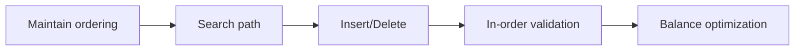

## Overview

A binary search tree (BST) is a data structure that adds a sorting constraint on top of a binary tree. It allows search, insertion, and deletion to proceed along the height of the tree rather than scanning every node.

The core property of a BST is:

```text
左子树所有值 < 当前节点值 < 右子树所有值
```

If the tree stays balanced, the complexity of operations is close to O(log n); if it degenerates into a linked list, the complexity becomes O(n).

> Prerequisites
> - **Binary tree**: each node has at most a left and a right child
> - **Ordering**: the left subtree is smaller than the root, the right subtree is larger than the root
> - **Recursive traversal**: search, insertion, and validation all rely on recursing into subtrees

---

## Problem Definition

A BST is suitable for maintaining a set of comparable data and supporting dynamic search and updates.

Example:

```text
      8
     / \
    3   10
   / \    \
  1   6    14
```

Path for searching `6`:

```text
6 < 8  -> 去左边
6 > 3  -> 去右边
6 = 6  -> 找到
```

BST problems usually revolve around four things:

| Operation | Core judgment |
| --- | --- |
| Search | Compare the target value with the current node's value |
| Insert | Find a suitable empty position |
| Delete | The BST property must still hold after deletion |
| Validate | Every node must fall within a valid range |

---

## Core Principle: Step-by-Step Diagram

### Search Path

Each comparison eliminates half of the subtrees in one direction:

```text
       8
      / \
   < 8   > 8
```

This is why a BST is better suited for searching than an ordinary binary tree.

### In-Order Traversal

The in-order traversal of a BST is always in ascending order:

```text
左 -> 根 -> 右
1, 3, 6, 8, 10, 14
```

This property is often used to validate a BST, find the K-th smallest element, or convert a BST into a sorted array.

### Deleting a Node

Deletion is the most complex because the structure must remain valid:

| Case | Handling |
| --- | --- |
| Leaf node | Delete it directly |
| Only one child | Replace the current node with its child |
| Two children | Replace it with the smallest node in the right subtree or the largest node in the left subtree |

When there are two children, we usually find the "in-order successor": the smallest node in the right subtree.

---

## Detailed Algorithm Steps

Inserting a value `x`:

1. If the current node is empty, create a new node;
2. If `x < node.value`, insert into the left subtree;
3. If `x > node.value`, insert into the right subtree;
4. If it equals the current value, decide based on business needs whether to ignore it, count it, or place it on one side;
5. Return the current node to keep the parent connection.

When validating a BST, you cannot just compare the current node with its left and right children. You must maintain a valid range:

```text
min < node.value < max
```

When entering the left subtree, the upper bound becomes the current value; when entering the right subtree, the lower bound becomes the current value.

---

## TypeScript Implementation

```typescript
class TreeNode {
  constructor(
    public value: number,
    public left: TreeNode | null = null,
    public right: TreeNode | null = null,
  ) {}
}
```

### 1. Search

```typescript
function searchBST(root: TreeNode | null, target: number): TreeNode | null {
  let current = root;

  while (current !== null) {
    if (target === current.value) return current;
    current = target < current.value ? current.left : current.right;
  }

  return null;
}
```

### 2. Insert

```typescript
function insertIntoBST(root: TreeNode | null, value: number): TreeNode {
  if (root === null) return new TreeNode(value);

  if (value < root.value) {
    root.left = insertIntoBST(root.left, value);
  } else if (value > root.value) {
    root.right = insertIntoBST(root.right, value);
  }

  return root;
}
```

### 3. Validate

```typescript
function isValidBST(root: TreeNode | null): boolean {
  function validate(node: TreeNode | null, min: number, max: number): boolean {
    if (node === null) return true;
    if (node.value <= min || node.value >= max) return false;

    return validate(node.left, min, node.value) && validate(node.right, node.value, max);
  }

  return validate(root, Number.NEGATIVE_INFINITY, Number.POSITIVE_INFINITY);
}
```

---

## Engineering Optimization: Balance Determines Performance

The ideal shape of a BST is close to balanced:

```text
      4
    /   \
   2     6
  / \   / \
 1   3 5   7
```

In this case the height is O(log n). But if you insert in ascending order:

```text
1 -> 2 -> 3 -> 4 -> 5
```

The tree degenerates into a linked list, and search becomes O(n).

In engineering, if you need stable ordered-set capabilities, you usually use balanced trees, skip lists, B-trees, or database indexes rather than a bare BST.

---

## Applications and Limitations

### Typical Applications

- Ordered sets and ordered maps;
- Finding the K-th smallest element;
- Range queries;
- The foundational idea behind database and file system indexes;
- Building a balanced tree from a sorted array.

### Limitations

- Performance degrades when unbalanced;
- Deletion logic is more complex than search and insertion;
- The duplicate-value strategy needs to be defined in advance;
- The JavaScript standard library has no built-in balanced tree structure.

---

## Summary



- A BST adds the left-smaller-right-larger sorting constraint on top of a binary tree.
- In-order traversal of a BST yields an ascending sequence.
- The complexity of search, insertion, and deletion depends on the height of the tree.
- Validating a BST requires using upper and lower bounds, not just looking at direct children.
- In engineering, pay attention to balance, otherwise a BST will degenerate into a linked list.