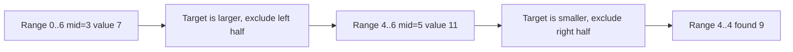
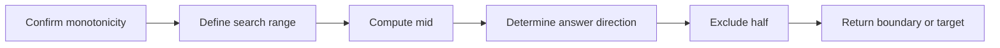

## Overview

**Binary Search** is an algorithm that uses monotonicity to eliminate half of the candidate space each time. It is not only used to "find a value in a sorted array," but also commonly used to "find the first position that satisfies a condition" or "binary search over the answer range."

> Prerequisites
> - **Sorted array**: the most common carrier for binary search
> - **Monotonic predicate**: a condition that changes from false to true, or from true to false, only once
> - **Interval invariant**: the answer must remain within the candidate interval after each loop iteration

---

## Problem Definition

Given a sorted or monotonic search space, quickly locate a target value, boundary position, or optimal answer.

| Element | Description |
|------|------|
| Input | A sorted array, target value, or a monotonic predicate function |
| Output | Target index, insertion position, left/right boundary, or minimum feasible answer |
| Core condition | The search space can be split in two and one half safely eliminated |
| Typical applications | Lookup, lower_bound, rotated array, binary search on answer |

---

## Core Principle: Step-by-Step Illustration

Taking the array `[1, 3, 5, 7, 9, 11, 13]` and searching for `9` as an example:



The key to binary search is not how to write `mid`, but being able to prove after each comparison that the eliminated half definitely does not contain the answer.

### Boundary Search

Many problems are not about finding any occurrence of a target, but about finding a boundary:

```text
nums:   1  2  2  2  3
index:  0  1  2  3  4
Left boundary:    ^
Right boundary:          ^
```

Such problems are better transformed into "find the first position of `>= target`" and "find the first position of `> target`."

---

## Detailed Algorithm Steps

```
Algorithm: LowerBound(nums, target)
Input: ascending array nums, target target
Output: the first position >= target

1. left ← 0, right ← nums.length
2. while left < right:
3.     mid ← left + floor((right - left) / 2)
4.     if nums[mid] >= target:
5.         right ← mid
6.     else:
7.         left ← mid + 1
8. return left
```

**Complexity analysis**:

| Operation | Time complexity | Space complexity | Description |
|------|------|------|------|
| Standard lookup | O(log n) | O(1) | Eliminate half each round |
| Left boundary / right boundary | O(log n) | O(1) | Number of iterations unchanged |
| Rotated array search | O(log n) | O(1) | At least half is sorted each round |
| Binary search on answer | O(log R × check) | O(1) or depends on check | R is the answer range |

---

## TypeScript Implementation

### 1. Standard Lookup

```typescript
function binarySearch(nums: number[], target: number): number {
  let left = 0;
  let right = nums.length - 1;

  while (left <= right) {
    const mid = left + Math.floor((right - left) / 2);
    if (nums[mid] === target) return mid;
    if (nums[mid] < target) left = mid + 1;
    else right = mid - 1;
  }

  return -1;
}
```

### 2. Left Boundary

```typescript
function lowerBound(nums: number[], target: number): number {
  let left = 0;
  let right = nums.length;

  while (left < right) {
    const mid = left + Math.floor((right - left) / 2);
    if (nums[mid] >= target) right = mid;
    else left = mid + 1;
  }

  return left;
}

function searchLeft(nums: number[], target: number): number {
  const index = lowerBound(nums, target);
  return index < nums.length && nums[index] === target ? index : -1;
}
```

### 3. Right Boundary

```typescript
function upperBound(nums: number[], target: number): number {
  let left = 0;
  let right = nums.length;

  while (left < right) {
    const mid = left + Math.floor((right - left) / 2);
    if (nums[mid] > target) right = mid;
    else left = mid + 1;
  }

  return left;
}

function searchRight(nums: number[], target: number): number {
  const index = upperBound(nums, target) - 1;
  return index >= 0 && nums[index] === target ? index : -1;
}
```

### 4. Search in Rotated Sorted Array

```typescript
function searchRotated(nums: number[], target: number): number {
  let left = 0;
  let right = nums.length - 1;

  while (left <= right) {
    const mid = left + Math.floor((right - left) / 2);
    if (nums[mid] === target) return mid;

    if (nums[left] <= nums[mid]) {
      if (nums[left] <= target && target < nums[mid]) right = mid - 1;
      else left = mid + 1;
    } else {
      if (nums[mid] < target && target <= nums[right]) left = mid + 1;
      else right = mid - 1;
    }
  }

  return -1;
}
```

### 5. Find Peak Element

```typescript
function findPeakElement(nums: number[]): number {
  let left = 0;
  let right = nums.length - 1;

  while (left < right) {
    const mid = left + Math.floor((right - left) / 2);
    if (nums[mid] > nums[mid + 1]) right = mid;
    else left = mid + 1;
  }

  return left;
}
```

---

## Engineering Optimization: Rewriting Problems as Monotonic Predicates

The most stable way to write binary search is to abstract out `check(mid)`:

| Problem | Monotonic predicate |
|------|------|
| Find insertion position | `nums[mid] >= target` |
| Minimum feasible capacity | Whether `capacity` can complete the task |
| First bad version | `isBadVersion(mid)` |
| Peak problem | `nums[mid] > nums[mid + 1]` determines peak direction |

In production code, it is recommended to first clarify the meaning of the interval, then write the loop condition. For half-open intervals `[left, right)`, the loop is usually `while (left < right)`; for closed intervals `[left, right]`, the loop is usually `while (left <= right)`.

---

## Applications and Limitations

### Typical Applications

- Sorted array lookup, insertion position, boundary location
- Log timestamp location, version range location
- Implicitly monotonic problems such as peaks and rotated arrays
- Binary search on answer for minimizing the maximum or maximizing the minimum

### Limitations

| Limitation | Description |
|------|------|
| Depends on monotonicity | Cannot directly binary search when unordered and direction is undecidable |
| Boundaries are error-prone | Unclear interval definitions can cause infinite loops or missed answers |
| Duplicate elements add complexity | Rotated arrays with many duplicates may degrade |

---

## Summary



**Key takeaways**:

1. The essence of binary search is using monotonicity to eliminate half of the candidate space.
2. Standard lookup can use closed intervals, while boundary search is better suited to half-open intervals.
3. `lowerBound` and `upperBound` can cover most boundary problems.
4. Writing the interval invariant before the code can significantly reduce boundary errors.