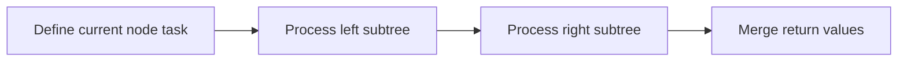

## Overview

A binary tree is a tree structure in which each node has at most two child nodes. It can represent hierarchical relationships and also serves as the foundation for structures such as search trees, heaps, expression trees, and syntax trees.

The most important thing when learning binary trees is to establish two perspectives:

- Recursive perspective: a tree consists of a root node, a left subtree, and a right subtree;
- Traversal perspective: visit each node in some order and maintain the answer during the visit.

Many seemingly different binary tree problems ultimately come back to "what information does the current node need to obtain from its left and right subtrees."

> Prerequisites
> - **Recursion**: binary tree problems are usually broken down into left and right subtrees
> - **Traversal order**: preorder, inorder, and postorder correspond to different processing timings
> - **Null nodes**: boundary conditions are usually defined starting from `null`

---

## Problem Definition

A binary tree node contains three parts:

```text
value
left  -> left subtree
right -> right subtree
```

Example:

```text
      1
     / \
    2   3
   / \
  4   5
```

The root node of this tree is `1`, node `2` has two child nodes, and nodes `4` and `5` are leaf nodes.

Common goals of binary tree problems:

| Type | Example | Core question |
| --- | --- | --- |
| Traversal | preorder, inorder, postorder, level order | In what order are nodes visited |
| Height/depth | maximum depth, minimum depth | How subtrees return information upward |
| Structural judgment | symmetric, same, balanced | Whether the relationship between left and right subtrees satisfies a condition |
| Path problems | diameter, path sum | How a path passes through the current node |
| Construction problems | build tree from traversal sequences | How the root node splits the left and right subtrees |

---

## Core Principle: Step-by-Step Illustration

### Recursive Decomposition

Binary trees are naturally suited to recursion. For any node `root`, the problem can be broken down into:

```text
solve(root) = combine(root.value, solve(root.left), solve(root.right))
```

For example, maximum depth:

```text
maxDepth(root) = 1 + max(maxDepth(left), maxDepth(right))
```

### Traversal Order

For the same tree, different traversal orders produce different sequences:

```text
      A
     / \
    B   C
```

| Traversal | Order | Result |
| --- | --- | --- |
| Preorder | root -> left -> right | A B C |
| Inorder | left -> root -> right | B A C |
| Postorder | left -> right -> root | B C A |
| Level order | top to bottom | A B C |

### The Role of the Current Node

When writing binary tree recursion, first ask three questions:

1. What does a null node return?
2. What does the current node need to get from the left and right subtrees?
3. What does the current node need to return to its parent node?

Once these three answers are determined, the code is usually very short.

---

## Detailed Algorithm Steps

Take the "binary tree diameter" as an example. The diameter is the number of edges in the longest path between any two nodes.

Core idea:

1. For each node, calculate the height of the left subtree;
2. Calculate the height of the right subtree;
3. The longest path passing through the current node is `leftHeight + rightHeight`;
4. Use a global variable to update the maximum value;
5. The current node returns its own height to its parent node.

There is a common distinction here:

- What is returned to the parent node is the "single-side height";
- What is used to update the answer is the "sum of both left and right sides."

Many tree DPs have a similar structure: the return value serves the parent node, while the global answer records the optimal result that the current node can form.

---

## TypeScript Implementation

### 1. Node Definition

```typescript
class TreeNode<T> {
  constructor(
    public value: T,
    public left: TreeNode<T> | null = null,
    public right: TreeNode<T> | null = null,
  ) {}
}
```

### 2. Maximum Depth

```typescript
function maxDepth<T>(root: TreeNode<T> | null): number {
  if (root === null) return 0;

  return 1 + Math.max(maxDepth(root.left), maxDepth(root.right));
}
```

### 3. Check Symmetric Binary Tree

```typescript
function isSymmetric<T>(root: TreeNode<T> | null): boolean {
  function isMirror(left: TreeNode<T> | null, right: TreeNode<T> | null): boolean {
    if (left === null || right === null) return left === right;

    return (
      left.value === right.value &&
      isMirror(left.left, right.right) &&
      isMirror(left.right, right.left)
    );
  }

  return root === null || isMirror(root.left, root.right);
}
```

### 4. Binary Tree Diameter

```typescript
function diameterOfBinaryTree<T>(root: TreeNode<T> | null): number {
  let diameter = 0;

  function height(node: TreeNode<T> | null): number {
    if (node === null) return 0;

    const left = height(node.left);
    const right = height(node.right);
    diameter = Math.max(diameter, left + right);

    return 1 + Math.max(left, right);
  }

  height(root);
  return diameter;
}
```

---

## Engineering Optimization: Serialization and Boundary Representation

If a binary tree needs to be stored in text, transmitted over a network, or kept in a local cache, it must be serialized. The key is to preserve null nodes; otherwise, the structure will be lost.

```typescript
function serialize<T>(root: TreeNode<T> | null): Array<T | null> {
  const result: Array<T | null> = [];

  function dfs(node: TreeNode<T> | null): void {
    if (node === null) {
      result.push(null);
      return;
    }

    result.push(node.value);
    dfs(node.left);
    dfs(node.right);
  }

  dfs(root);
  return result;
}
```

Null node markers are part of the structural information. Without them, many trees of different shapes may produce the same traversal sequence.

---

## Applications and Limitations

### Typical Applications

- Hierarchical data and organizational structures;
- Expression trees, ASTs, and DOM-like tree structures;
- Binary search trees, heaps, and balanced trees;
- Coding trees and decision trees;
- Search, path, construction, and serialization problems.

### Limitations

- An ordinary binary tree has no ordering property, so lookup is not necessarily fast;
- If the tree is too deep, recursion may cause a stack overflow;
- Pointer structures are harder to access in a cache-friendly way than arrays;
- When constructing and serializing, the representation of null nodes must be made explicit.

---

## Summary



- The core model of a binary tree is the root node, left subtree, and right subtree.
- Recursion is the first approach to solving binary tree problems.
- Traversal order determines "when the current node is processed."
- Tree-shaped problems must distinguish between the information returned to the parent node and the global answer.
- Null nodes are boundaries and also structural information that cannot be ignored during serialization.