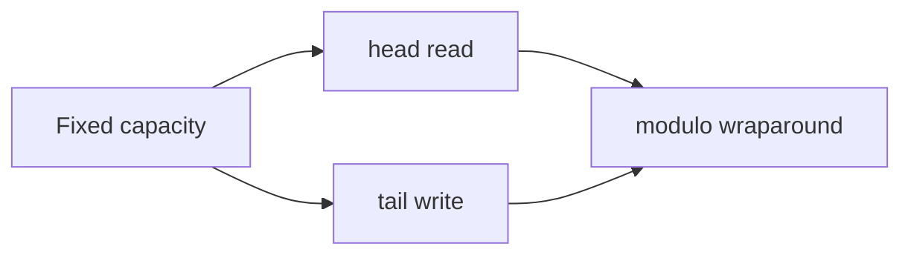

## Overview

A circular array is not a new physical storage structure, but rather a way of "connecting the ends of an ordinary array together." It uses modulo arithmetic to make the index wrap back to the beginning at the array boundary, thereby simulating a ring.

This structure is especially suitable for scenarios with fixed capacity and continuous reads and writes, such as circular queues, log buffers, audio and video frame buffers, and the most recent N records.

An ordinary array stops once its tail reaches the capacity limit, whereas a circular array maps the next write back to a previously freed position.

> Prerequisites
> - **Modulo arithmetic**: indices wrap around via `% capacity`
> - **Queue semantics**: head and tail pointers handle reads and writes respectively
> - **Capacity design**: empty and full states need to be distinguished

---

## Problem Definition

Suppose we have an array with a fixed length of 5:

```text
index: 0 1 2 3 4
value: _ _ _ _ _
```

We want it to support:

- Writing new elements from the tail;
- Reading old elements from the head;
- Not moving elements when space runs out;
- Automatically returning to 0 when the index goes past the tail.

This is the problem that a circular array solves: using a fixed array to implement logically circular space.

---

## Core Principle: Step-by-Step Diagram

A circular array usually maintains three states:

```text
capacity: 固定容量
head:     下一个读取位置
tail:     下一个写入位置
size:     当前元素数量
```

### Writing Elements

When writing, place the element at `tail`, then move the tail pointer:

```text
tail = (tail + 1) % capacity
```

When `tail` reaches the end of the array, the next step returns to 0:

```text
index: 0 1 2 3 4
value: C D _ A B
head:        ^
tail:     ^
```

This diagram shows that the logical order is `A -> B -> C -> D`, but the physical storage is split into two segments.

### Reading Elements

When reading, take the element from `head`, then move the head pointer:

```text
head = (head + 1) % capacity
```

As long as all pointer movements use the same modulo rule, the array can be reused cyclically and stably.

---

## Detailed Algorithm Steps

When implementing a circular queue, the key point is distinguishing "empty" from "full." There are two common approaches:

| Approach | Check empty | Check full | Characteristics |
| --- | --- | --- | --- |
| Maintain an extra `size` | `size === 0` | `size === capacity` | Intuitive semantics |
| Reserve one empty slot | `head === tail` | `(tail + 1) % capacity === head` | Maintains one fewer field, but wastes one position |

This article adopts the `size` approach because it is better suited to teaching and TypeScript encapsulation.

Enqueue steps:

1. If the queue is full, reject the write;
2. Write the element to `items[tail]`;
3. Move `tail` forward by one position and apply modulo;
4. Increment `size` by one.

Dequeue steps:

1. If the queue is empty, return `undefined`;
2. Read `items[head]`;
3. Clear the current position;
4. Move `head` forward by one position and apply modulo;
5. Decrement `size` by one.

---

## TypeScript Implementation

```typescript
class CircularQueue<T> {
  private readonly items: Array<T | undefined>;
  private head = 0;
  private tail = 0;
  private count = 0;

  constructor(private readonly capacity: number) {
    if (capacity <= 0) {
      throw new Error('capacity must be positive');
    }

    this.items = new Array<T | undefined>(capacity);
  }

  get size(): number {
    return this.count;
  }

  isEmpty(): boolean {
    return this.count === 0;
  }

  isFull(): boolean {
    return this.count === this.capacity;
  }

  enqueue(value: T): boolean {
    if (this.isFull()) return false;

    this.items[this.tail] = value;
    this.tail = (this.tail + 1) % this.capacity;
    this.count++;
    return true;
  }

  dequeue(): T | undefined {
    if (this.isEmpty()) return undefined;

    const value = this.items[this.head];
    this.items[this.head] = undefined;
    this.head = (this.head + 1) % this.capacity;
    this.count--;
    return value;
  }

  peek(): T | undefined {
    return this.items[this.head];
  }
}

const queue = new CircularQueue<number>(3);
queue.enqueue(1);
queue.enqueue(2);
queue.enqueue(3);
console.log(queue.enqueue(4)); // false
console.log(queue.dequeue()); // 1
queue.enqueue(4);
```

In this implementation, the array capacity never changes, and all positions can be reused.

---

## Engineering Optimization: Ring Buffer

In logging or monitoring scenarios, sometimes we do not want to reject writes after the queue is full, but instead overwrite the oldest data. This is a ring buffer.

```typescript
class RingBuffer<T> {
  private readonly items: Array<T | undefined>;
  private next = 0;
  private count = 0;

  constructor(private readonly capacity: number) {
    this.items = new Array<T | undefined>(capacity);
  }

  push(value: T): void {
    this.items[this.next] = value;
    this.next = (this.next + 1) % this.capacity;
    this.count = Math.min(this.count + 1, this.capacity);
  }

  values(): T[] {
    const result: T[] = [];
    const start = this.count === this.capacity ? this.next : 0;

    for (let i = 0; i < this.count; i++) {
      const index = (start + i) % this.capacity;
      result.push(this.items[index] as T);
    }

    return result;
  }
}
```

A queue emphasizes "not losing data," while a buffer emphasizes "keeping the latest data." Both use a circular array, but their business semantics differ.

---

## Applications and Limitations

### Typical Applications

- Fixed-capacity task queues;
- The most recent N logs;
- Audio and video stream buffering;
- Sliding window statistics;
- Event queues in games or embedded systems.

### Limitations

- Fixed capacity, not suitable for data that grows without an upper bound;
- The full-policy must be made explicit: reject, wait, expand, or overwrite;
- Modulo arithmetic makes index debugging more convoluted than with ordinary arrays;
- Multithreaded environments require additional synchronization; array logic alone does not guarantee concurrency safety.

---

## Summary



- A circular array uses modulo to turn an ordinary array into a logical closed loop.
- `head`, `tail`, and `size` are the core states for implementing a circular queue.
- The difference between a queue and a buffer lies in the full-policy.
- It is suitable for scenarios with fixed capacity, high-frequency reads and writes, and avoidance of element shifting.