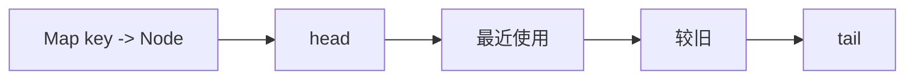
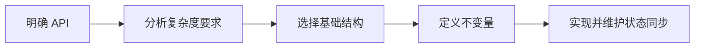

## Overview

**Data structure design problems** require combining existing data structures to implement a new abstraction under specified operations and complexity constraints. The focus is not on writing a single function, but on maintaining the object's internal state so that every method satisfies its time and space requirements.

> Prerequisites
> - **Stacks, hash tables, linked lists**: the foundational building blocks for high-frequency design problems
> - **Complexity constraints**: each API must be analyzed individually
> - **Invariants**: the object's internal state must remain consistent after every operation

---

## Problem Definition

Given a set of APIs and complexity requirements, design the class's internal data structures so that all operations execute correctly and efficiently.

| Element | Description |
|------|------|
| Input | Constructor parameters and a sequence of method calls |
| Output | Each method's return value and the object's state changes |
| Core constraint | Operation complexities such as `get`, `put`, `push`, `pop` |
| Typical problems | Min stack, hash set, LRU cache, LFU cache |

---

## Core Principle: Step-by-Step Illustration

Taking the LRU cache as an example, the hash table handles O(1) node lookup, while the doubly linked list handles O(1) movement and eviction:



On each `get` or update of an existing key, move the node to the head of the list; when capacity is exceeded, remove the least recently used node from the tail.

---

## Detailed Algorithm Steps

```
算法：LRUCache.put(key, value)
输入：键和值
输出：无

1. 如果 key 已存在：
2.     更新节点值
3.     将节点移动到链表头部
4.     返回
5. 创建新节点并加入 Map
6. 将新节点插入链表头部
7. 如果容量超限：
8.     删除链表尾部节点
9.     从 Map 中删除对应 key
```

**Complexity analysis**:

| Structure | Operation | Time complexity | Space complexity |
|------|------|------|------|
| Min stack | `push/pop/top/getMin` | O(1) | O(n) |
| Hash set | `add/remove/contains` | Average O(1) | O(n) |
| LRU cache | `get/put` | O(1) | O(capacity) |
| LFU cache | `get/put` | O(1) amortized | O(capacity) |

---
## TypeScript Implementation

### 1. Min Stack

```typescript
class MinStack {
  private stack: number[] = [];
  private minStack: number[] = [];

  push(value: number): void {
    this.stack.push(value);
    const min = this.minStack.length === 0
      ? value
      : Math.min(value, this.minStack[this.minStack.length - 1]);
    this.minStack.push(min);
  }

  pop(): void {
    this.stack.pop();
    this.minStack.pop();
  }

  top(): number {
    return this.stack[this.stack.length - 1];
  }

  getMin(): number {
    return this.minStack[this.minStack.length - 1];
  }
}
```

### 2. Hash Set

```typescript
class MyHashSet {
  private readonly size = 769;
  private buckets: number[][] = Array.from({ length: 769 }, () => []);

  private hash(key: number): number {
    return key % this.size;
  }

  add(key: number): void {
    const bucket = this.buckets[this.hash(key)];
    if (!bucket.includes(key)) bucket.push(key);
  }

  remove(key: number): void {
    const bucket = this.buckets[this.hash(key)];
    const index = bucket.indexOf(key);
    if (index !== -1) bucket.splice(index, 1);
  }

  contains(key: number): boolean {
    return this.buckets[this.hash(key)].includes(key);
  }
}
```

### 3. LRU Node

```typescript
class DLinkedNode {
  key: number;
  value: number;
  prev: DLinkedNode | null = null;
  next: DLinkedNode | null = null;

  constructor(key: number, value: number) {
    this.key = key;
    this.value = value;
  }
}
```

### 4. LRU Cache

```typescript
class LRUCache {
  private cache = new Map<number, DLinkedNode>();
  private head = new DLinkedNode(0, 0);
  private tail = new DLinkedNode(0, 0);

  constructor(private capacity: number) {
    this.head.next = this.tail;
    this.tail.prev = this.head;
  }

  get(key: number): number {
    const node = this.cache.get(key);
    if (!node) return -1;

    this.moveToHead(node);
    return node.value;
  }

  put(key: number, value: number): void {
    const existing = this.cache.get(key);
    if (existing) {
      existing.value = value;
      this.moveToHead(existing);
      return;
    }

    const node = new DLinkedNode(key, value);
    this.cache.set(key, node);
    this.addToHead(node);

    if (this.cache.size > this.capacity) {
      const removed = this.removeTail();
      this.cache.delete(removed.key);
    }
  }

  private addToHead(node: DLinkedNode): void {
    node.prev = this.head;
    node.next = this.head.next;
    this.head.next!.prev = node;
    this.head.next = node;
  }

  private removeNode(node: DLinkedNode): void {
    node.prev!.next = node.next;
    node.next!.prev = node.prev;
  }

  private moveToHead(node: DLinkedNode): void {
    this.removeNode(node);
    this.addToHead(node);
  }

  private removeTail(): DLinkedNode {
    const node = this.tail.prev!;
    this.removeNode(node);
    return node;
  }
}
```

### 5. Simplified LFU Cache Implementation

```typescript
interface LFUNode {
  key: number;
  value: number;
  freq: number;
}

class LFUCache {
  private minFreq = 0;
  private keyToNode = new Map<number, LFUNode>();
  private freqToKeys = new Map<number, Set<number>>();

  constructor(private capacity: number) {}

  get(key: number): number {
    const node = this.keyToNode.get(key);
    if (!node) return -1;

    this.increaseFreq(key);
    return node.value;
  }

  put(key: number, value: number): void {
    if (this.capacity === 0) return;

    const node = this.keyToNode.get(key);
    if (node) {
      node.value = value;
      this.increaseFreq(key);
      return;
    }

    if (this.keyToNode.size >= this.capacity) {
      const evictKey = this.freqToKeys.get(this.minFreq)!.values().next().value;
      this.freqToKeys.get(this.minFreq)!.delete(evictKey);
      this.keyToNode.delete(evictKey);
    }

    this.keyToNode.set(key, { key, value, freq: 1 });
    if (!this.freqToKeys.has(1)) this.freqToKeys.set(1, new Set());
    this.freqToKeys.get(1)!.add(key);
    this.minFreq = 1;
  }

  private increaseFreq(key: number): void {
    const node = this.keyToNode.get(key)!;
    const oldKeys = this.freqToKeys.get(node.freq)!;
    oldKeys.delete(key);

    if (oldKeys.size === 0 && node.freq === this.minFreq) {
      this.minFreq++;
    }

    node.freq++;
    if (!this.freqToKeys.has(node.freq)) this.freqToKeys.set(node.freq, new Set());
    this.freqToKeys.get(node.freq)!.add(key);
  }
}
```

---

## Engineering Optimization: Managing State with Invariants

| Design Problem | Core Invariant | Auxiliary Structure |
|------|------|------|
| Min Stack | `minStack[i]` stores the minimum of the first i levels | Auxiliary stack |
| Hash Set | No duplicate keys within the same bucket | Bucket array |
| LRU | Head of the linked list is most recent, tail is oldest | Map + doubly linked list |
| LFU | `minFreq` always points to the minimum access frequency | keyMap + freqMap |

When solving design problems, first list the APIs, then list the invariants that must be maintained after each API—this is more reliable than writing code directly.

---

## Applications and Limitations

### Typical Applications

- Cache eviction policies: LRU, LFU
- Enhanced stack/queue structures: min stack, monotonic queue
- Hash structures: sets, maps, counters
- Business object state machines and resource pool management

### Limitations

| Limitation | Description |
|------|------|
| High state coupling | Multiple structures must be updated in sync |
| Many edge cases | Empty capacity, duplicate keys, and deleting the tail node must all remain consistent |
| High implementation complexity | O(1) requirements typically require combining multiple structures |

---
## Summary



**Key points**:

1. The core of a design problem is to combine existing data structures to create new operation semantics.
2. Each method must individually satisfy the complexity requirements.
3. A Map handles fast lookup, while a linked list handles fast reordering—a common combination for cache problems.
4. Internal invariants matter more than code templates.