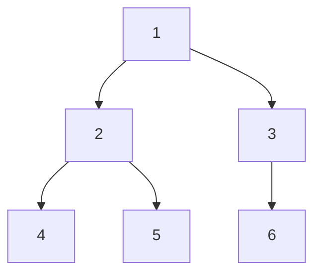

## Overview

**Depth-First Search (DFS)** is a traversal method that goes as deep as possible along one path, then backtracks to a branching point to continue searching. It can use recursion to implicitly maintain the call stack, or an explicit stack for an iterative implementation.

> Prerequisites
> - **Stack**: DFS path state is last-in, first-out
> - **Recursion**: naturally expresses deep exploration in trees, graphs, and grids
> - **visited marking**: used in graphs and grids to avoid revisiting

---

## Problem Definition

Given a tree, graph, or grid structure, explore all reachable states from a starting point, and compute results or determine whether a target exists during the visit process.

| Element | Description |
|------|------|
| Input | Starting point, adjacency relations, grid or tree nodes |
| Output | Traversal order, connected regions, path results, or boolean determination |
| Core state | Current node, path, visited set, recursive return value |
| Applicable scenarios | Connectivity, path enumeration, tree recursion, backtracking search |

---

## Core Principle: Step-by-Step Diagram

DFS prioritizes going deep into one branch until it cannot continue, then returns to the previous branching point:



Starting from node `1`, the preorder DFS visit order might be:

```text
1 → 2 → 4 → rollback → 5 → rollback → 3 → 6
```

### Recursive Perspective

Each level of recursion is responsible for only one node: process the current node, recursively process neighbors, and return subproblem results when necessary.

### Iterative Perspective

Explicitly maintain a stack, pop the top node each time, and push unvisited neighbors onto the stack.

---

## Detailed Algorithm Steps

```
Algorithm: DFS(node)
Input: current node node
Output: traversal or computation result

1. If node is empty or already visited, return
2. Mark node as visited
3. Process the current node
4. Traverse each neighbor next of node:
5.     DFS(next)
6. Merge and return based on the sub-results
```

**Complexity Analysis**:

| Scenario | Time Complexity | Space Complexity | Description |
|------|------|------|------|
| Tree traversal | O(n) | O(h) | h is tree height |
| Graph traversal | O(V + E) | O(V) | visited and recursion stack |
| Grid search | O(mn) | O(mn) | each cell is visited at most once |
| Backtracking search | Exponential | O(depth) | depends on branching factor and depth |

---

## TypeScript Implementation

### 1. Graph DFS Template

```typescript
function dfsGraph(graph: Map<number, number[]>, start: number): number[] {
  const visited = new Set<number>();
  const result: number[] = [];

  function dfs(node: number): void {
    if (visited.has(node)) return;
    visited.add(node);
    result.push(node);

    for (const next of graph.get(node) ?? []) {
      dfs(next);
    }
  }

  dfs(start);
  return result;
}
```

### 2. Iterative DFS

```typescript
function dfsIterative(graph: Map<number, number[]>, start: number): number[] {
  const stack = [start];
  const visited = new Set<number>([start]);
  const result: number[] = [];

  while (stack.length > 0) {
    const node = stack.pop()!;
    result.push(node);

    for (const next of graph.get(node) ?? []) {
      if (visited.has(next)) continue;
      visited.add(next);
      stack.push(next);
    }
  }

  return result;
}
```

### 3. Binary Tree Path Sum

```typescript
class TreeNode {
  val: number;
  left: TreeNode | null;
  right: TreeNode | null;

  constructor(val: number, left: TreeNode | null = null, right: TreeNode | null = null) {
    this.val = val;
    this.left = left;
    this.right = right;
  }
}

function hasPathSum(root: TreeNode | null, targetSum: number): boolean {
  if (root === null) return false;
  if (root.left === null && root.right === null) return root.val === targetSum;

  return (
    hasPathSum(root.left, targetSum - root.val) ||
    hasPathSum(root.right, targetSum - root.val)
  );
}
```

### 4. Maximum Area of an Island

```typescript
function maxAreaOfIsland(grid: number[][]): number {
  const m = grid.length;
  const n = grid[0].length;
  const dirs = [[1, 0], [-1, 0], [0, 1], [0, -1]];

  function dfs(row: number, col: number): number {
    if (row < 0 || row >= m || col < 0 || col >= n || grid[row][col] !== 1) return 0;

    grid[row][col] = 0;
    let area = 1;
    for (const [dr, dc] of dirs) {
      area += dfs(row + dr, col + dc);
    }
    return area;
  }

  let maxArea = 0;
  for (let i = 0; i < m; i++) {
    for (let j = 0; j < n; j++) {
      if (grid[i][j] === 1) {
        maxArea = Math.max(maxArea, dfs(i, j));
      }
    }
  }

  return maxArea;
}
```

### 5. Path Enumeration

```typescript
function pathSum(root: TreeNode | null, targetSum: number): number[][] {
  const result: number[][] = [];
  const path: number[] = [];

  function dfs(node: TreeNode | null, remaining: number): void {
    if (node === null) return;

    path.push(node.val);
    if (node.left === null && node.right === null && node.val === remaining) {
      result.push([...path]);
    }

    dfs(node.left, remaining - node.val);
    dfs(node.right, remaining - node.val);
    path.pop();
  }

  dfs(root, targetSum);
  return result;
}
```

---

## Engineering Optimization: Recursion or Explicit Stack

| Approach | Advantages | Cost |
|------|------|------|
| Recursive DFS | Natural expression, short code | Stack overflow possible if depth is too large |
| Iterative DFS | Controllable, does not depend on the call stack | Requires manually maintaining the stack and state |
| In-place marking | Saves visited space | Modifies the input data |
| visited set | Does not destroy the input | Extra O(n) space |

In tree structures, recursion is usually the clearest; in graphs and large grids, if depth is uncontrollable, an explicit stack is more reliable.

---

## Applications and Limitations

### Typical Applications

- Tree traversal, depth, height, path computation
- Graph connectivity, cycle detection, topology-related determination
- Grid islands, mazes, region filling
- Decision tree search in backtracking problems

### Limitations

| Limitation | Description |
|------|------|
| Does not guarantee shortest path | For unweighted shortest paths, BFS should be preferred |
| Recursion depth risk | Chain-like structures may cause the call stack to become too deep |
| State is easy to confuse | Path-type problems require attention to backtracking and copying |

---

## Summary


**Key Points**:

1. DFS = go deep along one path to the end, then backtrack to explore other branches.
2. Tree problems commonly use recursion, while graph and grid problems must handle visited.
3. Path enumeration should add to the path on entry and undo on exit.
4. When the minimum number of steps is needed, prefer BFS over DFS.

--- END CONTENT ---