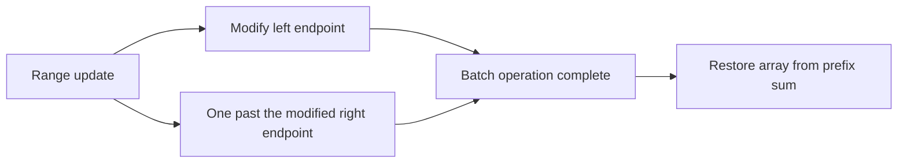
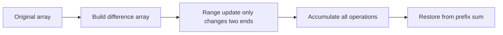

## Overview

The **Difference Array** is the inverse operation of prefix sums. It transforms the operation of "adding the same value to all elements within a range" into modifying only the two endpoints of the range, thereby reducing a single range update from O(n) to O(1).

> Prerequisites
> - **Prefix sums**: The difference array is ultimately restored to the original array via prefix sums
> - **Range endpoints**: Focus on handling the boundaries of `right + 1`
> - **Offline processing**: Suitable for batch modifications first, then a unified query of results at the end

---

## Problem Definition

Given an initial array and multiple range increment/decrement operations, find the final array after all operations are completed.

| Element | Description |
|------|------|
| Input | Initial array, several `[left, right, delta]` operations |
| Output | The final array after all range modifications |
| Update formula | `diff[left] += delta`, `diff[right + 1] -= delta` |
| Restoration formula | `nums[i] = nums[i - 1] + diff[i]` |

---

## Core Principle: Step-by-Step Illustration

The difference array of the original array `[1, 2, 3, 4, 5]` is:

```text
nums:  1  2  3  4  5
diff:  1  1  1  1  1
```

Add `2` to the range `[1, 3]`:

```text
diff[1] += 2   Raise the entire suffix starting from index 1
diff[4] -= 2   Cancel the effect starting from index 4

diff: 1  3  1  1 -1
Prefix restoration: 1  4  5  6  5
```



---

## Detailed Algorithm Steps

```
Algorithm: DifferenceArray(nums, updates)
Input: original array nums, multiple range updates updates
Output: final array

1. Build diff, where diff[0] = nums[0]
2. for i from 1 to n - 1:
3.     diff[i] = nums[i] - nums[i - 1]
4. For each operation [left, right, delta]:
5.     diff[left] += delta
6.     if right + 1 < n: diff[right + 1] -= delta
7. Compute the prefix sum of diff to reconstruct the final array
```

**Complexity analysis**:

| Operation | Brute force | Difference | Description |
|------|------|------|------|
| Single range update | O(n) | O(1) | Only modify two endpoints |
| m range updates | O(nm) | O(m) | The update phase does not traverse the range |
| Final restoration | O(1) | O(n) | Unified prefix sum restoration |
| Total complexity | O(nm) | O(n + m) | Suitable for batch offline modifications |

---

## TypeScript Implementation

### 1. Difference Array Class

```typescript
class Difference {
  private diff: number[];

  constructor(nums: number[]) {
    this.diff = new Array(nums.length).fill(0);
    this.diff[0] = nums[0];

    for (let i = 1; i < nums.length; i++) {
      this.diff[i] = nums[i] - nums[i - 1];
    }
  }

  increment(left: number, right: number, value: number): void {
    this.diff[left] += value;
    if (right + 1 < this.diff.length) {
      this.diff[right + 1] -= value;
    }
  }

  result(): number[] {
    const nums = new Array(this.diff.length);
    nums[0] = this.diff[0];

    for (let i = 1; i < this.diff.length; i++) {
      nums[i] = nums[i - 1] + this.diff[i];
    }

    return nums;
  }
}
```

### 2. Flight Booking Statistics

```typescript
function corpFlightBookings(bookings: number[][], n: number): number[] {
  const diff = new Array(n + 1).fill(0);

  for (const [first, last, seats] of bookings) {
    diff[first - 1] += seats;
    diff[last] -= seats;
  }

  const result: number[] = [];
  let current = 0;

  for (let i = 0; i < n; i++) {
    current += diff[i];
    result.push(current);
  }

  return result;
}
```

### 3. Car Pooling

```typescript
function carPooling(trips: number[][], capacity: number): boolean {
  const diff = new Array(1001).fill(0);

  for (const [passengers, from, to] of trips) {
    diff[from] += passengers;
    diff[to] -= passengers;
  }

  let current = 0;
  for (const change of diff) {
    current += change;
    if (current > capacity) return false;
  }

  return true;
}
```

### 4. Range Addition

```typescript
function getModifiedArray(length: number, updates: number[][]): number[] {
  const diff = new Array(length + 1).fill(0);

  for (const [start, end, inc] of updates) {
    diff[start] += inc;
    diff[end + 1] -= inc;
  }

  const result = new Array(length);
  let current = 0;
  for (let i = 0; i < length; i++) {
    current += diff[i];
    result[i] = current;
  }

  return result;
}
```

---

## Engineering Optimization: Trade-offs Between Offline Modifications and Dynamic Queries

The difference array is suitable for "multiple modifications followed by a single retrieval of results," but not for "querying while modifying."

| Requirement | Recommended structure | Reason |
|------|------|------|
| Multiple range additions, query at the end | Difference array | Update O(1), final O(n) restoration |
| Range addition + point query | Difference array / Fenwick tree | Query frequency determines the implementation |
| Range addition + range query | Segment tree | Requires lazy propagation support |
| 2D matrix range addition | 2D difference | Record changes at four corners |

If the business logic requires immediately reading the range sum after each modification, the difference array loses its advantage, and a data structure that supports online queries should be used instead.

---

## Applications and Limitations

### Typical Applications

- Batch range increment/decrement
- Flight bookings, meeting room occupancy, carpool capacity
- Timeline event statistics
- 2D grid batch coloring or weighting

### Limitations

| Limitation | Description |
|------|------|
| Delayed queries | Typically requires all modifications to be completed before unified restoration |
| Only suitable for additive modifications | Not directly applicable to operations such as maximum or minimum |
| Boundaries are error-prone | Whether `right + 1` exists must be clearly determined |

---

## Summary



**Key points**:

1. The difference array is the inverse operation of prefix sums.
2. To add a value to the range `[left, right]`, only `left` and `right + 1` need to be modified.
3. Suitable for offline scenarios of "batch range modifications + a single query at the end."
4. When dynamic query requirements are stronger, a Fenwick tree or segment tree should be considered.