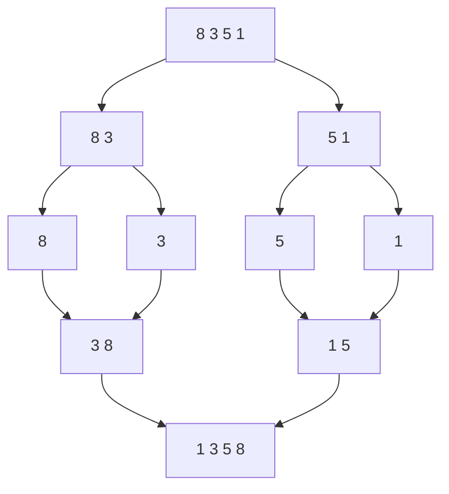
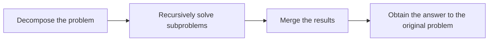

## Overview

**Divide and Conquer** breaks a large problem into several smaller problems of the same structure, solves them separately, and then merges the results. It is commonly used in sorting, searching, geometry problems, and recursion optimization.

> Prerequisites
> - **Recursion**: Divide and conquer usually expresses problem decomposition through recursion
> - **Array intervals**: Use left and right boundaries to represent the current subproblem
> - **Complexity recurrence**: Analyze total complexity using "number of levels × cost per level"

---

## Problem Definition

When a problem can be broken into mutually independent subproblems of the same form, divide and conquer can be used.

| Element | Description |
|------|------|
| Input | A problem that can be split, such as an array, interval, or point set |
| Output | The solution to the original problem, such as a sorted result, target element, or minimum distance |
| Three stages | Divide, solve, merge |
| Typical algorithms | Merge sort, quicksort, binary search, quickselect |

---

## Core Principle: Step-by-Step Diagram

Merge sort is the most typical divide-and-conquer model:



Divide and conquer does not require every step to "merge." Quicksort places the pivot in position through partitioning, and once the subarrays are sorted, the whole array is naturally ordered; binary search even recurses into only one side.

---

## Detailed Algorithm Steps

```
Algorithm: DivideAndConquer(problem)
Input: a problem problem
Output: the solution to problem

1. If problem is small enough, solve it directly and return
2. Split problem into several subproblems
3. Recursively solve each subproblem
4. Merge the subproblem results into the result for the original problem
5. Return the merged result
```

**Complexity analysis**:

| Algorithm | Decomposition method | Merge cost | Time complexity | Space complexity |
|------|------|------|------|------|
| Merge sort | Split in half | O(n) | O(n log n) | O(n) |
| Quicksort | Pivot partitioning | O(1) | Average O(n log n) | O(log n) |
| Binary search | Discard half | O(1) | O(log n) | O(1) |
| Quickselect | Recurse into only one side | O(1) | Average O(n) | O(log n) |

---

## TypeScript Implementation

### 1. General Divide-and-Conquer Framework

```typescript
function divideAndConquer<T, R>(
  problem: T,
  isBaseCase: (problem: T) => boolean,
  solveBase: (problem: T) => R,
  split: (problem: T) => T[],
  merge: (results: R[]) => R,
): R {
  if (isBaseCase(problem)) return solveBase(problem);

  const subProblems = split(problem);
  const subResults = subProblems.map(sub =>
    divideAndConquer(sub, isBaseCase, solveBase, split, merge),
  );

  return merge(subResults);
}
```

### 2. Merge Sort

```typescript
function mergeSort(nums: number[]): number[] {
  if (nums.length <= 1) return nums;

  const mid = Math.floor(nums.length / 2);
  const left = mergeSort(nums.slice(0, mid));
  const right = mergeSort(nums.slice(mid));

  return merge(left, right);
}

function merge(left: number[], right: number[]): number[] {
  const result: number[] = [];
  let i = 0;
  let j = 0;

  while (i < left.length && j < right.length) {
    if (left[i] <= right[j]) result.push(left[i++]);
    else result.push(right[j++]);
  }

  return result.concat(left.slice(i), right.slice(j));
}
```

### 3. Quicksort

```typescript
function quickSort(nums: number[], left = 0, right = nums.length - 1): void {
  if (left >= right) return;

  const pivotIndex = partition(nums, left, right);
  quickSort(nums, left, pivotIndex - 1);
  quickSort(nums, pivotIndex + 1, right);
}

function partition(nums: number[], left: number, right: number): number {
  const pivot = nums[right];
  let storeIndex = left;

  for (let i = left; i < right; i++) {
    if (nums[i] < pivot) {
      [nums[storeIndex], nums[i]] = [nums[i], nums[storeIndex]];
      storeIndex++;
    }
  }

  [nums[storeIndex], nums[right]] = [nums[right], nums[storeIndex]];
  return storeIndex;
}
```

### 4. Quickselect

```typescript
function findKthLargest(nums: number[], k: number): number {
  const target = nums.length - k;
  let left = 0;
  let right = nums.length - 1;

  while (left <= right) {
    const pivotIndex = partition(nums, left, right);
    if (pivotIndex === target) return nums[pivotIndex];
    if (pivotIndex < target) left = pivotIndex + 1;
    else right = pivotIndex - 1;
  }

  return nums[left];
}
```

### 5. Closest Pair of Points Problem

```typescript
interface Point {
  x: number;
  y: number;
}

function closestPair(points: Point[]): number {
  points.sort((a, b) => a.x - b.x);

  function distance(a: Point, b: Point): number {
    return Math.hypot(a.x - b.x, a.y - b.y);
  }

  function solve(left: number, right: number): number {
    if (right - left <= 3) {
      let best = Infinity;
      for (let i = left; i <= right; i++) {
        for (let j = i + 1; j <= right; j++) {
          best = Math.min(best, distance(points[i], points[j]));
        }
      }
      return best;
    }

    const mid = (left + right) >> 1;
    const bestLeft = solve(left, mid);
    const bestRight = solve(mid + 1, right);
    let best = Math.min(bestLeft, bestRight);

    const strip: Point[] = [];
    for (let i = left; i <= right; i++) {
      if (Math.abs(points[i].x - points[mid].x) < best) strip.push(points[i]);
    }

    strip.sort((a, b) => a.y - b.y);
    for (let i = 0; i < strip.length; i++) {
      for (let j = i + 1; j < strip.length && strip[j].y - strip[i].y < best; j++) {
        best = Math.min(best, distance(strip[i], strip[j]));
      }
    }

    return best;
  }

  return solve(0, points.length - 1);
}
```

---

## Engineering Optimization: Controlling Recursion Depth and Extra Space

| Scenario | Optimization direction | Description |
|------|------|------|
| Quicksort degradation | Random pivot / median-of-three | Avoid degradation to O(n²) on sorted arrays |
| Merge sort space | Reuse auxiliary arrays | Reduce repeated creation of temporary arrays |
| Excessive recursion depth | Switch small intervals to insertion sort / iteration | Reduce call stack risk |
| Quickselect | Recurse into only the target side | Average O(n), no need for full sorting |

Production sorting usually does not hand-write quicksort; more often, the divide-and-conquer idea is borrowed to solve problems where "parts are independent and merging is controllable."

---

## Applications and Limitations

### Typical Applications

- Merge sort, quicksort, quickselect
- Binary search, binary search on the answer
- Chunked processing of large-scale data
- Closest pair of points, inversion counting

### Limitations

| Limitation | Description |
|------|------|
| Subproblems must be mergeable | Divide and conquer does not hold when results cannot be merged |
| Recursion overhead | Excessive recursion depth may bring stack risk |
| Not necessarily the most space-efficient | Merge-type algorithms usually require extra arrays |

---
## Summary



**Key points**:

1. Divide and conquer = divide, solve, combine.
2. Merge sort emphasizes merging, while quicksort emphasizes partitioning.
3. Halving the size each time usually leads to O(log n) levels of recursion.
4. Quickselect takes advantage of "only caring about one side" to reduce the average complexity to O(n).