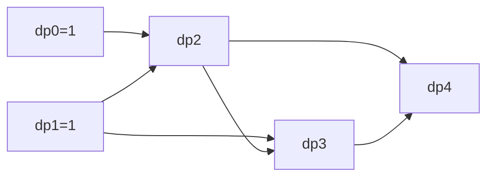
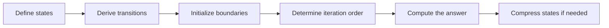

## Overview

**Dynamic Programming (DP)** avoids repeated computation by storing the results of subproblems. It is suitable for scenarios with optimal substructure and overlapping subproblems, such as path counting, sequence matching, knapsack selection, and interval optimal values.

> Prerequisites
> - **Recursion / Memoized Search**: Understanding state dependencies from a top-down perspective
> - **Arrays and Matrices**: One-dimensional and two-dimensional DP tables are the most common state storage
> - **State Transitions**: Deriving the current problem from known smaller problems

---

## Problem Definition

Given an optimization or counting problem that can be decomposed into overlapping subproblems, define the state and solve for the final answer through a transition equation.

| Element | Description |
|------|------|
| Input | Sequence, capacity, target value, or two strings |
| Output | Maximum/minimum value, number of solutions, longest length, or minimum number of operations |
| Core State | `dp[i]`, `dp[i][j]`, or a compressed one-dimensional array |
| Key Questions | State meaning, transition equation, initialization, iteration order |

---

## Core Principle: Step-by-Step Illustration

Taking stair climbing as an example, reaching step `i` can only come from `i - 1` or `i - 2`:



The state transition is:

```text
dp[i] = dp[i - 1] + dp[i - 2]
```

The difficulty of dynamic programming usually lies not in the code, but in reformulating the problem as "how the current state can be obtained from smaller states."

---

## Detailed Algorithm Steps

```
算法：SolveDP(problem)
输入：可拆分的问题
输出：最优值、方案数或可行性

1. 定义状态：dp[i] 或 dp[i][j] 表示什么
2. 写出转移方程：当前状态从哪些旧状态来
3. 初始化边界状态：空数组、第一行、第一列等
4. 确定遍历顺序：保证依赖状态已计算
5. 返回答案：dp[n]、dp[m][n] 或表中最大值
```

**Complexity Analysis**:

| Problem | State Definition | Time Complexity | Space Complexity |
|------|------|------|------|
| Stair Climbing | `dp[i]` number of ways to reach step i | O(n) | O(1) |
| House Robber | `dp[i]` maximum profit from first i houses | O(n) | O(1) |
| LCS | `dp[i][j]` longest common subsequence of two prefixes | O(mn) | O(mn) |
| Edit Distance | `dp[i][j]` minimum operations to convert prefixes | O(mn) | O(mn) |
| 0-1 Knapsack | `dp[w]` maximum value at capacity w | O(nW) | O(W) |

---

## TypeScript Implementation

### 1. Stair Climbing

```typescript
function climbStairs(n: number): number {
  if (n <= 2) return n;

  let prev2 = 1;
  let prev1 = 2;

  for (let i = 3; i <= n; i++) {
    const current = prev1 + prev2;
    prev2 = prev1;
    prev1 = current;
  }

  return prev1;
}
```

### 2. House Robber

```typescript
function rob(nums: number[]): number {
  let prev2 = 0;
  let prev1 = 0;

  for (const money of nums) {
    const current = Math.max(prev1, prev2 + money);
    prev2 = prev1;
    prev1 = current;
  }

  return prev1;
}
```

### 3. Longest Common Subsequence

```typescript
function longestCommonSubsequence(text1: string, text2: string): number {
  const m = text1.length;
  const n = text2.length;
  const dp = Array.from({ length: m + 1 }, () => new Array(n + 1).fill(0));

  for (let i = 1; i <= m; i++) {
    for (let j = 1; j <= n; j++) {
      if (text1[i - 1] === text2[j - 1]) {
        dp[i][j] = dp[i - 1][j - 1] + 1;
      } else {
        dp[i][j] = Math.max(dp[i - 1][j], dp[i][j - 1]);
      }
    }
  }

  return dp[m][n];
}
```

### 4. Edit Distance

```typescript
function minDistance(word1: string, word2: string): number {
  const m = word1.length;
  const n = word2.length;
  const dp = Array.from({ length: m + 1 }, () => new Array(n + 1).fill(0));

  for (let i = 0; i <= m; i++) dp[i][0] = i;
  for (let j = 0; j <= n; j++) dp[0][j] = j;

  for (let i = 1; i <= m; i++) {
    for (let j = 1; j <= n; j++) {
      if (word1[i - 1] === word2[j - 1]) {
        dp[i][j] = dp[i - 1][j - 1];
      } else {
        dp[i][j] = 1 + Math.min(dp[i - 1][j], dp[i][j - 1], dp[i - 1][j - 1]);
      }
    }
  }

  return dp[m][n];
}
```

### 5. 0-1 Knapsack

```typescript
function knapsack(weights: number[], values: number[], capacity: number): number {
  const dp = new Array(capacity + 1).fill(0);

  for (let i = 0; i < weights.length; i++) {
    for (let w = capacity; w >= weights[i]; w--) {
      dp[w] = Math.max(dp[w], dp[w - weights[i]] + values[i]);
    }
  }

  return dp[capacity];
}
```

### 6. Longest Increasing Subsequence

```typescript
function lengthOfLIS(nums: number[]): number {
  const tails: number[] = [];

  for (const num of nums) {
    let left = 0;
    let right = tails.length;

    while (left < right) {
      const mid = left + Math.floor((right - left) / 2);
      if (tails[mid] < num) left = mid + 1;
      else right = mid;
    }

    tails[left] = num;
  }

  return tails.length;
}
```

---

## Engineering Optimization: State Compression and Iteration Order

| Optimization | Approach | Notes |
|------|------|------|
| One-dimensional compression | Keep only the previous row or necessary states | Must confirm dependency direction |
| Rolling variables | E.g., stair climbing keeps only two values | Suitable when depending on a fixed number of old states |
| 0-1 Knapsack | Iterate capacity in reverse order | Prevents the same item from being used repeatedly |
| Unbounded Knapsack | Iterate capacity in forward order | Allows the same item to be used repeatedly |
| Memoized Search | Cache results top-down | Closer to the recursive definition, intuitive for debugging |

DP optimization cannot focus solely on space reduction; it must also ensure that state dependencies are not overwritten prematurely.

---

## Applications and Limitations

### Typical Applications

- Path counting, stair climbing, grid paths
- Sequence problems: LCS, LIS, edit distance
- Knapsack and resource allocation
- Stock trading, interval DP, bitmask DP

### Limitations

| Limitation | Description |
|------|------|
| Difficult state design | Unclear state meaning leads to incorrect transitions |
| Space can be large | Two-dimensional or multi-dimensional DP easily consumes large amounts of memory |
| Not suitable without overlapping subproblems | DP yields limited benefit when there is no repeated computation |

---

## Summary



**Key Takeaways**:

1. DP solves problems with overlapping subproblems and optimal substructure.
2. Before writing DP, first clarify the meaning of each position in the `dp` array.
3. The iteration order must ensure that dependency states have already been computed.
4. The core of state compression is ensuring that old states are not incorrectly overwritten.