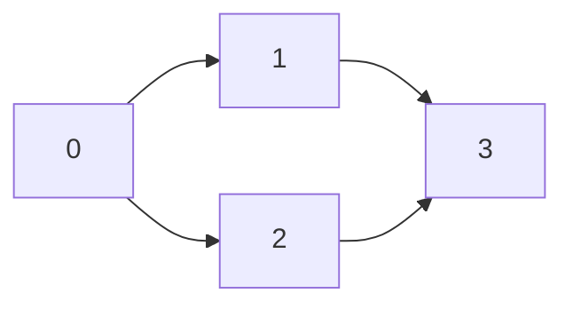
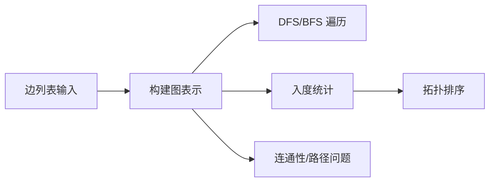

## Overview

A **graph** uses vertices and edges to describe relationships between objects. Compared with arrays, linked lists, and trees, graphs are better suited to expressing "many-to-many connections," such as social relationships, dependency relationships, map roads, and task scheduling.

> Prerequisites
> - **Hash table / array**: commonly used to store adjacency lists
> - **DFS / BFS**: the foundational algorithms for graph traversal
> - **In-degree**: used in topological sorting to determine whether a node can be processed

---

## Problem Definition

Given a set of vertices and a set of edges, choose an appropriate representation and complete traversal, connectivity determination, or dependency ordering.

| Element | Description |
|------|------|
| Input | Number of vertices, edge list, direction, and weights |
| Output | Adjacency structure, traversal result, topological order, or number of connected components |
| Common representations | Adjacency list, adjacency matrix, edge list |
| Typical problems | DFS/BFS, course schedule, connected components, shortest path |

---

## Core Principle: Step-by-Step Diagram

The directed graph edge list `[[0,1], [0,2], [1,3], [2,3]]` can be represented as an adjacency list:



The corresponding structure:

```text
0 -> [1, 2]
1 -> [3]
2 -> [3]
3 -> []
```

### Intuition Behind Topological Sorting

If an edge `u -> v` means "u must be completed before v can be completed," then repeatedly taking out nodes with in-degree `0` yields a valid dependency execution order.

---

## Detailed Algorithm Steps

```
算法：TopologicalSort(n, edges)
输入：节点数 n，依赖边 edges
输出：拓扑序；有环时返回空数组

1. 构建邻接表 graph 和入度数组 indegree
2. 将所有 indegree 为 0 的节点入队
3. while 队列不为空：
4.     node 出队并加入结果
5.     遍历 node 的邻居 next：
6.         indegree[next] -= 1
7.         如果 indegree[next] == 0，入队
8. 如果结果长度为 n，返回结果；否则说明有环
```

**Complexity analysis**:

| Operation | Time complexity | Space complexity | Description |
|------|------|------|------|
| Build adjacency list | O(V + E) | O(V + E) | Initialize nodes and add edges |
| DFS / BFS | O(V + E) | O(V) | Each vertex and edge is visited at most once |
| Topological sort | O(V + E) | O(V + E) | Adjacency list and in-degree array |
| Query edge in adjacency matrix | O(1) | O(V²) | Suitable for dense graphs |

---

## TypeScript Implementation

### 1. Building an Adjacency List

```typescript
type AdjList = Map<number, number[]>;

function buildGraph(n: number, edges: number[][], directed = true): AdjList {
  const graph: AdjList = new Map();

  for (let i = 0; i < n; i++) {
    graph.set(i, []);
  }

  for (const [from, to] of edges) {
    graph.get(from)!.push(to);
    if (!directed) graph.get(to)!.push(from);
  }

  return graph;
}
```

### 2. DFS Traversal

```typescript
function dfs(graph: AdjList, start: number): number[] {
  const visited = new Set<number>();
  const result: number[] = [];

  function visit(node: number): void {
    if (visited.has(node)) return;
    visited.add(node);
    result.push(node);

    for (const next of graph.get(node) ?? []) {
      visit(next);
    }
  }

  visit(start);
  return result;
}
```

### 3. BFS Traversal

```typescript
function bfs(graph: AdjList, start: number): number[] {
  const queue = [start];
  const visited = new Set<number>([start]);
  const result: number[] = [];
  let head = 0;

  while (head < queue.length) {
    const node = queue[head++];
    result.push(node);

    for (const next of graph.get(node) ?? []) {
      if (visited.has(next)) continue;
      visited.add(next);
      queue.push(next);
    }
  }

  return result;
}
```

### 4. Topological Sort

```typescript
function topologicalSort(numCourses: number, prerequisites: number[][]): number[] {
  const graph = buildGraph(numCourses, prerequisites);
  const indegree = new Array(numCourses).fill(0);

  for (const [, to] of prerequisites) {
    indegree[to]++;
  }

  const queue: number[] = [];
  for (let i = 0; i < numCourses; i++) {
    if (indegree[i] === 0) queue.push(i);
  }

  const result: number[] = [];
  let head = 0;

  while (head < queue.length) {
    const node = queue[head++];
    result.push(node);

    for (const next of graph.get(node) ?? []) {
      indegree[next]--;
      if (indegree[next] === 0) queue.push(next);
    }
  }

  return result.length === numCourses ? result : [];
}
```

### 5. Number of Connected Components

```typescript
function findCircleNum(isConnected: number[][]): number {
  const n = isConnected.length;
  const visited = new Set<number>();
  let provinces = 0;

  function dfsCity(city: number): void {
    visited.add(city);

    for (let next = 0; next < n; next++) {
      if (isConnected[city][next] === 1 && !visited.has(next)) {
        dfsCity(next);
      }
    }
  }

  for (let city = 0; city < n; city++) {
    if (!visited.has(city)) {
      provinces++;
      dfsCity(city);
    }
  }

  return provinces;
}
```

---

## Engineering Optimization: Adjacency List or Adjacency Matrix

| Representation | Advantages | Cost | Applicable scenarios |
|------|------|------|------|
| Adjacency list | Space O(V + E), fast neighbor traversal | Determining whether an edge exists between two points requires traversing neighbors | Sparse graphs, traversal-type problems |
| Adjacency matrix | Edge lookup O(1) | Space O(V²) | Dense graphs, small number of nodes |
| Edge list | Convenient input and sorting | Slow neighbor lookup | Kruskal, Bellman-Ford |

In JavaScript/TypeScript, if node indices are contiguous, `number[][]` is usually lighter than `Map<number, number[]>`; if nodes are strings or sparse IDs, `Map` is more natural.

---

## Applications and Limitations

### Typical Applications

- Dependency analysis: course schedules, task orchestration, package management
- Social networks, recommendation systems, relationship chain search
- Map paths, network routing, shortest paths
- Connected components, cycle detection, topological sorting

### Limitations

| Limitation | Description |
|------|------|
| High modeling cost | The meaning of nodes and edges must first be clarified |
| Memory pressure for large graphs | The adjacency structure may be very large |
| Algorithm choice depends on graph type | Directed/undirected, weighted/unweighted, and whether cycles exist all affect the solution |

---

## Summary



**Key points**:

1. Graphs are used to express many-to-many relationships, and adjacency lists are the most commonly used representation.
2. DFS is suitable for connectivity and deep exploration, while BFS is suitable for level order and unweighted shortest paths.
3. Topological sorting relies on repeatedly dequeuing nodes with in-degree 0.
4. First determine the graph type, then choose the appropriate data structure and algorithm.