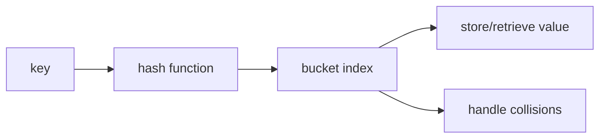

## Overview

A hash table is a data structure that quickly locates values by key. It maps keys to array positions through a hash function, achieving O(1) lookup, insertion, and deletion on average.

In JavaScript / TypeScript, the commonly used hash structures are `Map`, `Set`, and plain objects. They are widely used for deduplication, counting, caching, index building, and algorithmic problems like two sum.

The core idea of a hash table is: trade space for time.

> Prerequisites
> - **Hash function**: maps a key to a bucket position
> - **Array / bucket**: the underlying storage is usually an array holding elements
> - **Collision handling**: different keys may land in the same bucket

---

## Problem Definition

If we frequently need to answer "has this value appeared before" or "what data does this key correspond to," linear scanning will be slow.

For example, searching in an array:

```text
[12, 7, 9, 20, 31]
```

Each time it may scan the entire array, with complexity O(n). A hash table aims to turn this problem into:

```text
key -> hash -> bucket -> value
```

Common needs include:

| Need | Recommended structure |
| --- | --- |
| Determine whether an element exists | `Set` |
| Count occurrences | `Map<T, number>` |
| Build an index from ID to object | `Map<string, Item>` |
| Simple records with string keys | `Record<string, T>` |

---

## Core Principle: Step-by-Step Illustration

The logical flow of a hash table can be broken into three steps:

```text
key -> hash(key) -> index -> bucket
```

Suppose the capacity is 8, and the hash value of a certain key is 18:

```text
index = 18 % 8 = 2
```

So it is placed into the bucket at index 2.

### Hash Collisions

Different keys may map to the same position:

```text
hash("a") % 8 = 2
hash("b") % 8 = 2
```

This is called a hash collision. Common solutions include:

- Separate chaining: each bucket holds a linked list or array;
- Open addressing: after a collision, continue searching for the next empty slot;
- Resize and rehash: expand capacity when the load factor gets too high.

In everyday TypeScript development, we do not need to handle these details ourselves, but understanding them helps judge the performance boundaries of hash tables.

---

## Basic Operations and Complexity

| Operation | Average complexity | Worst-case complexity | Description |
| --- | --- | --- | --- |
| `set` | O(1) | O(n) | Degrades when collisions are severe |
| `get` | O(1) | O(n) | Depends on hash distribution |
| `has` | O(1) | O(n) | Commonly used for set membership |
| `delete` | O(1) | O(n) | Removes a key-value relationship |
| Traversal | O(n) | O(n) | Visits all key-value pairs |

In real engineering, the built-in `Map` / `Set` already handle resizing and collisions. Prefer using them rather than writing a hash table by hand.

---

## TypeScript Implementation

### 1. Counter

```typescript
function countBy<T>(items: T[]): Map<T, number> {
  const counter = new Map<T, number>();

  for (const item of items) {
    counter.set(item, (counter.get(item) ?? 0) + 1);
  }

  return counter;
}

console.log(countBy(['a', 'b', 'a']));
```

### 2. Two Sum

```typescript
function twoSum(nums: number[], target: number): [number, number] | null {
  const seen = new Map<number, number>();

  for (let i = 0; i < nums.length; i++) {
    const need = target - nums[i];

    if (seen.has(need)) {
      return [seen.get(need)!, i];
    }

    seen.set(nums[i], i);
  }

  return null;
}
```

This implementation turns the O(n) scan of "looking forward for another number" into an O(1) query.

### 3. Grouping

```typescript
function groupBy<T, K>(items: T[], getKey: (item: T) => K): Map<K, T[]> {
  const groups = new Map<K, T[]>();

  for (const item of items) {
    const key = getKey(item);
    const group = groups.get(key);

    if (group) {
      group.push(item);
    } else {
      groups.set(key, [item]);
    }
  }

  return groups;
}
```

Hash tables are very suitable for reorganizing a list into an index of "key to collection."

---

## Engineering Optimization: Map, Set, and Object

| Structure | Suitable scenarios | Notes |
| --- | --- | --- |
| `Map` | Keys of any type, frequent additions and deletions | Clearest semantics |
| `Set` | Deduplication, existence checks | Only cares whether a value appears |
| `Record<string, T>` | Objects with fixed string keys | Watch out for prototypes and key conversion |
| `WeakMap` | Object metadata, avoiding memory leaks | Keys must be objects and cannot be traversed |

General recommendations:

- When keys are not fixed fields, use `Map`;
- When only checking existence, use `Set`;
- When representing a clear object structure, use a plain object or `Record`.

---

## Applications and Limitations

### Typical Applications

- Array deduplication;
- Frequency counting;
- Caching and memoization;
- Quickly finding objects by ID;
- Adjacency lists for graphs;
- Two sum, longest consecutive sequence, grouping anagrams.

### Limitations

- Hash tables are not inherently ordered. Although JS `Map` preserves insertion order, it cannot be used as a sorted structure;
- Requires extra space;
- When objects are used as keys, comparison is by reference, not by content;
- Unstable key design leads to low cache hit rates.

---

## Summary



- Hash tables improve lookup efficiency through key-to-position mapping.
- `Map` and `Set` are the most commonly used hash structures in TypeScript.
- Hashing is suitable for existence checks, counting, indexing, and caching.
- It trades extra space for average O(1) query speed.
- When choosing keys, ensure stable semantics, especially for object keys and caching scenarios.