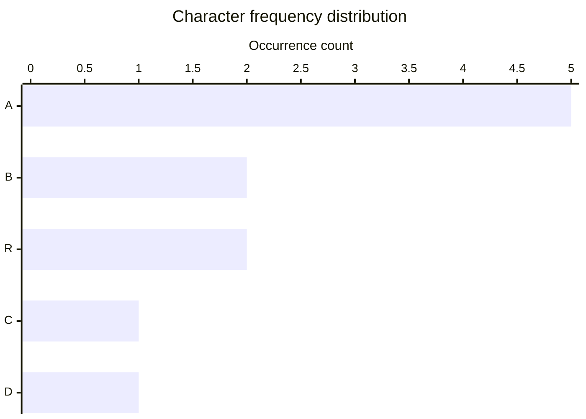
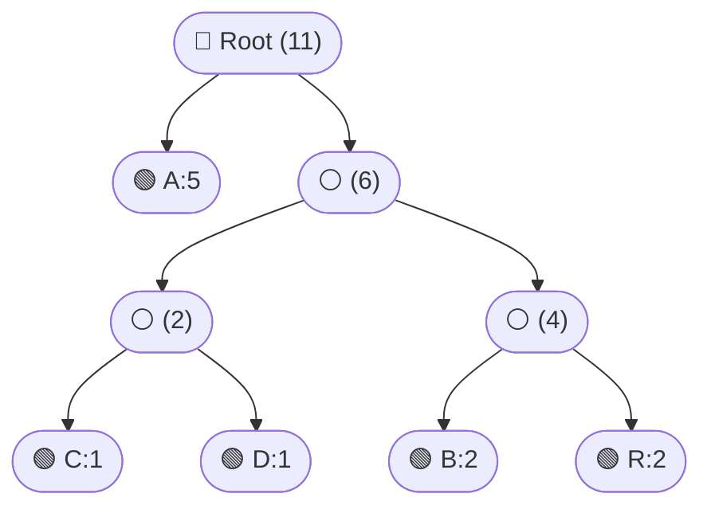
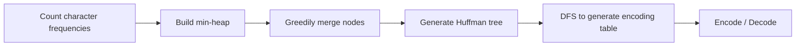

## Overview

**Huffman Coding** is an optimal prefix code construction method. It builds variable-length codes based on character frequency—characters with high frequency get short code lengths, while those with low frequency get long code lengths, thereby achieving lossless data compression. The core idea is to **greedily merge the two subtrees with the smallest weights**, building the coding tree from the bottom up.

> 📚 **Prerequisites**
> - **Binary tree**: stores the coding structure
> - **Min-heap / priority queue**: efficiently retrieves the node with the smallest frequency
> - **Prefix code**: no code is a prefix of another, ensuring unique decodability

---

## Problem Definition

Given characters and their frequencies, construct a set of binary prefix codes that minimizes the total encoded length.

| Element | Description |
|------|------|
| Input | Character frequency table (e.g., `A:5, B:2, R:2, C:1, D:1`) |
| Output | Binary code for each character, along with encoding/decoding algorithms |
| Application | File compression (ZIP), image compression (JPEG entropy coding step) |

---

## Core Principle: Step-by-Step Illustration

Using the string `"ABRACADABRA"` as an example, first count the character frequencies:



### Huffman Tree Construction Process (Greedy Strategy)

1. Build each character as a leaf node, and add all of them to a **min-heap** (sorted by frequency).
2. Each time, take out the two nodes with the smallest frequencies, merge them into a new node (frequency = sum of the two), and put it back into the heap.
3. Repeat until only one node remains in the heap, which is the **root node**.

The final Huffman tree constructed:



> 🌿 Green nodes are **leaf nodes** (storing actual characters), and white nodes are internal merge nodes.

### Generating Codes

Starting from the root node, define:

- Going along the **left branch** as `0`
- Going along the **right branch** as `1`

The resulting code table:

| Character | Path | Code | Code Length |
|------|------|------|------|
| A | Left | `0` | 1 bit |
| B | Right→Left | `10` | 2 bits |
| R | Right→Right | `11` | 2 bits |
| C | Right→Left→Left | `100` | 3 bits |
| D | Right→Left→Right | `101` | 3 bits |

> 💡 The high-frequency character A uses only 1 bit, while the low-frequency characters C/D use 3 bits—this is precisely the intuitive embodiment of "allocating code lengths by frequency."

---

## Detailed Algorithm Steps

```
算法：BuildHuffmanTree(freqMap)
输入：字符→频率的映射表
输出：霍夫曼树的根节点

1. 初始化最小堆 H
2. for each (char, freq) in freqMap:
3.     H.push( new HuffmanNode(char, freq) )
4. while H.size() > 1:
5.     left  ← H.pop()     // 最小频率节点
6.     right ← H.pop()     // 次小频率节点
7.     merged ← new HuffmanNode(null, left.freq + right.freq, left, right)
8.     H.push(merged)
9. return H.pop()          // 根节点
```

**Complexity Analysis**:

| Operation | Time Complexity | Description |
|------|-----------|------|
| Build heap | O(n) | Heapify n character nodes at once |
| Merge loop | O(n log n) | Each pop/push is O(log n), with n-1 merges in total |
| Code generation | O(n) | One DFS traversal of the tree |
| Encoding / Decoding | O(m) | m is the length of the encoded bit string |
| Space complexity | O(n) | Stores the tree and code table |

---
## TypeScript Implementation

### 1. Node and Type Definitions

```typescript
class HuffmanNode {
  char: string | null;      // 非 null 表示叶子节点
  freq: number;             // 节点权值（频率之和）
  left: HuffmanNode | null;
  right: HuffmanNode | null;

  constructor(
    char: string | null,
    freq: number,
    left: HuffmanNode | null = null,
    right: HuffmanNode | null = null
  ) {
    this.char = char;
    this.freq = freq;
    this.left = left;
    this.right = right;
  }

  /** 判断是否为叶子节点 */
  isLeaf(): boolean {
    return this.char !== null;
  }
}
```

### 2. Min-Heap (Priority Queue)

```typescript
class MinHeap {
  private heap: HuffmanNode[] = [];

  size(): number {
    return this.heap.length;
  }

  push(node: HuffmanNode): void {
    this.heap.push(node);
    this.bubbleUp(this.heap.length - 1);
  }

  pop(): HuffmanNode {
    if (this.size() === 1) return this.heap.pop()!;
    const top = this.heap[0];
    this.heap[0] = this.heap.pop()!;
    this.bubbleDown(0);
    return top;
  }

  private swap(i: number, j: number): void {
    [this.heap[i], this.heap[j]] = [this.heap[j], this.heap[i]];
  }

  private bubbleUp(idx: number): void {
    while (idx > 0) {
      const parent = Math.floor((idx - 1) / 2);
      if (this.heap[idx].freq >= this.heap[parent].freq) break;
      this.swap(idx, parent);
      idx = parent;
    }
  }

  private bubbleDown(idx: number): void {
    while (true) {
      const left = idx * 2 + 1;
      const right = idx * 2 + 2;
      let smallest = idx;

      if (left < this.size() && this.heap[left].freq < this.heap[smallest].freq)
        smallest = left;
      if (right < this.size() && this.heap[right].freq < this.heap[smallest].freq)
        smallest = right;
      if (smallest === idx) break;

      this.swap(idx, smallest);
      idx = smallest;
    }
  }
}
```

### 3. Building the Huffman Tree

```typescript
function buildHuffmanTree(freqMap: Map<string, number>): HuffmanNode {
  const heap = new MinHeap();

  // 将所有字符节点加入最小堆
  for (const [char, freq] of freqMap) {
    heap.push(new HuffmanNode(char, freq));
  }

  // 贪心合并，直到只剩一个根节点
  while (heap.size() > 1) {
    const left = heap.pop();   // 最小
    const right = heap.pop();  // 次小
    const merged = new HuffmanNode(
      null,
      left.freq + right.freq,
      left,
      right
    );
    heap.push(merged);
  }

  return heap.pop();
}
```

### 4. Generating the Code Table

```typescript
function generateCodes(root: HuffmanNode): Map<string, string> {
  const codes = new Map<string, string>();

  function dfs(node: HuffmanNode, path: string): void {
    if (node.isLeaf()) {
      // 单字符输入时，编码设为 "0"（否则 path 为空串）
      codes.set(node.char!, path || '0');
      return;
    }
    if (node.left) dfs(node.left, path + '0');
    if (node.right) dfs(node.right, path + '1');
  }

  dfs(root, '');
  return codes;
}
```

### 5. Encoding and Decoding

```typescript
function encode(text: string, codes: Map<string, string>): string {
  let result = '';
  for (const ch of text) {
    const code = codes.get(ch);
    if (code === undefined) {
      throw new Error(`字符 '${ch}' 不在编码表中`);
    }
    result += code;
  }
  return result;
}

function decode(bits: string, root: HuffmanNode): string {
  let result = '';
  let node = root;

  for (const bit of bits) {
    node = bit === '0' ? node.left! : node.right!;

    if (node.isLeaf()) {
      result += node.char;
      node = root; // 回到根节点，继续解码下一个字符
    }
  }

  if (node !== root) {
    throw new Error('解码失败：编码序列不完整');
  }

  return result;
}
```

### 6. Complete Running Example

```typescript
// ===== 测试 =====
const text = "ABRACADABRA";

// 1. 统计频率
const freqMap = new Map<string, number>();
for (const ch of text) {
  freqMap.set(ch, (freqMap.get(ch) || 0) + 1);
}
console.log('频率表:', freqMap);
// Map { 'A' => 5, 'B' => 2, 'R' => 2, 'C' => 1, 'D' => 1 }

// 2. 构建霍夫曼树
const root = buildHuffmanTree(freqMap);

// 3. 生成编码表
const codes = generateCodes(root);
console.log('编码表:', codes);
// Map { 'A' => '0', 'B' => '10', 'R' => '11', 'C' => '100', 'D' => '101' }

// 4. 编码
const encoded = encode(text, codes);
console.log('编码结果:', encoded);
console.log('编码长度:', encoded.length, 'bits');
// 编码结果: 010110010011001011010
// 编码长度: 21 bits
// 原始 ASCII: 11 × 8 = 88 bits → 压缩至 23.9%

// 5. 解码验证
const decoded = decode(encoded, root);
console.log('解码结果:', decoded);
console.log('验证通过:', decoded === text);
// 解码结果: ABRACADABRA
// 验证通过: true
```

---

## Engineering Optimization: Canonical Huffman Coding

In real-world engineering (such as ZIP and JPEG), **Canonical Huffman Coding** is typically used to reduce the storage overhead of the code table:

- Only the **code length** of each character is stored, rather than the full code
- Code values are reassigned based on code length and lexicographic order
- The decoder can reconstruct the code table from the code length information

The canonical version can compress the code table from O(n × code length) to O(n), making it the standard practice in production environments.

---

## Applications and Limitations

### ✅ Typical Applications

- **ZIP / GZIP**: The entropy coding stage of the DEFLATE algorithm
- **PNG**: Lossless image compression
- **JPEG**: Entropy coding of DCT coefficients
- **HTTP/2**: Huffman coding in HPACK header compression

### ⚠️ Limitations

| Limitation | Description |
|------|------|
| Requires known frequencies | Adaptive Huffman is needed for dynamic data streams |
| Single-character encoding | Does not exploit contextual correlation between characters |
| Fragility | A 1-bit error can cause all subsequent decoding to fail |

---
## Summary



**Key points**:

1. **Greedy strategy**: Merge the two currently smallest subtrees each time, building the optimal tree from the bottom up.
2. **Data structures**: Min-heap (O(log n) insertion / deletion) + binary tree traversal.
3. **Optimality guarantee**: Huffman coding can be mathematically proven to be optimal among prefix codes.
4. **Engineering implementation**: In practice, a canonical version is used to reduce encoding table storage.

> Mastering Huffman coding not only gives you an understanding of the foundation of a class of compression algorithms, but also deepens your understanding of **greedy algorithms** and **tree structures**. It is recommended to further study its engineering implementation by combining the DEFLATE source code or the PNG specification.