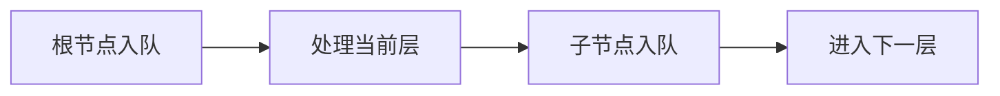

## Overview

Level-order traversal is BFS on a binary tree. It visits nodes layer by layer from top to bottom and from left to right, making it ideal for problems involving "each level."

Unlike recursive DFS, level-order traversal uses a queue to maintain the nodes waiting to be visited. The first-in-first-out property of the queue maps exactly to the level order of the tree.

Common variants include: per-level node lists, zigzag traversal, right side view, maximum value per level, and average value per level.

> Prerequisites
> - **Binary tree**: level-order traversal visits nodes by depth
> - **Queue**: first-in-first-out guarantees same-level ordering
> - **BFS**: level-order traversal is breadth-first search on a tree

---

## Problem Definition

Given a binary tree:

```text
      3
     / \
    9   20
       /  \
      15   7
```

The level-order traversal result is:

```text
[
  [3],
  [9, 20],
  [15, 7]
]
```

The key question is: how do you know how many nodes are in the current level?

The answer is: before processing each level, record the current length of the queue. That length is the number of nodes in the current level.

---

## Core Principle: Step-by-Step Diagram

Initially, the queue contains only the root node:

```text
queue: [3]
```

Process level 1, pop `3`, and enqueue its children:

```text
result: [[3]]
queue: [9, 20]
```

When processing level 2, first record `levelSize = 2` and process only those two nodes. The children they produce belong to the next level:

```text
result: [[3], [9, 20]]
queue: [15, 7]
```

The queue naturally guarantees top-to-bottom order, while `levelSize` defines the boundary of each level.

---

## Detailed Algorithm Steps

Standard level-order traversal:

1. If the root node is null, return an empty array;
2. Enqueue the root node;
3. While the queue is not empty, record the current queue length;
4. Loop through all nodes in the current level;
5. Pop a node and record its value;
6. Enqueue its non-null left and right children;
7. After the current level is fully processed, add the level result to the answer.

Complexity:

- Time complexity O(n), each node is enqueued and dequeued once;
- Space complexity O(w), where `w` is the maximum width of the tree.

---

## TypeScript Implementation

```typescript
class TreeNode<T> {
  constructor(
    public value: T,
    public left: TreeNode<T> | null = null,
    public right: TreeNode<T> | null = null,
  ) {}
}
```

### 1. Standard Level-Order Traversal

```typescript
function levelOrder<T>(root: TreeNode<T> | null): T[][] {
  if (root === null) return [];

  const result: T[][] = [];
  const queue: TreeNode<T>[] = [root];
  let head = 0;

  while (head < queue.length) {
    const levelSize = queue.length - head;
    const level: T[] = [];

    for (let i = 0; i < levelSize; i++) {
      const node = queue[head++];
      level.push(node.value);

      if (node.left) queue.push(node.left);
      if (node.right) queue.push(node.right);
    }

    result.push(level);
  }

  return result;
}
```

### 2. Right Side View

```typescript
function rightSideView<T>(root: TreeNode<T> | null): T[] {
  return levelOrder(root).map(level => level[level.length - 1]);
}
```

### 3. Zigzag Level-Order Traversal

```typescript
function zigzagLevelOrder<T>(root: TreeNode<T> | null): T[][] {
  const levels = levelOrder(root);

  for (let i = 1; i < levels.length; i += 2) {
    levels[i].reverse();
  }

  return levels;
}
```

---

## Engineering Optimization: Don't Shift the Queue Frequently

Many examples write it like this:

```typescript
const node = queue.shift();
```

This is fine with small data, but `shift` moves array elements, and frequent calls may incur O(n) cost. A more robust approach is to use a `head` pointer:

```typescript
const node = queue[head++];
```

This turns dequeue into O(1), which is especially suitable for trees or graphs with a large number of nodes.

---

## Applications and Limitations

### Typical Applications

- Binary tree level-order traversal;
- Finding the maximum, average, or width of each level;
- Binary tree right side view and left side view;
- Shortest-path BFS;
- Processing tasks or dependencies by level.

### Limitations

- Queue space depends on the maximum level width, so wide trees use more memory;
- Level-order traversal is not suitable for problems that require bottom-up aggregation;
- If path backtracking is needed, DFS is usually more natural;
- Directly implementing a queue with `shift` may cause hidden performance issues.

---

## Summary



- Level-order traversal is BFS on a binary tree.
- The queue guarantees visit order, and `levelSize` defines level boundaries.
- Each node is enqueued and dequeued only once, so the time complexity is O(n).
- Replacing `shift` with a head pointer avoids the cost of array shifting.
- Level-order traversal is suitable for all problems involving "per-level statistics or observation."