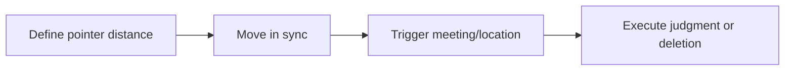

## Overview

Linked list two pointers are a set of techniques centered around moving node references. Because linked lists cannot be randomly accessed by index, many operations that are simple in arrays—such as "find the midpoint," "find the k-th from the end," or "determine whether two lists intersect"—must be accomplished in linked lists through pointer speed or distance.

The most common linked list two-pointer patterns include:

- Fast and slow pointers: one moves fast, one moves slow;
- Front and back pointers: two pointers maintain a fixed distance;
- Synchronized pointers: two pointers move synchronously according to a rule across different linked lists.

> Prerequisites
> - **Linked list nodes**: can only move forward unidirectionally along `next`
> - **Fast and slow pointers**: use speed difference to create a distance relationship
> - **Dummy head node**: unify boundary handling when deleting nodes

---

## Problem Definition

Linked list two pointers mainly solve three types of problems:

| Problem | Pointer model | Key idea |
| --- | --- | --- |
| Find the midpoint | Fast and slow pointers | Fast pointer moves two steps, slow pointer moves one step |
| Detect a cycle | Fast and slow pointers | If there is a cycle, the fast pointer will catch up to the slow pointer |
| Delete the N-th from the end | Front and back pointers | The two pointers maintain a distance of N nodes |
| Find the intersection node | Synchronized pointers | The two pointers traverse the same total length |

The commonality of these problems is that they cannot rely on length or index for direct positioning; relationships can only be established through the movement process.

---

## Core Principle: Step-by-Step Diagram

### Fast and slow pointers to find the midpoint

```text
slow moves 1 step each time
fast moves 2 steps each time
```

When `fast` reaches the tail, `slow` is exactly near the middle.

```text
1 -> 2 -> 3 -> 4 -> 5 -> null
          ^
         slow
```

### Fast and slow pointers to detect a cycle

If the linked list has a cycle, the fast pointer will keep chasing the slow pointer inside the cycle. Since the fast pointer moves one step more than the slow pointer each round, they will eventually meet.

```text
A -> B -> C -> D
     ^         |
     |---------|
```

### Front and back pointers to delete the N-th from the end

Let `fast` move `n` steps first, then `slow` and `fast` move together. When `fast` reaches the tail, `slow` is right before the node to be deleted.

---

## Detailed Algorithm Steps

General steps for linked list two-pointer problems:

1. Clarify what relationship must be maintained between the two pointers;
2. Handle edge cases such as empty lists, single nodes, and head node deletion;
3. Move the pointers according to the rule;
4. Explain the position of each pointer when the loop ends;
5. Modify pointer connections or return the target node.

The easiest thing to get wrong is the loop condition. For example, when finding the midpoint, there are two common ways to write it:

```typescript
while (fast !== null && fast.next !== null) {
  slow = slow.next;
  fast = fast.next.next;
}
```

This condition ensures that `fast.next.next` will not access a null value.

---

## TypeScript Implementation

### 1. Node definition

```typescript
class ListNode<T> {
  constructor(
    public value: T,
    public next: ListNode<T> | null = null,
  ) {}
}
```

### 2. Find the midpoint of a linked list

```typescript
function middleNode<T>(head: ListNode<T> | null): ListNode<T> | null {
  let slow = head;
  let fast = head;

  while (fast !== null && fast.next !== null) {
    slow = slow!.next;
    fast = fast.next.next;
  }

  return slow;
}
```

For even lengths, this implementation returns the second middle node.

### 3. Determine whether there is a cycle

```typescript
function hasCycle<T>(head: ListNode<T> | null): boolean {
  let slow = head;
  let fast = head;

  while (fast !== null && fast.next !== null) {
    slow = slow!.next;
    fast = fast.next.next;

    if (slow === fast) return true;
  }

  return false;
}
```

### 4. Delete the N-th node from the end

```typescript
function removeNthFromEnd<T>(head: ListNode<T> | null, n: number): ListNode<T> | null {
  const dummy = new ListNode<T>(null as T, head);
  let fast: ListNode<T> | null = dummy;
  let slow: ListNode<T> | null = dummy;

  for (let i = 0; i < n; i++) {
    fast = fast!.next;
  }

  while (fast?.next !== null) {
    fast = fast.next;
    slow = slow!.next;
  }

  slow!.next = slow!.next!.next;
  return dummy.next;
}
```

---

## Engineering Optimization: Turn Distance into an Invariant

The essence of linked list two pointers is maintaining invariants:

- Fast and slow pointers: the distance traveled by `fast` is approximately equal to `2 * slow`;
- Front and back pointers: `fast` and `slow` always differ by `n` nodes;
- Intersecting linked lists: the two pointers ultimately traverse the same length of `lenA + lenB`.

Intersecting linked lists can be written like this:

```typescript
function getIntersectionNode<T>(
  headA: ListNode<T> | null,
  headB: ListNode<T> | null,
): ListNode<T> | null {
  let a = headA;
  let b = headB;

  while (a !== b) {
    a = a === null ? headB : a.next;
    b = b === null ? headA : b.next;
  }

  return a;
}
```

After the two pointers swap starting points, the path lengths are equalized, so if there is an intersection point, they will arrive at it in the same round.

---

## Applications and Limitations

### Typical applications

- Find the midpoint of a linked list;
- Detect cycles and find the entry point of a cycle;
- Delete the N-th node from the end;
- Determine whether two linked lists intersect;
- In palindrome linked lists, "find the midpoint + reverse the second half."

### Limitations

- Pointer semantics are less intuitive than array indices;
- Loop conditions are very sensitive;
- Before modifying a linked list, the subsequent nodes must be saved;
- Not suitable for problems that require frequent random access.

---

## Summary



- Linked list two pointers use movement relationships instead of index-based positioning.
- Fast and slow pointers are suitable for finding midpoints and detecting cycles.
- Front and back pointers are suitable for problems related to positions from the end.
- Synchronized pointers can eliminate differences in linked list lengths.
- Before writing code, first define the invariant between the two pointers.