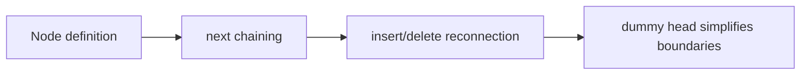

## Overview

A linked list is a data structure made up of nodes connected in a chain. Each node stores data and points to the next node via a pointer. Unlike arrays, linked lists don't rely on contiguous indices; instead, they rely on reference relationships between nodes.

The advantage of a linked list is that inserting and deleting nodes doesn't require shifting large numbers of elements; the trade-off is that you can't randomly access a position in O(1) like you can with an array.

In frontend development and algorithms, linked lists frequently appear in LRU caches, queues, undo stacks, virtual list scheduling, and various pointer problems.

> Prerequisites
> - **Node references**: linked lists chain nodes together via `next`
> - **Pointer rewiring**: insertion and deletion are essentially modifying references
> - **Dummy head node**: unifies the handling of the head node and ordinary nodes

---

## Problem Definition

Linked lists are well-suited for representing data where "order exists, but position doesn't depend on an index."

A singly linked list node can be abstracted as:

```text
value + next
```

Multiple nodes chained together:

```text
head -> A -> B -> C -> null
```

The problem linked lists solve is: when we only know a reference to some node, how do we efficiently change the connections around it?

| Operation | Array | Linked List |
| --- | --- | --- |
| Access by index | O(1) | O(n) |
| Insert at known position | O(n) shifting elements | O(1) pointer change |
| Delete at known position | O(n) shifting elements | O(1) pointer change |
| Sequential traversal | O(n) | O(n) |

---

## Core Principle: Step-by-Step Diagrams

### Inserting a Node

Insert `X` between `A` and `B`:

```text
Before insertion: A -> B
Step 1: X -> B
Step 2: A -> X
After insertion: A -> X -> B
```

Order matters: you must first make the new node point to its successor, then make the predecessor point to the new node; otherwise you'll lose the original chain.

### Deleting a Node

Delete `B`:

```text
Before deletion: A -> B -> C
After deletion: A ------> C
```

You only need to make `A.next = C`. In languages with garbage collection, `B` will be reclaimed once it's no longer referenced.

### Dummy Head Node

Many linked list problems introduce a dummy node:

```text
dummy -> head -> ...
```

It unifies "deleting the head node" and "deleting a middle node" into the same logic, reducing boundary branches.

---

## Basic Operations and Complexity

| Operation | Time Complexity | Notes |
| --- | --- | --- |
| Find a value | O(n) | Requires traversal from the head |
| Insert at head | O(1) | New node points to the old head |
| Insert at tail | O(n) / O(1) | O(1) if a tail pointer exists |
| Delete known successor | O(1) | Change `next`'s pointer |
| Reverse linked list | O(n) | Each edge reversed once |

The most critical thing in linked list problems isn't complexity—it's the order of pointer updates. Get one node reference wrong and you might break the chain or create a cycle.

---

## TypeScript Implementation

### 1. Node Definition

```typescript
class ListNode<T> {
  constructor(
    public value: T,
    public next: ListNode<T> | null = null,
  ) {}
}
```

### 2. Reversing a Linked List

```typescript
function reverseList<T>(head: ListNode<T> | null): ListNode<T> | null {
  let prev: ListNode<T> | null = null;
  let current = head;

  while (current !== null) {
    const next = current.next;
    current.next = prev;
    prev = current;
    current = next;
  }

  return prev;
}
```

Invariants during the reversal process:

- `prev` is the head of the already-reversed list;
- `current` is the first node not yet processed;
- `next` temporarily saves the remaining chain to avoid breaking it.

### 3. Deleting a Specified Value

```typescript
function removeElements<T>(head: ListNode<T> | null, target: T): ListNode<T> | null {
  const dummy = new ListNode<T>(target, head);
  let current: ListNode<T> | null = dummy;

  while (current.next !== null) {
    if (current.next.value === target) {
      current.next = current.next.next;
    } else {
      current = current.next;
    }
  }

  return dummy.next;
}
```

The dummy head node lets deletion of the head node and deletion of an ordinary node share the same logic.

---

## Engineering Optimization: Doubly Linked Lists and LRU

A singly linked list can only be traversed forward. If you need O(1) deletion of an arbitrary node, you typically use a doubly linked list:

```text
prev <- node -> next
```

An LRU cache is a combination of a doubly linked list and a hash map:

- `Map` is responsible for O(1) node lookup;
- The doubly linked list is responsible for O(1) moving of the most recently used node;
- The head represents the most recent, the tail represents the oldest.

```typescript
class DoublyNode<K, V> {
  prev: DoublyNode<K, V> | null = null;
  next: DoublyNode<K, V> | null = null;

  constructor(
    public key: K,
    public value: V,
  ) {}
}
```

The value of linked lists in engineering often isn't in using them alone, but in combining them with hash maps to supplement "order maintenance" capabilities.

---

## Applications and Limitations

### Typical Applications

- LRU / LFU caches;
- Underlying implementation of queues and deques;
- Undo, redo, history records;
- Ordered data with frequent insertions and deletions;
- Reversal, merging, cycle detection, and finding the midpoint in algorithm problems.

### Limitations

- Cannot quickly access by index;
- Each node stores extra pointers, resulting in higher space overhead;
- Pointer operations easily break chains or create cycles;
- In JavaScript, object nodes are scattered across the heap, so cache locality is worse than arrays.

---

## Summary



- Linked lists maintain order through reference relationships, not contiguous indices.
- The core of insertion and deletion is changing pointer directions.
- Dummy nodes can significantly reduce head-node boundary handling.
- To reverse a linked list, first save `next`, then modify the current node's pointer.
- Linked lists are often combined with hash maps for caching and order maintenance.