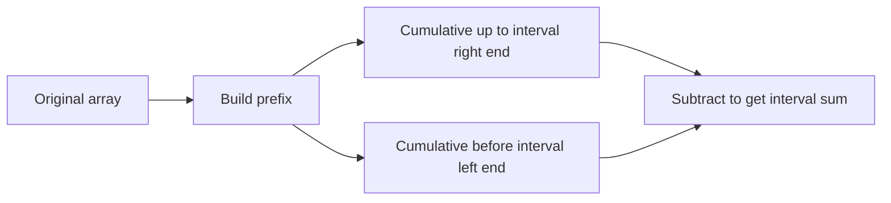
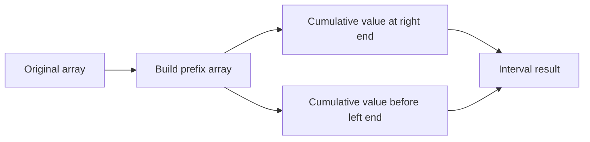

## Overview

**Prefix Sum** is a preprocessing technique: first store the cumulative value from the beginning to the current position, then the sum of any contiguous interval can be obtained by subtracting the results of two queries.

> Prerequisites
> - **Array indexing**: The prefix array usually has one extra slot to reduce boundary-handling overhead
> - **Interval representation**: Clearly distinguish the difference between `[l, r]` and `[l, r)`
> - **Hash map**: Used to count prefix sum occurrences, solving "subarrays with sum K"

---

## Problem Definition

Given an array and multiple interval queries, quickly compute the sum or related cumulative value of any contiguous interval.

| Element | Description |
|------|------|
| Input | Original array, interval endpoints, target sum |
| Output | Interval sum, number of qualifying subarrays, or derived cumulative value |
| Preprocessing | `prefix[i + 1] = prefix[i] + nums[i]` |
| Query formula | `sum(l, r) = prefix[r + 1] - prefix[l]` |

---

## Core Principle: Step-by-Step Illustration

Using the array `[1, 3, 5, 2, 4]` as an example:

```text
nums:    1   3   5   2   4
index:   0   1   2   3   4
prefix: 0   1   4   9   11  15
```

Querying the interval `nums[1..3]`:

```text
prefix[4] - prefix[1] = 11 - 1 = 10
nums[1] + nums[2] + nums[3] = 3 + 5 + 2 = 10
```



The advantage of having one extra slot `prefix[0] = 0` is that intervals starting from index `0` can also use the same formula.

---

## Detailed Algorithm Steps

```
算法：PrefixSum(nums)
输入：数组 nums
输出：可 O(1) 查询区间和的前缀数组

1. 创建长度为 nums.length + 1 的数组 prefix，初始为 0
2. for i from 0 to nums.length - 1:
3.     prefix[i + 1] ← prefix[i] + nums[i]
4. 查询 [l, r] 时返回 prefix[r + 1] - prefix[l]
```

**Complexity analysis**:

| Operation | Time complexity | Space complexity | Description |
|------|------|------|------|
| Build prefix sum | O(n) | O(n) | One linear scan |
| Single interval query | O(1) | O(1) | Subtract two prefix values |
| m interval queries | O(n + m) | O(n) | Preprocess first, then query |
| Subarray sum equals K | O(n) | O(n) | Prefix sum + hash counting |

---

## TypeScript Implementation

### 1. Basic Prefix Sum

```typescript
function buildPrefixSum(nums: number[]): number[] {
  const prefix = new Array(nums.length + 1).fill(0);

  for (let i = 0; i < nums.length; i++) {
    prefix[i + 1] = prefix[i] + nums[i];
  }

  return prefix;
}

function rangeSum(prefix: number[], left: number, right: number): number {
  return prefix[right + 1] - prefix[left];
}
```

### 2. Range Sum Query

```typescript
class NumArray {
  private prefix: number[];

  constructor(nums: number[]) {
    this.prefix = buildPrefixSum(nums);
  }

  sumRange(left: number, right: number): number {
    return this.prefix[right + 1] - this.prefix[left];
  }
}
```

### 3. Subarrays with Sum K

```typescript
function subarraySum(nums: number[], k: number): number {
  const countByPrefix = new Map<number, number>();
  countByPrefix.set(0, 1);

  let prefix = 0;
  let count = 0;

  for (const num of nums) {
    prefix += num;
    count += countByPrefix.get(prefix - k) ?? 0;
    countByPrefix.set(prefix, (countByPrefix.get(prefix) ?? 0) + 1);
  }

  return count;
}
```

### 4. Maximum Subarray Sum from a Prefix Perspective

```typescript
function maxSubArray(nums: number[]): number {
  let prefix = 0;
  let minPrefix = 0;
  let best = nums[0];

  for (const num of nums) {
    prefix += num;
    best = Math.max(best, prefix - minPrefix);
    minPrefix = Math.min(minPrefix, prefix);
  }

  return best;
}
```

### 5. Prefix Product Variant

```typescript
function productExceptSelf(nums: number[]): number[] {
  const result = new Array(nums.length).fill(1);

  let leftProduct = 1;
  for (let i = 0; i < nums.length; i++) {
    result[i] = leftProduct;
    leftProduct *= nums[i];
  }

  let rightProduct = 1;
  for (let i = nums.length - 1; i >= 0; i--) {
    result[i] *= rightProduct;
    rightProduct *= nums[i];
  }

  return result;
}
```

---

## Engineering Optimization: Unifying Interval Semantics

The most common bugs in prefix sums come from endpoint confusion. It is recommended to consistently use the pattern of "prefix array with one extra slot + querying the closed interval `[left, right]`".

| Scenario | Recommended expression | Reason |
|------|------|------|
| 1D interval sum | `prefix[right + 1] - prefix[left]` | Covers intervals starting from 0 |
| Subarray counting | `prefix - k` | Converts interval sums into historical prefix queries |
| 2D prefix sum | Add one extra row and column | Avoids special-casing the top and left boundaries |
| Frequent updates | Not suitable for ordinary prefix sums | Consider a Fenwick tree or segment tree instead |

If the array is modified frequently, ordinary prefix sums require rebuilding after every update, so you should switch to a data structure that supports dynamic updates.

---

## Applications and Limitations

### Typical Applications

- Multiple static interval sum queries
- Subarrays with sum K, contiguous interval counting
- 2D matrix region sum
- Variants such as prefix XOR, prefix product, prefix extrema, etc.

### Limitations

| Limitation | Description |
|------|------|
| Not suitable for frequent point updates | Updating one value affects all subsequent prefixes |
| Only suitable for invertible or accumulable operations | Interval sums can be subtracted, but maximum values cannot be directly subtracted |
| Requires extra space | Generally requires an O(n) preprocessing array |

---

## Summary



**Key points**:

1. Prefix sum = preprocessing cumulative values + O(1) interval queries.
2. Having one extra slot `prefix[0] = 0` unifies the boundary formula.
3. Prefix sum + hash map is the core model for "subarrays with sum K".
4. Use prefix sums for static queries; consider a Fenwick tree or segment tree for dynamic updates.