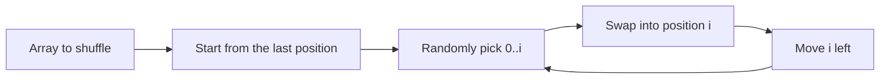
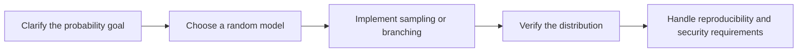

## Overview

**Randomized Algorithms** use random numbers to make choices, sample, or approximate estimates. They are commonly used to shuffle order, uniformly sample from a data stream, distribute traffic by weight, and estimate complex results through random sampling.

> Prerequisites
> - **Probability fundamentals**: understanding uniform and weighted probability
> - **Prefix sums / binary search**: for efficient weighted random selection
> - **Hash functions**: for stable traffic splitting, rather than being fully random each time

---

## Problem Definition

In scenarios involving uncertainty, design algorithms that satisfy probabilistic requirements while controlling time, space, and stability.

| Element | Description |
|------|------|
| Input | Array, data stream, weight table, or number of samples |
| Output | Random permutation, random sample, weighted result, or approximate value |
| Core requirements | Probabilistically correct, controllable complexity, reproducible when necessary |
| Typical algorithms | Fisher-Yates, reservoir sampling, weighted random, Monte Carlo |

---

## Core Principle: Step-by-Step Illustration

Fisher-Yates shuffle fixes positions from back to front, each time selecting an element from `[0, i]` with equal probability to swap:



Because the `i`-th position is chosen with equal probability from the remaining `i + 1` elements, every permutation has an equal probability of occurring.

---

## Detailed Algorithm Steps

```
Algorithm: FisherYatesShuffle(arr)
Input: array arr
Output: the array shuffled in place

1. for i from arr.length - 1 downto 1:
2.     j ← random integer in [0, i]
3.     swap arr[i] and arr[j]
4. return arr
```

**Complexity analysis**:

| Algorithm | Time complexity | Space complexity | Use case |
|------|------|------|------|
| Fisher-Yates | O(n) | O(1) | Uniform random permutation |
| Reservoir sampling | O(n) | O(k) | Sampling from data streams of unknown length |
| Weighted random linear version | O(n) | O(1) | Few selections |
| Prefix sum + binary search | O(log n) / op | O(n) | Multiple weighted selections |
| Monte Carlo | O(samples) | O(1) | Approximate estimation |

---

## TypeScript Implementation

### 1. Fisher-Yates Shuffle

```typescript
function shuffle<T>(arr: T[]): T[] {
  for (let i = arr.length - 1; i > 0; i--) {
    const j = Math.floor(Math.random() * (i + 1));
    [arr[i], arr[j]] = [arr[j], arr[i]];
  }

  return arr;
}
```

### 2. Reservoir Sampling

```typescript
function reservoirSampling<T>(stream: T[], k: number): T[] {
  const reservoir: T[] = [];

  for (let i = 0; i < stream.length; i++) {
    if (i < k) {
      reservoir.push(stream[i]);
    } else {
      const j = Math.floor(Math.random() * (i + 1));
      if (j < k) reservoir[j] = stream[i];
    }
  }

  return reservoir;
}
```

### 3. Weighted Random Selection

```typescript
interface WeightedItem<T> {
  value: T;
  weight: number;
}

function weightedRandom<T>(items: WeightedItem<T>[]): T {
  const total = items.reduce((sum, item) => sum + item.weight, 0);
  let random = Math.random() * total;

  for (const item of items) {
    random -= item.weight;
    if (random <= 0) return item.value;
  }

  return items[items.length - 1].value;
}
```

### 4. Prefix Sum + Binary Search Optimization

```typescript
class WeightedPicker<T> {
  private values: T[];
  private prefix: number[] = [];
  private total = 0;

  constructor(items: WeightedItem<T>[]) {
    this.values = items.map(item => item.value);

    for (const item of items) {
      this.total += item.weight;
      this.prefix.push(this.total);
    }
  }

  pick(): T {
    const target = Math.random() * this.total;
    let left = 0;
    let right = this.prefix.length - 1;

    while (left < right) {
      const mid = left + Math.floor((right - left) / 2);
      if (this.prefix[mid] < target) left = mid + 1;
      else right = mid;
    }

    return this.values[left];
  }
}
```

### 5. Monte Carlo Estimation of π

```typescript
function estimatePi(samples = 1_000_000): number {
  let inside = 0;

  for (let i = 0; i < samples; i++) {
    const x = Math.random();
    const y = Math.random();
    if (x * x + y * y <= 1) inside++;
  }

  return (inside / samples) * 4;
}
```

### 6. Stable A/B Splitting

```typescript
class ABTesting {
  private variants: string[];
  private weights: number[];

  constructor(config: Record<string, number>) {
    this.variants = Object.keys(config);
    this.weights = Object.values(config);
  }

  assign(userId: string): string {
    const total = this.weights.reduce((sum, weight) => sum + weight, 0);
    const bucket = this.hashCode(userId) % total;
    let current = 0;

    for (let i = 0; i < this.variants.length; i++) {
      current += this.weights[i];
      if (bucket < current) return this.variants[i];
    }

    return this.variants[this.variants.length - 1];
  }

  private hashCode(str: string): number {
    let hash = 0;
    for (let i = 0; i < str.length; i++) {
      hash = ((hash << 5) - hash + str.charCodeAt(i)) | 0;
    }
    return Math.abs(hash);
  }
}
```

---

## Engineering Optimization: Randomness, Security, and Reproducibility

| Scenario | Recommended approach | Reason |
|------|------|------|
| Ordinary UI randomness | `Math.random()` | Simple and sufficient |
| Security-sensitive randomness | `crypto.getRandomValues()` | `Math.random()` is not suitable for security purposes |
| A/B testing | Hash user ID | Ensures the same user is consistently grouped |
| Testing randomized algorithms | Inject random number generator | Facilitates reproduction and unit testing |
| Multiple weighted selections | Prefix sum + binary search | O(log n) per operation after preprocessing |

The correctness of randomized algorithms is usually probabilistic, and a single result should not be used to judge whether an implementation is correct.

---

## Applications and Limitations

### Typical Applications

- List shuffling, random playback, lotteries
- Log stream and data stream sampling
- A/B testing and gradual rollout
- Monte Carlo estimation, randomized QuickSelect

### Limitations

| Limitation | Description |
|------|------|
| Unstable results | The random source must be controlled when reproducibility is required |
| Difficult probability verification | Requires statistical testing rather than a single example |
| Different security requirements | Business randomness and cryptographic randomness cannot be mixed |

---

## Summary



**Key points**:

1. Fisher-Yates is the standard algorithm for uniform shuffling.
2. Reservoir sampling is suitable for data streams of unknown length.
3. Multiple weighted selections can be optimized with prefix sums and binary search.
4. Do not use `Math.random()` in security scenarios.