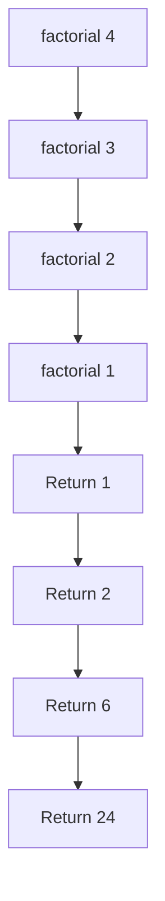
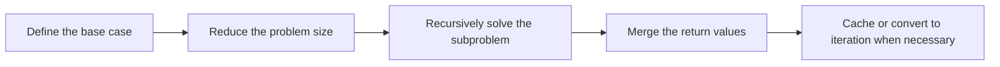

## Overview

**Recursion** is a programming method in which a function calls itself directly or indirectly. It breaks a large problem into smaller problems of the same structure, stops splitting through a termination condition, and combines the results during the return process.

> Prerequisites
> - **Call stack**: each recursive call saves the current execution context
> - **Divide and conquer**: recursion is often used to break a problem into subproblems of the same structure
> - **Tree structure**: trees are naturally recursive by definition, and traversal is best expressed recursively

---

## Problem Definition

When a problem can be described as "the current answer depends on a smaller instance of the same kind of problem," recursion can be considered.

| Element | Description |
|------|------|
| Input | The current problem size or current node |
| Output | The result at the current size |
| Termination condition | The direct answer to the smallest problem |
| Recurrence relation | How the current result is obtained from subproblems |

---

## Core Principle: Step-by-Step Illustration

Take factorial `factorial(4)` as an example:



Recursion involves two directions:

1. **Descending**: continuously break the problem into smaller pieces until the termination condition is hit.
2. **Returning**: after subproblems return their results, merge them layer by layer into the final answer.

If the termination condition is unreachable, recursion will call indefinitely and eventually cause a stack overflow.

---

## Detailed Algorithm Steps

```
算法：RecursiveSolve(problem)
输入：当前问题 problem
输出：problem 的答案

1. 如果 problem 是最小问题，返回已知答案
2. 将 problem 转化为一个或多个更小的同类问题
3. 递归求解子问题
4. 将子问题结果组合成当前问题答案
5. 返回答案
```

**Complexity analysis**:

| Example | Time complexity | Space complexity | Description |
|------|------|------|------|
| Factorial | O(n) | O(n) | Recursion depth is n |
| Naive Fibonacci | O(2^n) | O(n) | Massive repeated computation |
| Memoized Fibonacci | O(n) | O(n) | Cache each subproblem |
| Binary tree depth | O(n) | O(h) | h is the tree height |
| Fast exponentiation | O(log n) | O(log n) | Size halves each time |

---

## TypeScript Implementation

### 1. Factorial

```typescript
function factorial(n: number): number {
  if (n <= 1) return 1;
  return n * factorial(n - 1);
}
```

### 2. Fibonacci and Memoization

```typescript
function fib(n: number): number {
  if (n <= 1) return n;
  return fib(n - 1) + fib(n - 2);
}

function fibMemo(n: number, memo = new Map<number, number>()): number {
  if (n <= 1) return n;
  if (memo.has(n)) return memo.get(n)!;

  const value = fibMemo(n - 1, memo) + fibMemo(n - 2, memo);
  memo.set(n, value);
  return value;
}
```

### 3. Tower of Hanoi

```typescript
function hanoi(n: number, from: string, to: string, via: string): void {
  if (n === 1) {
    console.log(`${from} -> ${to}`);
    return;
  }

  hanoi(n - 1, from, via, to);
  console.log(`${from} -> ${to}`);
  hanoi(n - 1, via, to, from);
}
```

### 4. Fast Exponentiation

```typescript
function myPow(x: number, n: number): number {
  if (n === 0) return 1;
  if (n < 0) return 1 / myPow(x, -n);

  const half = myPow(x, Math.floor(n / 2));
  return n % 2 === 0 ? half * half : half * half * x;
}
```

### 5. Maximum Depth of a Binary Tree

```typescript
interface TreeNode {
  val: number;
  left: TreeNode | null;
  right: TreeNode | null;
}

function maxDepth(root: TreeNode | null): number {
  if (root === null) return 0;
  return 1 + Math.max(maxDepth(root.left), maxDepth(root.right));
}
```

### 6. Converting Recursion to Iteration

```typescript
function sumRecursive(n: number): number {
  if (n === 0) return 0;
  return n + sumRecursive(n - 1);
}

function sumIterative(n: number): number {
  let sum = 0;
  for (let i = 1; i <= n; i++) {
    sum += i;
  }
  return sum;
}
```

---

## Engineering Optimization: Memoization and Stack Depth Control

| Problem | Optimization method | Description |
|------|------|------|
| Repeated computation | Memoized search | Use a Map to cache subproblem results |
| Excessive stack depth | Rewrite as iteration | Avoid call stack overflow |
| Tail recursion | Accumulator parameter | JavaScript engines do not guarantee tail call optimization |
| Global state pollution | Parameter passing / local variables | Recursive functions become more reusable |

Tail-recursive code is closer to iteration, but in JavaScript/TypeScript environments you cannot rely on the runtime to automatically optimize the call stack.

---

## Applications and Limitations

### Typical Applications

- Traversal of trees and graphs
- Divide-and-conquer algorithms: merge sort, quicksort, fast exponentiation
- Memoized search versions of dynamic programming
- Backtracking and combinatorial enumeration

### Limitations

| Limitation | Description |
|------|------|
| Stack overflow | The call stack becomes uncontrollable when depth is too large |
| Repeated computation | Naive recursion may degrade exponentially |
| Debugging cost | State tracking is harder with multiple call layers |

---

## Summary



**Key points**:

1. The three essential elements of recursion are the termination condition, the recurrence relation, and the return value.
2. Recursion is suitable for problems that are naturally hierarchical, such as tree-shaped, divide-and-conquer, and backtracking problems.
3. Overlapping subproblems require memoization to avoid exponential repeated computation.
4. When depth is uncontrollable, prefer rewriting to an explicit stack or iteration.