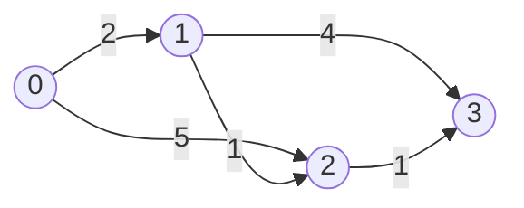
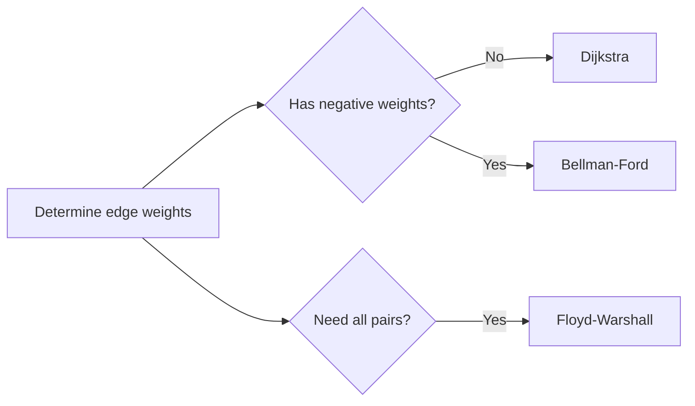

## Overview

**Shortest path** studies the minimum-cost path from one point to another in a graph. Depending on whether edge weights can be negative and whether all-pairs results are needed, common algorithms include Dijkstra, Bellman-Ford, and Floyd-Warshall.

> Prerequisites
> - **Adjacency list / edge list for graphs**: different algorithms suit different representations
> - **Relaxation operation**: update distances using shorter paths
> - **Priority queue**: used to optimize Dijkstra's selection of the minimum-distance node

---

## Problem Definition

Given a weighted graph, a source and target or all nodes, compute the path length with the smallest sum of path weights.

| Element | Description |
|------|------|
| Input | Vertices, weighted edges, a source or all points |
| Output | Single-source distance array, a single target distance, or an all-pairs distance matrix |
| Core operation | Relaxation: `dist[v] = min(dist[v], dist[u] + w)` |
| Algorithm choice | Use Dijkstra when there are no negative weights, Bellman-Ford when there are negative weights, and Floyd for multiple sources |

---

## Core Principle: Step-by-Step Illustration

Dijkstra determines, at each step, the point with the smallest distance among the currently unvisited nodes:



Starting from `0`:

1. Initially `dist[0] = 0`, others are infinity.
2. Select the undetermined node with the smallest distance.
3. Use its outgoing edges to update neighbor distances.
4. Repeat until all reachable nodes are determined.

Dijkstra relies on the greedy property that "the current shortest node will not be updated again," so it cannot handle negative-weight edges.

---

## Detailed Algorithm Steps

```
Algorithm: Dijkstra(graph, start)
Input: non-negative weight graph graph, starting point start
Output: shortest distance from start to each node

1. Initialize all dist to Infinity, dist[start] = 0
2. Add [start, 0] to the priority queue
3. while the queue is not empty:
4.     Extract the node u with the smallest distance
5.     If that distance is already stale, skip
6.     Traverse all edges u -> v of u, with weight w:
7.         If dist[u] + w < dist[v]:
8.             Update dist[v] and add it to the queue
9. Return dist
```

**Complexity analysis**:

| Algorithm | Applicable scenario | Time complexity | Space complexity |
|------|------|------|------|
| Dijkstra naive version | No negative weights, dense graph | O(V² + E) | O(V) |
| Dijkstra heap-optimized | No negative weights, sparse graph | O(E log V) | O(V + E) |
| Bellman-Ford | May contain negative-weight edges | O(VE) | O(V) |
| Floyd-Warshall | All pairs | O(V³) | O(V²) |

---
## TypeScript Implementation

### 1. Graph Types and Naive Dijkstra

```typescript
type WeightedGraph = [number, number][][];

function dijkstra(graph: WeightedGraph, start: number): number[] {
  const n = graph.length;
  const dist = new Array(n).fill(Infinity);
  const visited = new Array(n).fill(false);
  dist[start] = 0;

  for (let i = 0; i < n; i++) {
    let u = -1;
    for (let j = 0; j < n; j++) {
      if (!visited[j] && (u === -1 || dist[j] < dist[u])) u = j;
    }

    if (u === -1 || dist[u] === Infinity) break;
    visited[u] = true;

    for (const [v, weight] of graph[u]) {
      if (dist[u] + weight < dist[v]) {
        dist[v] = dist[u] + weight;
      }
    }
  }

  return dist;
}
```

### 2. Heap-Optimized Dijkstra

```typescript
class MinHeap {
  private heap: [number, number][] = [];

  push(item: [number, number]): void {
    this.heap.push(item);
    this.bubbleUp(this.heap.length - 1);
  }

  pop(): [number, number] | undefined {
    if (this.heap.length === 0) return undefined;
    if (this.heap.length === 1) return this.heap.pop();

    const top = this.heap[0];
    this.heap[0] = this.heap.pop()!;
    this.bubbleDown(0);
    return top;
  }

  get size(): number {
    return this.heap.length;
  }

  private bubbleUp(index: number): void {
    while (index > 0) {
      const parent = Math.floor((index - 1) / 2);
      if (this.heap[parent][1] <= this.heap[index][1]) break;
      [this.heap[parent], this.heap[index]] = [this.heap[index], this.heap[parent]];
      index = parent;
    }
  }

  private bubbleDown(index: number): void {
    while (true) {
      const left = index * 2 + 1;
      const right = index * 2 + 2;
      let smallest = index;

      if (left < this.heap.length && this.heap[left][1] < this.heap[smallest][1]) smallest = left;
      if (right < this.heap.length && this.heap[right][1] < this.heap[smallest][1]) smallest = right;
      if (smallest === index) break;

      [this.heap[smallest], this.heap[index]] = [this.heap[index], this.heap[smallest]];
      index = smallest;
    }
  }
}

function dijkstraHeap(graph: WeightedGraph, start: number): number[] {
  const dist = new Array(graph.length).fill(Infinity);
  const heap = new MinHeap();
  dist[start] = 0;
  heap.push([start, 0]);

  while (heap.size > 0) {
    const [node, distance] = heap.pop()!;
    if (distance > dist[node]) continue;

    for (const [next, weight] of graph[node]) {
      const nextDistance = distance + weight;
      if (nextDistance < dist[next]) {
        dist[next] = nextDistance;
        heap.push([next, nextDistance]);
      }
    }
  }

  return dist;
}
```

### 3. Bellman-Ford

```typescript
function bellmanFord(edges: [number, number, number][], n: number, start: number): number[] {
  const dist = new Array(n).fill(Infinity);
  dist[start] = 0;

  for (let i = 0; i < n - 1; i++) {
    let updated = false;

    for (const [from, to, weight] of edges) {
      if (dist[from] !== Infinity && dist[from] + weight < dist[to]) {
        dist[to] = dist[from] + weight;
        updated = true;
      }
    }

    if (!updated) break;
  }

  for (const [from, to, weight] of edges) {
    if (dist[from] !== Infinity && dist[from] + weight < dist[to]) {
      throw new Error('存在负权环');
    }
  }

  return dist;
}
```

### 4. Floyd-Warshall

```typescript
function floydWarshall(graph: number[][]): number[][] {
  const n = graph.length;
  const dist = graph.map(row => [...row]);

  for (let k = 0; k < n; k++) {
    for (let i = 0; i < n; i++) {
      for (let j = 0; j < n; j++) {
        if (dist[i][k] + dist[k][j] < dist[i][j]) {
          dist[i][j] = dist[i][k] + dist[k][j];
        }
      }
    }
  }

  return dist;
}
```

---

## Engineering Optimization: Choosing an Algorithm by Graph Type

| Graph Characteristics | Recommended Algorithm | Reason |
|------|------|------|
| Non-negative weight, single source | Dijkstra + priority queue | Fast, most commonly used |
| Negative weight edges | Bellman-Ford | Can detect negative weight cycles |
| All pairs | Floyd-Warshall | Simple to implement, suitable for fewer nodes |
| All edge weights are 1 | BFS | No need for a shortest path weight algorithm |
| 0/1 edge weights | 0-1 BFS | Can be optimized with a deque |

In practical engineering, also pay attention to distance overflow, representation of unreachable nodes, whether the graph is directed, and whether input node numbering starts from 0.

---

## Applications and Limitations

### Typical Applications

- Map navigation, route planning
- Network delay time, task chain cost
- Game pathfinding, resource allocation on graphs
- Multi-source distance preprocessing

### Limitations

| Limitation | Description |
|------|------|
| Dijkstra does not support negative weights | Negative weights break the correctness of the greedy approach |
| Floyd is costly | O(V³) is only suitable for graphs with a small number of nodes |
| Graph modeling affects results | Edge direction, weights, and node numbering must be clearly defined |

---

## Summary



**Key Points**:

1. The core operation of shortest paths is edge relaxation.
2. For single-source shortest paths without negative weights, prefer Dijkstra.
3. When there are negative weight edges, use Bellman-Ford and detect negative weight cycles.
4. For all-pairs shortest paths, Floyd can be used, but you must accept the O(V³) cost.

--- END CONTENT ---