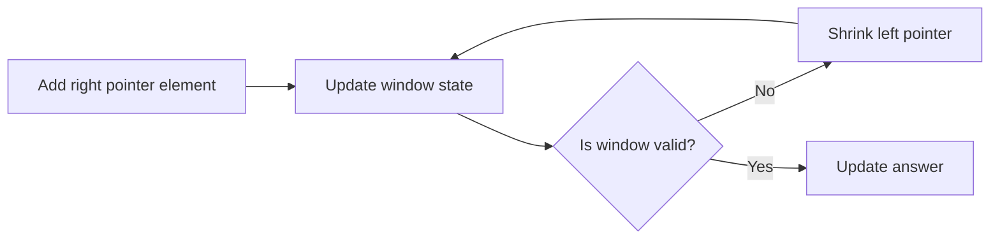
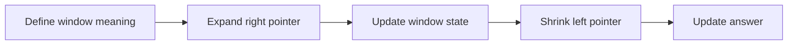

## Overview

**Sliding Window** is a common form of the two-pointer technique applied to contiguous interval problems. It maintains a window `[left, right]` or `[left, right)`, and as the right pointer expands and the left pointer contracts, it handles subarray or substring problems in O(n) time.

> Prerequisites
> - **Two Pointers**: the window's left and right boundaries are maintained by two pointers
> - **Hash Map / Counter**: tracks the state of characters or elements within the window
> - **Interval Invariant**: clearly defines what condition the window currently satisfies or fails to satisfy

---

## Problem Definition

Given an array or string, find a contiguous interval that satisfies some condition, such as maximum length, minimum length, fixed-length optimum, or coverage relationship.

| Element | Description |
|------|------|
| Input | Array, string, target length, or constraint conditions |
| Output | Longest/shortest window length, window contents, or statistical value |
| Core State | `left`, `right`, window counts, current answer |
| Common Types | Fixed-length window, variable-length window, covering window |

---

## Core Principle: Step-by-Step Illustration

Taking the variable-length window as an example, the right pointer is responsible for expansion, and the left pointer is responsible for restoring the condition:

```text
s:      a  b  c  a  b  c  b  b
index:  0  1  2  3  4  5  6  7
window: [left ...... right]
```



The reason sliding window is O(n) is that each element is added by the right pointer at most once and removed by the left pointer at most once.

---

## Detailed Algorithm Steps

```
Algorithm: VariableSlidingWindow(nums)
Input: array or string nums
Output: the optimal window that satisfies the condition

1. left ← 0
2. Initialize the window state window
3. for right from 0 to nums.length - 1:
4.     Add nums[right] to window
5.     while window does not satisfy the constraint:
6.         Remove nums[left] from window
7.         left ← left + 1
8.     Update the answer with the current window
9. Return the answer
```

**Complexity Analysis**:

| Window Type | Time Complexity | Space Complexity | Description |
|------|------|------|------|
| Fixed-length window | O(n) | O(1) | One in, one out each time |
| Variable-length window | O(n) | O(k) | k is the number of distinct elements in the window |
| Covering window | O(n) | O(alphabet size) | Requires maintaining need/window counts |
| Brute force enumeration | O(n²) or higher | O(1) | Enumerate all contiguous intervals |

---

## TypeScript Implementation

### 1. Maximum Sum of Fixed-Length Window

```typescript
function maxSumSubarray(nums: number[], k: number): number {
  let sum = 0;

  for (let i = 0; i < k; i++) {
    sum += nums[i];
  }

  let best = sum;
  for (let right = k; right < nums.length; right++) {
    sum += nums[right] - nums[right - k];
    best = Math.max(best, sum);
  }

  return best;
}
```

### 2. Maximum Average

```typescript
function findMaxAverage(nums: number[], k: number): number {
  return maxSumSubarray(nums, k) / k;
}
```

### 3. Longest Substring Without Repeating Characters

```typescript
function lengthOfLongestSubstring(s: string): number {
  const window = new Map<string, number>();
  let left = 0;
  let best = 0;

  for (let right = 0; right < s.length; right++) {
    const char = s[right];
    window.set(char, (window.get(char) ?? 0) + 1);

    while (window.get(char)! > 1) {
      const removed = s[left];
      window.set(removed, window.get(removed)! - 1);
      left++;
    }

    best = Math.max(best, right - left + 1);
  }

  return best;
}
```

### 4. Minimum Size Subarray Sum

```typescript
function minSubArrayLen(target: number, nums: number[]): number {
  let left = 0;
  let sum = 0;
  let best = Infinity;

  for (let right = 0; right < nums.length; right++) {
    sum += nums[right];

    while (sum >= target) {
      best = Math.min(best, right - left + 1);
      sum -= nums[left];
      left++;
    }
  }

  return best === Infinity ? 0 : best;
}
```

### 5. Minimum Window Substring

```typescript
function minWindow(s: string, t: string): string {
  const need = new Map<string, number>();
  const window = new Map<string, number>();

  for (const char of t) {
    need.set(char, (need.get(char) ?? 0) + 1);
  }

  let left = 0;
  let valid = 0;
  let start = 0;
  let minLength = Infinity;

  for (let right = 0; right < s.length; right++) {
    const char = s[right];
    if (need.has(char)) {
      window.set(char, (window.get(char) ?? 0) + 1);
      if (window.get(char) === need.get(char)) valid++;
    }

    while (valid === need.size) {
      if (right - left + 1 < minLength) {
        start = left;
        minLength = right - left + 1;
      }

      const removed = s[left];
      left++;

      if (need.has(removed)) {
        if (window.get(removed) === need.get(removed)) valid--;
        window.set(removed, window.get(removed)! - 1);
      }
    }
  }

  return minLength === Infinity ? '' : s.slice(start, start + minLength);
}
```

---

## Engineering Optimization: Window State Must Be Incrementally Maintainable

The premise of sliding window is that when the window changes, the state can be updated quickly.

| State | Entering Window | Leaving Window | Applicable Problems |
|------|------|------|------|
| Sum | `sum += x` | `sum -= x` | Subarray sum, average |
| Count | `count[x]++` | `count[x]--` | Character coverage, frequency limits |
| Deduplication | Record occurrence count | Shrink on duplicate | Substring without repeats |
| Max/Min | Monotonic queue | Dequeue expired elements | Window maximum |

If the window state cannot be updated in O(1) or amortized O(1), the sliding window may degrade, and you should consider a monotonic queue, heap, or other structures.

---

## Applications and Limitations

### Typical Applications

- Longest or shortest subarray/substring problems
- Fixed-length window statistics
- String coverage, anagrams, repeated character limits
- Statistics over the most recent segment of streaming data

### Limitations

| Limitation | Description |
|------|------|
| Must be a contiguous interval | Non-contiguous subsequences do not apply |
| Condition must be maintainable | State must be quickly updatable after window expansion/contraction |
| Monotonicity requirement | Variable-length windows typically rely on "shrinking improves the constraint" |

---

## Summary



**Key Points**:

1. Sliding window is suitable for contiguous subarray and substring problems.
2. Fixed-length windows focus on balancing entry and exit; variable-length windows focus on maintaining validity.
3. Each element enters and leaves the window at most once, so it is typically O(n).
4. Define the window state and shrink condition before writing code.

## Related Articles

- [Sliding Window Core Code Template: Three Questions to Solve All Substring and Subarray Problems](/technology/sliding-window-template/) — Condenses the categories in this article into a reusable skeleton: when to expand, when to shrink, when to update the result, and why the window interval is written as left-closed right-open
- [Array Two Pointers: An Optimization Tool from O(n²) to O(n)](/technology/two-pointers-array/) — The two-pointer idea behind sliding window
- [Classic Array Two-Pointer Exercises (Part 1): One-Dimensional Arrays and Strings](/technology/two-pointers-exercises-1d/) — Fast-slow pointers, left-right pointers, and Dutch national flag
- [Hash Map: From Two Sum to Subarray Sum](/technology/hash/) — Sliding window is often used in conjunction with hash counting