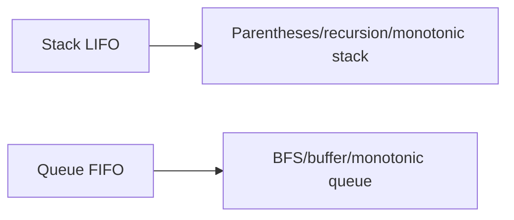

## Overview

Stacks and queues are both restricted linear structures. They do not emphasize "access at arbitrary positions"; instead, they emphasize "the order in which elements enter and leave."

- Stack: last in, first out, like a stack of plates;
- Queue: first in, first out, like waiting in line.

These two structures may seem simple, but they are the foundation of recursion, expression parsing, BFS, task scheduling, monotonic stacks, and monotonic queues.

> Prerequisites
> - **LIFO / FIFO**: stacks are last in, first out; queues are first in, first out
> - **Array implementation**: pay attention to the cost of `push/pop` and `shift/unshift`
> - **Monotonic structures**: use a stack or queue to maintain an ordered candidate set

---

## Problem Definition

Stacks and queues solve the problem of "order control."

| Structure | Insert | Remove | Order |
| --- | --- | --- | --- |
| Stack | `push` | `pop` | Last in, first out |
| Queue | `enqueue` | `dequeue` | First in, first out |

If a problem cares about "the most recently added element," you usually think of a stack; if a problem cares about "the earliest waiting element," you usually think of a queue.

---

## Core Principles: Step-by-Step Illustration

### Stack

```text
push 1 -> [1]
push 2 -> [1, 2]
pop    -> [1]，返回 2
```

A stack operates only on the same end, so both push and pop are O(1).

### Queue

```text
enqueue 1 -> [1]
enqueue 2 -> [1, 2]
dequeue   -> [2]，返回 1
```

A queue enters from the tail and leaves from the head. Using a JavaScript array directly with `shift` will shift elements, so a better implementation is to maintain a head pointer.

### Monotonic Structures

Monotonic stacks and monotonic queues remove, during insertion, elements that can no longer become the answer:

```text
保持从大到小：
入队 3: [3]
入队 1: [3, 1]
入队 2: [3, 2]  // 1 被移除
```

This kind of structure optimizes many problems of "find the first greater value to the left/right" to O(n).

---

## Basic Operations and Complexity

| Structure | Operation | Time Complexity | Description |
| --- | --- | --- | --- |
| Stack | push / pop / peek | O(1) | Operates only on the tail |
| Queue | enqueue / dequeue / peek | O(1) | Uses head and tail pointers |
| Monotonic stack | push / pop | Amortized O(1) | Each element is pushed and popped at most once |
| Monotonic queue | push / shift | Amortized O(1) | Maintains the window extremum |

"Amortized O(1)" means: a single operation may pop multiple elements, but each element is popped only once over its entire lifetime.

---

## TypeScript Implementation

### 1. Stack

```typescript
class Stack<T> {
  private readonly items: T[] = [];

  push(value: T): void {
    this.items.push(value);
  }

  pop(): T | undefined {
    return this.items.pop();
  }

  peek(): T | undefined {
    return this.items[this.items.length - 1];
  }

  get size(): number {
    return this.items.length;
  }
}
```

### 2. Queue

```typescript
class Queue<T> {
  private readonly items: T[] = [];
  private head = 0;

  enqueue(value: T): void {
    this.items.push(value);
  }

  dequeue(): T | undefined {
    if (this.head >= this.items.length) return undefined;

    const value = this.items[this.head];
    this.head++;

    if (this.head > 32 && this.head * 2 > this.items.length) {
      this.items.splice(0, this.head);
      this.head = 0;
    }

    return value;
  }

  get size(): number {
    return this.items.length - this.head;
  }
}
```

This queue avoids `shift` on every dequeue, and only performs a compaction when there is a lot of wasted space at the head.

### 3. Monotonic Stack: Next Greater Element

```typescript
function nextGreater(nums: number[]): number[] {
  const result = Array(nums.length).fill(-1);
  const stack: number[] = [];

  for (let i = 0; i < nums.length; i++) {
    while (stack.length > 0 && nums[i] > nums[stack[stack.length - 1]]) {
      const index = stack.pop()!;
      result[index] = nums[i];
    }

    stack.push(i);
  }

  return result;
}
```

The stack stores indices, not values, because the answer needs to be written back to the original position.

---

## Engineering Optimization: Avoid Misusing Array APIs

In JavaScript, operations at the end of an array are fast:

```typescript
arr.push(value);
arr.pop();
```

But operations at the head will shift elements:

```typescript
arr.shift();
arr.unshift(value);
```

If the queue size is small, using `shift` directly is acceptable; if the queue is on a hot path, you should use a head pointer, a circular array, or a deque implementation.

---

## Applications and Limitations

### Typical Applications

- Stack: bracket matching, function calls, undo operations, DFS;
- Queue: BFS, task scheduling, message buffering;
- Monotonic stack: next greater element, largest rectangle in a histogram;
- Monotonic queue: sliding window maximum.

### Limitations

- Stacks and queues do not support efficient access to middle elements;
- When implementing a queue with a normal array, avoid frequent `shift`;
- Monotonic structures are only suitable for problems where invalid candidates can be eliminated;
- When the stack depth is too large, recursive calls may hit the call stack limit.

---

## Summary



- A stack is last in, first out; a queue is first in, first out.
- Their value lies in controlling processing order, not random access.
- Queue implementations should avoid O(n) shifting caused by frequent deletion at the head.
- Monotonic stacks and monotonic queues optimize problems to linear time by deleting invalid candidates.