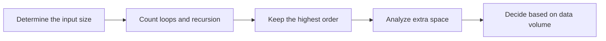

## Overview

**Time complexity** and **space complexity** are used to describe how the running time and memory usage of code grow as the input size increases. They don't care about the specific time taken on a particular machine, but rather about the growth trend.

> Prerequisites
> - **Input size n**: array length, number of nodes, string length, etc.
> - **Loops and recursion**: complexity usually comes from the number of repeated executions
> - **Cost of data structure operations**: the complexity of APIs for arrays, Maps, Sets, sorting, etc. differs

---

## Problem Definition

Given a piece of code or an algorithm, estimate its time and space cost as the input size grows.

| Element | Description |
|------|------|
| Input | A program, algorithm, or data structure operation |
| Output | Time complexity, space complexity, and the main bottleneck |
| Analysis goal | Find the fastest-growing part, ignoring constants and lower-order terms |
| Common results | O(1), O(log n), O(n), O(n log n), O(n²), O(2^n) |

---

## Core Principle: Step-by-Step Diagram

Finding one user among 1 million users:

```typescript
interface User {
  id: number;
  name: string;
}

function findUserLinear(users: User[], id: number): User | null {
  for (const user of users) {
    if (user.id === id) return user;
  }
  return null;
}

const userMap = new Map<number, User>();
function findUserByMap(id: number): User | undefined {
  return userMap.get(id);
}
```

```mermaid
graph LR
    A[Input size n grows] --> B[Linear scan O(n)]
    A --> C[Hash lookup O(1)]
    B --> D[The larger the data, the slower]
    C --> E[Query cost stays basically stable]
```

Big O notation keeps only the fastest-growing term:

```text
T(n) = 3n² + 100n + 5000  =>  O(n²)
T(n) = 50n + 1000         =>  O(n)
T(n) = 200                =>  O(1)
```

---

## Detailed Algorithm Steps

```
Algorithm: AnalyzeComplexity(code)
Input: A piece of code or an algorithm
Output: Time complexity and space complexity

1. Clarify what the input size n represents
2. Identify the statements that are repeatedly executed as n grows
3. Count the number of loop, recursive, or data structure operations
4. Keep the fastest-growing term, ignore constants and lower-order terms
5. Count the additionally allocated space; do not count the input itself as additional space
```

**Common complexity comparison**:

| Complexity | Growth pattern | Typical scenarios |
|------|------|------|
| O(1) | Does not change with input size | Array index access, Map lookup |
| O(log n) | Eliminates half each time | Binary search, heap operations |
| O(n) | Traverses the input once | Summation, filtering, linear search |
| O(n log n) | O(n) per level, log n levels total | Merge sort, heap sort |
| O(n²) | Double enumeration | Brute-force pair matching, matrix traversal |
| O(2^n) | Each element chosen or not | Subset enumeration, naive recursion |

---

## TypeScript Implementation

### 1. O(1): Constant time

```typescript
function getFirst<T>(arr: T[]): T | undefined {
  return arr[0];
}

function getByKey<K, V>(map: Map<K, V>, key: K): V | undefined {
  return map.get(key);
}
```

### 2. O(log n): Binary search

```typescript
function binarySearch(nums: number[], target: number): number {
  let left = 0;
  let right = nums.length - 1;

  while (left <= right) {
    const mid = left + Math.floor((right - left) / 2);
    if (nums[mid] === target) return mid;
    if (nums[mid] < target) left = mid + 1;
    else right = mid - 1;
  }

  return -1;
}
```

### 3. O(n): Linear scan

```typescript
function sum(nums: number[]): number {
  let total = 0;
  for (const num of nums) {
    total += num;
  }
  return total;
}

function findMax(nums: number[]): number {
  let max = nums[0];
  for (const num of nums) {
    if (num > max) max = num;
  }
  return max;
}
```

### 4. Optimizing O(n²) to O(n)

```typescript
function findDuplicatesSlow(nums: number[]): number[] {
  const result: number[] = [];

  for (let i = 0; i < nums.length; i++) {
    for (let j = i + 1; j < nums.length; j++) {
      if (nums[i] === nums[j]) result.push(nums[i]);
    }
  }

  return result;
}

function findDuplicatesFast(nums: number[]): number[] {
  const seen = new Set<number>();
  const duplicates = new Set<number>();

  for (const num of nums) {
    if (seen.has(num)) duplicates.add(num);
    else seen.add(num);
  }

  return [...duplicates];
}
```

### 5. Space complexity comparison

```typescript
function reverseInPlace<T>(arr: T[]): T[] {
  let left = 0;
  let right = arr.length - 1;

  while (left < right) {
    [arr[left], arr[right]] = [arr[right], arr[left]];
    left++;
    right--;
  }

  return arr;
}

function reverseNew<T>(arr: T[]): T[] {
  const result: T[] = [];
  for (let i = arr.length - 1; i >= 0; i--) {
    result.push(arr[i]);
  }
  return result;
}
```

---

## Engineering Optimization: Look at the Data Size Before Optimizing

The purpose of complexity analysis is not to make all code extremely optimized, but to determine where the risk lies at the current data scale.

| Data size | Rule of thumb | Recommendation |
|------|------|------|
| < 1,000 | Most approaches are acceptable | Prioritize readability |
| 1,000 ~ 100,000 | Avoid O(n²) | Use Map/Set, sorting, two pointers |
| 100,000 ~ 1,000,000 | Watch out for large constants and memory copying | Prefer O(n log n) or O(n) |
| > 1,000,000 | Focus on indexing, pagination, streaming | Aim for O(log n) / O(1) queries |

Frontend scenarios also have complexity issues: rendering large lists, search suggestions, table filtering, and component tree re-rendering all require attention to input size.

---

## Applications and Limitations

### Typical applications

- Assessing whether an algorithm solution can pass within the data range
- Determining the performance risk of APIs, lists, and searches under large data volumes
- Choosing data structures such as arrays, Maps, Sets, heaps, and trees
- Explaining the cost of sorting, searching, traversal, and recursion

### Limitations

| Limitation | Description |
|------|------|
| Ignores constants | O(n) is not always faster than O(n log n) |
| Ignores hardware factors | Cache, IO, and network latency may matter more |
| Average and worst case differ | Hashing, quicksort, etc. need to distinguish scenarios |
| Only looks at growth trends | With small data, readability is often more important than complexity |

---

## Summary



**Key points**:

1. Big O describes the growth trend, not the exact running time.
2. Time complexity looks at the number of executions; space complexity looks at extra usage.
3. Map/Set are often used to trade space for time, reducing O(n²) to O(n).
4. Before optimizing, look at the data size first, to avoid sacrificing readability for small-scale scenarios.