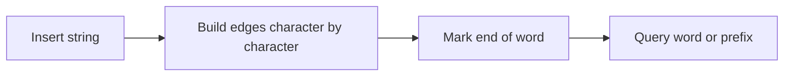

## Overview

A Trie, also called a dictionary tree or prefix tree, is a data structure specifically designed for handling string prefixes. It breaks words into character paths, and words sharing the same prefix share the same segment of nodes.

If you frequently need to do things like "does a certain word exist," "does a certain prefix exist," or "autocomplete based on an input prefix," a Trie is more natural than scanning strings one by one.

Its core idea is: use tree paths to represent strings.

> Prerequisites
> - **Tree structure**: each edge represents a character
> - **Hash map / array**: node child links can be stored using a Map or an array
> - **Prefix matching**: the query process goes down level by level along characters

---

## Problem Definition

Suppose there are three words:

```text
cat
car
dog
```

The Trie organizes them as:

```text
root
├─ c
│  └─ a
│     ├─ t (word)
│     └─ r (word)
└─ d
   └─ o
      └─ g (word)
```

This way, when querying the prefix `ca`, you only need to walk `c -> a` to know which words share this prefix.

Problems a Trie is suited for:

| Requirement | Plain array | Trie |
| --- | --- | --- |
| Determine whether a word exists | O(n * L) | O(L) |
| Determine whether a prefix exists | O(n * L) | O(L) |
| Autocomplete | Need to scan all words | Locate the prefix, then traverse the subtree |

Here `L` is the word length, and `n` is the number of words.

---

## Core Principle: Step-by-Step Diagram

### Inserting a Word

Insert `cat`:

```text
root -> c -> a -> t
```

If the path does not exist, create nodes; if the path already exists, reuse the nodes. Finally, mark the `t` node as "this is a complete word."

### Querying a Word

Query `car`:

1. Start from root;
2. Look up `c`, `a`, `r` in order;
3. If the path breaks, the word does not exist;
4. If the path exists, you still need to check whether the final node is marked as a complete word.

### Querying a Prefix

Querying a prefix only requires the path to exist; it does not require the final node to be a complete word.

This is the difference between `search("ca")` and `startsWith("ca")`.

---

## Detailed Algorithm Steps

A Trie node usually contains:

```text
children: mapping from the current character to child nodes
isWord:   whether a complete word ends here
```

Insertion process:

1. Start from the root node;
2. Traverse each character of the word;
3. If the current character has no corresponding child node, create one;
4. Move to the child node;
5. After traversal ends, mark `isWord = true`.

The query process is similar, except that it does not create nodes; if it encounters a missing path, it directly returns failure.

---

## TypeScript Implementation

```typescript
class TrieNode {
  readonly children = new Map<string, TrieNode>();
  isWord = false;
}

class Trie {
  private readonly root = new TrieNode();

  insert(word: string): void {
    let node = this.root;

    for (const char of word) {
      let next = node.children.get(char);

      if (!next) {
        next = new TrieNode();
        node.children.set(char, next);
      }

      node = next;
    }

    node.isWord = true;
  }

  search(word: string): boolean {
    const node = this.findNode(word);
    return node?.isWord ?? false;
  }

  startsWith(prefix: string): boolean {
    return this.findNode(prefix) !== null;
  }

  suggest(prefix: string, limit = 10): string[] {
    const start = this.findNode(prefix);
    if (start === null) return [];

    const result: string[] = [];

    const dfs = (node: TrieNode, path: string): void => {
      if (result.length >= limit) return;
      if (node.isWord) result.push(path);

      for (const [char, child] of node.children) {
        dfs(child, path + char);
      }
    };

    dfs(start, prefix);
    return result;
  }

  private findNode(text: string): TrieNode | null {
    let node = this.root;

    for (const char of text) {
      const next = node.children.get(char);
      if (!next) return null;
      node = next;
    }

    return node;
  }
}
```

---

## Engineering Optimization: Compressed Trie

A standard Trie may have many nodes, especially when strings are long and branching is sparse, producing many nodes with only one child.

For example:

```text
root -> a -> p -> p -> l -> e
```

If intermediate nodes have no branching, they can be compressed into:

```text
root -> "apple"
```

This kind of structure is called a compressed Trie or Radix Tree. It reduces the number of nodes, but the implementation is more complex, requiring handling the splitting and matching of string fragments.

Whether to compress in engineering depends on data scale, memory pressure, and query performance requirements.

---

## Applications and Limitations

### Typical Applications

- Search box autocomplete;
- Sensitive word matching;
- Spell checking;
- Route matching;
- IP prefix matching;
- Word games and dictionary lookup.

### Limitations

- Compared with hash maps, a Trie occupies more node objects;
- The larger the character set, the more complex the child node mapping;
- Deleting words requires cleaning up useless nodes;
- It is only suitable for prefix-related problems, not arbitrary substring matching.

---

## Summary



- A Trie uses tree paths to represent strings.
- Shared prefixes are the core advantage of a Trie.
- `search` requires a complete word to exist, while `startsWith` only requires the path to exist.
- Autocomplete can first locate the prefix node, then traverse the subtree.
- When the data volume is large, pay attention to the number of nodes and compression strategy.