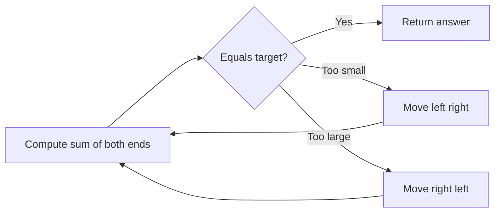
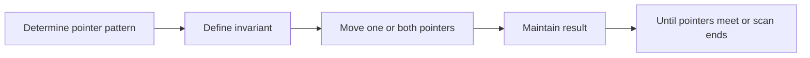

## Overview

**Array two pointers** uses two indices to simultaneously maintain positional relationships within an array. It often optimizes enumerations that would otherwise require nested loops into a single or a few linear scans.

> Prerequisites
> - **Array indices**: pointers are essentially index variables
> - **Sorted order**: left and right pointers often rely on array sorting
> - **Invariant**: clearly define the meaning of the interval between the two pointers

---

## Problem Definition

Given an array or string, use the relative movement of two pointers to accomplish searching, merging, reversing, deduplication, or in-place modification.

| Element | Description |
|------|------|
| Input | Array, target value, two sorted sequences, or string |
| Output | Index, modified array length, merged result, or optimal value |
| Pointer pattern | Left-right pointers, fast-slow pointers, separated pointers |
| Typical benefit | Reduce O(n²) enumeration to O(n) scanning |

---

## Core Principle: Step-by-Step Illustration

Taking two-sum on a sorted array as an example:

```text
nums:   2   7   11   15
target: 9
        L            R
```

If `nums[left] + nums[right]` is too large, move the right pointer left; if too small, move the left pointer right.



The premise for this movement to work is that the array is sorted, so after moving, a batch of impossible answers can be safely eliminated.

---

## Detailed Algorithm Steps

```
Algorithm: TwoPointers(nums, target)
Input: sorted array nums, target target
Output: the two positions that satisfy the condition

1. left ← 0, right ← nums.length - 1
2. while left < right:
3.     sum ← nums[left] + nums[right]
4.     if sum == target, return the answer
5.     if sum < target, left ← left + 1
6.     else right ← right - 1
7. return not found
```

**Complexity analysis**:

| Pattern | Time complexity | Space complexity | Description |
|------|------|------|------|
| Left-right pointers | O(n) | O(1) | Move from both ends toward the middle |
| Fast-slow pointers | O(n) | O(1) | Same-direction scanning, often used for in-place modification |
| Separated pointers | O(m + n) | O(m + n) or O(1) | Merge two sequences |
| Three-sum | O(n²) | O(1) | Sort, fix one number, then use two pointers |

---

## TypeScript Implementation

### 1. Two Sum II

```typescript
function twoSum(numbers: number[], target: number): number[] {
  let left = 0;
  let right = numbers.length - 1;

  while (left < right) {
    const sum = numbers[left] + numbers[right];
    if (sum === target) return [left + 1, right + 1];
    if (sum < target) left++;
    else right--;
  }

  return [-1, -1];
}
```

### 2. Reverse String

```typescript
function reverseString(s: string[]): void {
  let left = 0;
  let right = s.length - 1;

  while (left < right) {
    [s[left], s[right]] = [s[right], s[left]];
    left++;
    right--;
  }
}
```

### 3. Remove Duplicates from Sorted Array

```typescript
function removeDuplicates(nums: number[]): number {
  if (nums.length === 0) return 0;

  let slow = 0;
  for (let fast = 1; fast < nums.length; fast++) {
    if (nums[fast] !== nums[slow]) {
      slow++;
      nums[slow] = nums[fast];
    }
  }

  return slow + 1;
}
```

### 4. Move Zeroes

```typescript
function moveZeroes(nums: number[]): void {
  let write = 0;

  for (let read = 0; read < nums.length; read++) {
    if (nums[read] !== 0) {
      [nums[write], nums[read]] = [nums[read], nums[write]];
      write++;
    }
  }
}
```

### 5. Merge Two Sorted Arrays

```typescript
function merge(nums1: number[], m: number, nums2: number[], n: number): void {
  let p1 = m - 1;
  let p2 = n - 1;
  let tail = m + n - 1;

  while (p2 >= 0) {
    if (p1 >= 0 && nums1[p1] > nums2[p2]) {
      nums1[tail--] = nums1[p1--];
    } else {
      nums1[tail--] = nums2[p2--];
    }
  }
}
```

### 6. Three Sum

```typescript
function threeSum(nums: number[]): number[][] {
  nums.sort((a, b) => a - b);
  const result: number[][] = [];

  for (let i = 0; i < nums.length - 2; i++) {
    if (i > 0 && nums[i] === nums[i - 1]) continue;

    let left = i + 1;
    let right = nums.length - 1;

    while (left < right) {
      const sum = nums[i] + nums[left] + nums[right];
      if (sum === 0) {
        result.push([nums[i], nums[left], nums[right]]);
        while (left < right && nums[left] === nums[left + 1]) left++;
        while (left < right && nums[right] === nums[right - 1]) right--;
        left++;
        right--;
      } else if (sum < 0) {
        left++;
      } else {
        right--;
      }
    }
  }

  return result;
}
```

---

## Engineering Optimization: Define Pointer Invariants First

| Pattern | Invariant | Common use |
|------|------|------|
| Left-right pointers | The answer lies within `[left, right]` | Sorted search, palindrome, reversal |
| Fast-slow pointers | `[0, slow]` is the processed valid interval | Deduplication, filtering, moving elements |
| Separated pointers | Both inputs advance in sorted order | Merging arrays, merge sort |
| Front-back write pointers | Tail space has not been overwritten | In-place merging |

Don't just memorize templates for two-pointer code; explain why moving a certain pointer won't miss the answer.

---

## Applications and Limitations

### Typical applications

- Finding two-sum in a sorted array
- In-place deduplication, moving zeroes, removing elements
- Palindrome checking, string reversal
- Merging sorted arrays, three-sum

### Limitations

| Limitation | Description |
|------|------|
| Often relies on sorted order | Unsorted arrays usually require sorting first or using a hash table |
| Movement rules need proof | Answers will be missed if candidates cannot be safely eliminated |
| Sorting changes the input | For problems like three-sum, note whether in-place sorting is allowed |

---

## Summary



**Key points**:

1. The value of two pointers is replacing repeated enumeration with linear movement.
2. Left-right pointers typically rely on sorted order; fast-slow pointers are often used for in-place modification.
3. Before each pointer movement, you must be able to prove that the skipped states cannot be the answer.
4. Three-sum is a classic combination of "sort + fix one number + left-right pointers."